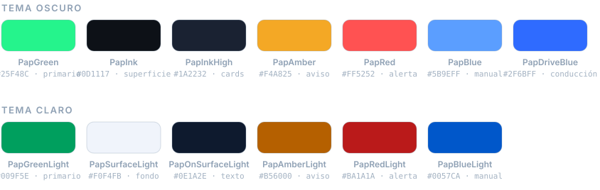

<p align="center">
  
</p>

<p align="center">
  <b>Plazas de aparcamiento en tiempo real, compartidas por la comunidad.</b><br/>
  Cuando sales con el coche, la app lo detecta sola y publica la plaza que acabas de liberar
  para que otro conductor cercano la encuentre.
</p>

<p align="center">
  <a href="https://play.google.com/store/apps/details?id=com.rndeveloper.paparcar">
    
  </a>
  
  <a href="https://paparcar.com"></a>
</p>

<p align="center">
  
  
  
  
  
</p>

---

## Estado del proyecto · 2026-09-30 (master `d5e3e3f71`)

**Publicada en Google Play** — [`com.rndeveloper.paparcar`](https://play.google.com/store/apps/details?id=com.rndeveloper.paparcar),
con la ficha y las capturas en los 9 idiomas. En producción está **1.3.0 (versionCode 14)**, del
corte del 17-09; **1.4.0 (versionCode 15)** está cortado y firmado en `8c45ce88a` —AAB verificado con
`-printcert` y notas en los 9 locales— pendiente de subir al Console. El día a día es medir la
detección en dispositivos reales (Oppo + Redmi) con telemetría remota y cerrar el fallo que salga:
política *fix-forward*, sin ramas de release largas. Lo que sigue vivo es producto, no lanzamiento.

| Área | Estado |
|------|--------|
| Detección dual (BT determinista + Coordinator AR-first) | ✅ En master, field-test continuo |
| Un solo foreground service, dos carriles (slots + use cases separados) | ✅ `d7880ac7` |
| Procedencia del pin (`detectionPath` + `armEvidence` en cada sesión) | ✅ |
| Niveles de detección honestos (Automático / Asistido+ / Asistido) | ✅ Con árbitro BT (supersede/veto) |
| Red de seguridad (worker 15 min + reconcile de salidas perdidas) | ✅ |
| Sync offline-first con reconcile LWW (vehículos, zonas, sesiones) | ✅ |
| Votos de comunidad sobre plazas · frescura por edad (TTL 2 h) | ✅ |
| Ciclo de vida de la plaza: `RELEASING` → `PROVISIONAL` → `CONFIRMED`, y `RETRACTED` como **estado**, no como borrado | ✅ `33aabb9ef` · `4a3b345be` · `caa54cc2d` |
| Trayectos como producto: ruta medida, km, gasto, batería, tiempo buscando plaza | ✅ Fases 1-5, 7 y 8 |
| Estadísticas con evidencia (cada cifra dice de cuánto sale y qué cubre) | ✅ `82e55f5ae` · Room v20 |
| Gasolineras con precio de surtidor (ES · FR · DE · IT) + media nacional fuera | ✅ |
| Parkings públicos (capa propia, tarifa y gálibo cuando la fuente los da) | ✅ |
| Coche compartido (espejo del grupo: estado, historial y cifras) | ✅ · ⏳ campo con dos cuentas |
| Paparcar Plus (RevenueCat) · límites free 7 d · 1 coche · 2 zonas | ✅ Gating soft; **ver** nunca se gatea |
| Widget Android (aparcamiento activo, acciones, lista de coches) | ✅ |
| Alertas: zona (Plus) · precio de combustible (Plus) · plaza cerca de ti (free) · push | ✅ |
| UI / design system (una tipografía, color por método, 33 guardarraíles Konsist) | ✅ |
| Marca 2026: la geometría es la fuente, las superficies son salida de un generador | ✅ `01310a3b3` · `f4181114e` |
| Puck de conducción nativo (fork kmp-maps en Maven Central) | ✅ · PR upstream [kmp-maps#170](https://github.com/software-mansion/kmp-maps/pull/170) |
| Dev Catalog (flavor `mock` sin backend) | ✅ |
| Telemetría de diagnóstico remota (Firestore, gate por flag) | ✅ Android e iOS |
| Split `:app` + `:shared` + `:mockkit` (los fakes fuera de todo binario publicable) | ✅ `6970b4065` |
| `paparcar.com` (generador estático propio, ES/EN) | ✅ En vivo, con guardarraíl de paridad |
| CI: build + `testAll` (compila el klib de iOS) + job Apple bajo demanda (link del framework, `commonTest` en el simulador y `xcodebuild` de la app) | ✅ Verde en master |
| Superficie legal (privacidad, borrado de cuenta por web, data safety) | ✅ |
| Publicación en Google Play (ficha, capturas y notas en 9 idiomas) | ✅ 1.3.0 (vc 14) en producción · ⏳ 1.4.0 (vc 15) firmado, sin subir |
| Detección iOS | 🟡 nativos y lazo GPS en master (`IosDetectionController`); sin validar en iPhone |
| Publicación iOS | 🟡 El carril entero está en master (`fastlane` + `match`, entitlement de Apple, ficha de App Store Connect, icono): ⛔ **nada verificado** — se mergeó desde Windows, sin Xcode. Gate: levantar el proyecto en un Mac |

Roadmap y bloqueantes en [`docs/ROADMAP.md`](./docs/ROADMAP.md).

---

## Releases

Cada versión sale firmada de `master`, con su `versionCode` y sus notas en los 9 locales; no hay
rama de release larga — la política es *fix-forward*.

```bash
./gradlew :app:assembleProdRelease   # APK firmado (requiere keystore.properties)
./gradlew :app:bundleProdRelease     # AAB para Play
```

- Versionado: `versionCode` / `versionName` en [`app/build.gradle.kts`](./app/build.gradle.kts).
  ⛔ **El `versionName` vive en DOS sitios**: `APP_VERSION` de `web/lib/config.mjs` tiene que decir lo
  mismo, y `WebSiteParityGuardrailTest` lo compara — bumpear solo el Gradle deja la suite roja. Y
  después hay que **reconstruir la web** (`node web/build.mjs`), o se despliega lo de antes.
- Ficha y notas de tienda en `docs/release/play-listing/paste/`. La **ficha** la genera
  `tools/make_paste.py`; las **notas de versión** (`release-notes-vX.Y.Z.txt`, 9 idiomas, tope de 500
  caracteres por locale) se escriben **a mano**. ⛔ En Play el rumano es **`ro`**, no `ro-RO`.
- ⛔ **El AAB no se versiona** — es derivado, sale de un commit y se regenera con un comando. Lo que
  **sí** tiene que entrar en master es el commit del bump, o el bundle que se sube salió de un árbol
  que no existe en ningún sitio.
- ⛔ **La firma solo se comprueba con `keytool -printcert`**, nunca con «jar verified.»: el 03-09 salió
  un AAB firmado con el certificado equivocado y el «verified» salía verde igual
  (`local.properties` pierde la precedencia frente a `keystore.properties`).
- ⛔ **Antes de cortar nada, `./gradlew testAll`** — nunca la suite de `:shared` sola: el verify del
  grafo del flavor `mock` vive en `:app` y el klib de iOS solo se compila ahí
  [TEST-A-GUARD-MUST-NOT-READ-THE-FOLDER-NAME-001].
- ⛔ **Orden de despliegue cuando cambian reglas o web**: `firestore:rules` → APK/AAB → hosting. Si
  la app sale antes que las reglas, un barrido de sesiones falla con permiso denegado en silencio.

Procedimiento completo (keystore, firma, versionado, rotación de claves) en
[`docs/release/RELEASE-PROCESS.md`](./docs/release/RELEASE-PROCESS.md) y
[`RELEASE-SECURITY.md`](./docs/release/RELEASE-SECURITY.md); la ficha de tienda, en
[`docs/release/play-listing/`](./docs/release/play-listing/).

---

## Identidad visual

### Logo

El logo es una **P** que es a la vez pin de ubicación y coche — las tres lecturas a la vez. **En la
app no lleva disco**: la marca de 2022 necesitaba uno oscuro detrás para sostenerse, la de 2026 no.
Lo único que cambia con la superficie es el verde: `PapGreen` `#25F48C` sobre oscuro,
`PapGreenLight` `#009F5E` sobre claro (porque el primero sobre blanco da 1,42:1).

⛔ **La fuente de verdad no es un fichero de la app: es un generador.**
[`docs/branding/master/`](./docs/branding/master/) dibuja la marca desde su geometría —seis
circunferencias y dos rectas tangentes— y `export_surfaces.py` la escribe en todas las superficies.
Los drawables (`paparcar_iconmark_*`, `ic_launcher_foreground`, `splash_glyph`,
`ic_notification_logo`, el favicon, `docs/assets/paparcar-logo.svg`) son **salida**: no se editan a
mano. Si cambia el dibujo se cambia un parámetro y se vuelve a correr el exportador, y después
`node web/build.mjs` (la web hornea el logo en sus páginas). Detalle y nombres en
[`docs/branding/README.md`](./docs/branding/README.md).

⛔ **Su lienzo no es cuadrado** (`244 × 236`, `MARK_W`/`MARK_H`) y la marca es **full bleed**: toca
los cuatro bordes. Las superficies que se encuadran por el círculo envolvente no se enteran, pero
meter la marca en una caja cuadrada a pelo le corta la rueda derecha o la aplasta.

Sigue siendo un asset **Nivel 3**: trae su color de marca horneado, **nunca se tinta** — salvo
`paparcar_iconmark_white`, que existe precisamente para eso.

**Dos superficies sí llevan disco, y el criterio que las une es uno**: *donde la marca llena su
caja no hace falta soporte; donde es un **emblema** dentro de una composición ajena —con un wordmark
al lado— el soporte es legítimo.* Eso se lee en un número: la app pone la marca al `F_MARK = 1.0` de
su caja, el emblema al `F_EMBLEM = 0.52896` de su disco. No abre la puerta a discos en la app.

| Superficie | Disco | Marca | Aro | Por qué |
|---|---|---|---|---|
| Gráfico de funciones de Play (`feature.html`) | tinta `#0D1117` | `PapGreen` | `PapGreen` al 28 % | El fondo es un degradado verdoso; sin disco la marca queda en ~46 px al lado de un wordmark de 82 |
| `paparcar.com` — cabecera, pie, las dos legales y la tarjeta social | `PapGreen` | tinta `#0D1117` | ninguno | El sitio es tinta **plana**: un disco de tinta daría **1,00:1**. Verde sobre tinta da **12,97:1** en los dos sentidos |

El disco tampoco se escribe a mano: vive en `export_surfaces.py` (`EMBLEM_BANNER` / `EMBLEM_SITE` +
`emblem_transform()`), que genera los dos `<circle>` del banner, las constantes de
[`web/lib/mark.generated.mjs`](./web/lib/mark.generated.mjs) y `docs/assets/paparcar-emblem.svg`.
Geometría compartida, pintura por superficie.

⛔ La antigua *compensación óptica* de grosor de rueda (6 sobre oscuro / 7 sobre claro) **murió con
la marca de 2022**: la de 2026 no tiene ni un trazo —sus ruedas son coronas rellenas—, así que no
hay irradiación que compensar.

### Colores corporativos

Fuente de verdad: [`ui/theme/Color.kt`](./shared/src/commonMain/kotlin/com/rndeveloper/paparcar/ui/theme/Color.kt).

<p align="center">
  
</p>

La doctrina en una frase: **la app es VERDE (marca); el color del NOMBRE de un coche dice CÓMO se le
vigila; el estado se ESCRIBE, no se tiñe.**

- **Verde de marca = primario.** Todo CTA normal usa `primary` (`PapGreen` #25F48C en oscuro,
  `PapGreenLight` #009F5E en claro).
- **Tres verdes separados por TONO, nunca por luminosidad**: marca (#25F48C / #009F5E), vigilancia
  (`PapWatchGreen` #0FBF9A / #05876D) y plaza fresca. Cada hex tiene una única historia.
- **Azul `papCarBlue` = vehículo vigilado por Bluetooth.** Gris = sin vigilancia. El estado
  (aparcado / en ruta / sin aparcar) va siempre en `onSurface`, animado.
- **Rojo reservado a alerta real**: permisos bloqueantes, acciones destructivas, errores de
  formulario y caducidad crítica de plaza. **Nunca en un CTA.**
- Las superficies oscuras son la rampa *ink* neutra-fría (#0D1117 → #222C3E); en claro, la rampa
  *azure* (misma familia de tono H≈217°). El ADN verde vive en los acentos, no en las superficies.

Doctrina y tabla completa de tokens: [`docs/design/COLOR-SYSTEM.md`](./docs/design/COLOR-SYSTEM.md).
Guardarraíl: `ColorGuardrailTest` prohíbe `Color(0x…)` literal y teñir el estado en `presentation/`.

### Tipografía — una familia, tres voces, 22 roles (`PaparcarType`)

Familia, tamaño **y peso** son propiedad del **ROL** del texto, nunca del widget
([`ui/theme/PaparcarType.kt`](./shared/src/commonMain/kotlin/com/rndeveloper/paparcar/ui/theme/PaparcarType.kt)).
Nunca se elige fuente: se elige rol. En el call site **solo se decide el color**.

Desde [UI-TYPE-RETIRE-THE-OLD-FAMILIES-001] la app envía **una sola tipografía**, Plus Jakarta Sans
(2,30 MB → 0,17 MB de fuentes). Que las tres voces compartan letra no las fusiona: siguen decidiendo
tamaño, peso y qué es un nombre, una cifra o prosa.

| Voz | Pregunta que contesta | Roles |
|-----|------------------------|-------|
| **MARCA** | ¿es un nombre propio o un título? | `screenTitle`, `heroTitle`, `sectionTitle`, `cardTitle`, `rowName` |
| **LECTURA** | todo lo que se lee o se pulsa | `sectionHeader`, `subsectionHeader`, `eyebrow`, `cta`, `rowTitle`, `subtitle`, `body`, `label`, `caption`, `meta`, `badge` |
| **CIFRA** | ¿es una cifra que protagoniza su bloque? | `statNumber`, `statLabel`, `counter`, `counterUnit`, `chartLabel`, `chartValue` |

`fontSize`, `letterSpacing`, `fontWeight` inline y `MaterialTheme.typography.*` están **prohibidos**
en features (guardarraíl Konsist `TypographyGuardrailTest`).

### Iconos — 3 niveles

*Plumbing de UI → Material Symbols Rounded (tintado); concepto de Paparcar → vector propio
multicolor sin tintar* (hero, onboarding, marcadores, vehículos). Detalle en [`CLAUDE.md`](./CLAUDE.md).

---

## Stack

> Fuente de verdad: [`gradle/libs.versions.toml`](./gradle/libs.versions.toml).

- **Lenguaje:** Kotlin 2.4.20 (KSP 2.3.12) · JVM 17 · Gradle 9.7.1
- **Build:** AGP 9.4.0 · compileSdk 37 · targetSdk 37 (Android 17) · minSdk 26
- **UI:** Compose Multiplatform 1.12.0 · Material3 (JB) 1.9.0 · Navigation Compose 2.9.2
- **Arquitectura:** Clean Architecture + MVI (State + Intent + Effect)
- **DI:** Koin 4.2.2
- **DB local:** Room KMP 2.8.5 (SQLite bundled 2.7.1) — esquema en **v20**
- **Backend:** Firebase vía GitLive KMP 2.7.0 (Auth + Firestore + Crashlytics) · firebase-bom 34.19.0
- **Mapas:** `io.github.rndevelo.kmpmaps:core:0.9.1-puck6` — **fork propio** en Maven Central
  (Google Maps en Android / Apple Maps en iOS); da el marker de id estable que necesita el puck
- **Auth:** BaseLogin 3.0.0 (librería propia, Maven Central) — ⛔ no se toca desde este repo
- **Monetización:** RevenueCat `purchases-kmp` 3.8.0 (SDK + paywalls con plantilla remota)
- **Async:** Coroutines 1.11.0 + Flow · Serialization 1.11.0 · Datetime 0.8.0
- **Imágenes:** Coil 3.6.2 + Ktor 3.5.2 (motor de red)
- **Android-only:** WorkManager 2.11.2 · Glance 1.2.0 (widget) · play-services-location 21.4.0
  (Activity Recognition) · DataStore 1.2.1
- **Logging:** Napier 2.7.1 · **Licencias OSS:** AboutLibraries 15.2.0
- **Tests:** JUnit 4 · Turbine 1.2.1 · Robolectric 4.17 · **Konsist 0.17.3**
  (**33 guardarraíles** de arquitectura, copy, i18n, reglas de Firestore y paridad con la web)

**Targets:** Android `minSdk 26 / target 37 / compile 37` · iOS `arm64 + simulatorArm64`

> Solo versiones estables en el catálogo: ni un alpha/beta/rc. Al comprobar si algo se quedó atrás,
> consultar `repo1.maven.org` y `dl.google.com/dl/android/maven2` — el índice de
> `search.maven.org/solrsearch` está obsoleto y miente por versiones enteras.
>
> ⛔ **El stack no es solo Gradle**: hay dos raíces npm con lockfile propio — `functions/` (Cloud
> Functions, se despliega) y `firestore-rules-tests/` (harness de reglas). Entran en el mismo
> barrido de dependencias.

---

## Cómo funciona la detección

**Doctrina rectora** (violarla es un bug):

> *El evento NOMINA, solo el movimiento MEDIDO confirma.* Un EXIT de geocerca o un AR ENTER solo
> despiertan/arman; ninguno confirma una plaza por sí mismo — hace falta conducción medida en el
> stream (o pasos/egress inambiguos).
>
> *Fallo asimétrico: mejor falso negativo que falso positivo.* Ante la duda se PREGUNTA (nudge /
> prompt), nunca se planta una plaza fantasma. La fiabilidad se estampa en cada sesión.
>
> *Todo trigger dispara SIEMPRE*, aunque llegue tarde, con verificación tardía. Un evento viejo
> pierde autoridad directa (pasa al evaluador), pero nunca se descarta en silencio.

Dos estrategias independientes que **nunca se mezclan**:

- **`BluetoothDetectionStrategy`** (determinista) — BT disconnect del MAC emparejado → fix GPS →
  alejarse ≥30 m del coche → confirma con fiabilidad alta. Ligada a la MAC del coche, no al
  modelo. Es el nivel **Automático**. ⛔ En iOS este carril es estructuralmente imposible (no hay
  eventos de BT clásico para terceros): allí el resolver cae siempre a Coordinator, y ninguna
  superficie promete «Automático».
- **`CoordinatorDetectionStrategy`** (probabilístico) — el **Asistido**. Se *arma* con AR
  IN_VEHICLE ENTER (carril de baja latencia) o GEOFENCE_EXIT, solo si el embarque está atado al
  propio coche. *Confirma* con pasos+egress, egress cinemático medido por GPS o
  vehicle-exit+ventana+egress — todas exigen conducción medida. El ancla de posición se bloquea
  con los pasos de egress o se congela al final de la conducción, para que la caminata no
  arrastre el pin.
- **Red de seguridad** — `ParkingSafetyNetWorker` (15 min) + sensor de movimiento reconcilian
  salidas que el OS no entregó; nunca liberan por distancia sola.
- **Árbitro BT** — si el BT del coche reconecta durante una detección asistida, la supersede/veta;
  el BT jamás puntúa dentro del scoring del Coordinator.

**Carriles separados ≠ servicios separados.** Desde `d7880ac7` hay **un solo foreground service y
una sola notificación**: el carril BT entra por el mismo intake, en slots de job propios. Lo
prohibido no ha cambiado — cero señales BT dentro del scoring del Coordinator.

Ambas convergen en `ConfirmParkingUseCase` → Room + Firestore + Geofence + Notification +
WorkManager. El servicio Android serializa todos los triggers en un intake único; la **decisión**
de cada trigger es un use case puro de `commonMain` — el service solo hace I/O y side-effects. Los
predicados que alimentan a un veredicto viven como funciones puras en `domain/detection/` (107
ficheros), no como métodos privados del coordinator.

Todo pin persiste su **procedencia**: `detectionPath` + `armEvidence`. En cualquier diagnóstico se
puede decir qué trigger colocó cada pin, no solo cuánto podía equivocarse.

La pantalla de permisos muestra el **nivel de detección** resultante (Automático / Asistido+ /
Asistido) según BT emparejado, exención de batería y permisos concedidos.

Spec canónica en [`docs/detection/PARKING-DETECTION.md`](./docs/detection/PARKING-DETECTION.md).

---

## Navegación

BottomNav con 3 destinos — regla editorial: *si pasa AHORA → Home; si pasó o es mío-permanente →
Vehículos; si configura → Ajustes.*

- **Home** — mapa, plazas libres en tiempo real, parkings públicos, gasolineras, sesión activa,
  detección en curso
- **Vehículos** — garaje (pager por vehículo, coche compartido incluido) + historial y estadísticas
- **Ajustes** — configuración + salud de detección/permisos

Flujo de entrada: Splash → Auth → VehicleRegistration → Onboarding → Permissions → Home.

**Plus vs free:** *free = tú preguntas y la app responde; Plus = la app te avisa a ti, y recuerda
por ti.* ⛔ Nunca se gatea **ver** — plazas, parkings públicos y gasolineras son free completo; se
vende la **vigilancia** (alertas) y la **memoria** (más allá de 7 días de historial). Límites free:
7 días · 1 coche propio · 2 zonas. Gating siempre **soft**: la acción dispara el paywall, el botón
nunca se esconde.

---

## Modelos de datos clave

- **`Spot`** — plaza comunitaria: location, type (auto/manual), confidence, sizeCategory, TTL y
  **`status`**: cada plaza dice cómo de probada está la salida que hay detrás. `CONFIRMED` (la
  salida se presenció), `PROVISIONAL` (solo se dedujo — se publica igual porque una plaza libre vale
  minutos, pero se muestra sin confirmar, ordena por debajo y caduca antes), `RELEASING` (**el coche
  sigue ahí y alguien acaba de subirse**), `RETRACTED` (retirada). ⛔ Retirar es un **estado**, no un
  delete: un documento borrado desaparece del snapshot sin explicación y deja circulando a quien ya
  iba de camino; uno retractado sigue llegando durante la gracia, el tiempo justo para decir por qué
  se fue
- **`UserParking`** — sesión propia: vehicleId, location, geofenceId, detectionMethod,
  `detectionPath`, `armEvidence`, ruta del viaje
- **`Vehicle`** — brand, model, bluetoothDeviceId, sizeCategory, carbodyType, combustible y consumo,
  `sharedCarId?` + `ownerUid?`
- **`SharedCar`** — espejo del coche que conducen varios: estado actual, miembros, sesiones del
  grupo. ⛔ El espejo **no lleva** mecánica de detección (`armEvidence`, `detectionPath`, matrícula)
- Categorización bidimensional: `VehicleSize` (5 tallas) × `CarbodyType` (10 carrocerías) →
  compatibilidad `SpotFit` — ver [`docs/architecture/VEHICLE-CATEGORIZATION.md`](./docs/architecture/VEHICLE-CATEGORIZATION.md)

---

## Estructura del proyecto

```
shared/                 KMP — toda la lógica de producto
├── src/commonMain/kotlin/com/rndeveloper/paparcar/
│   ├── domain/         Kotlin puro — entidades, UseCases y evaluadores; detection/ con las
│   │                   funciones puras compartidas; entitlement/, fuel/, parkings/, stats/,
│   │                   sharedcar/, zone/, sync/
│   ├── data/           Repos + Room (v20) + Firestore + mappers + reconcile LWW + overpass/
│   ├── presentation/   ViewModels MVI + screens Compose (home, vehicles, settings, stats,
│   │                   paywall, widget, onboarding, permissions…)
│   ├── ui/             Design system (PaparcarType, componentes Pap*, tema, iconos, mapa)
│   └── detection/ push/ core/ di/   transversales
├── src/androidMain/    detection/{service,worker,receiver,sensor}, location/, bluetooth/,
│                       notification/, permissions/, diagnostics/, logging/, push/
├── src/iosMain/        CLLocation, CMMotion, CoreBluetooth, geofence, schedulers y el
│                       IosDetectionController (sin stubs) + su parkdiag
├── src/commonTest/     el grueso de los tests (383 ficheros): use cases, ViewModels, mappers y
│                       el replay de trazas de campo reales
└── src/androidUnitTest/  lo que necesita JVM/Android (58): 33 guardarraíles Konsist, Robolectric,
                          workers, paridad de deserializadores Firestore

app/                    Shell Android — entry points, manifest, res, flavors, firma
├── src/main/           MainActivity, PaparcarApp, AppNotificationManagerImpl, res/
└── src/mock/           Dev Catalog — modo demo sin backend (kotlin + res/manifest)

mockkit/                TODO lo falso: los 19 fakes scenario-aware, MockScenario, ShotPresets,
                        iosMockModule y MockMainViewController. Depende de :shared y NUNCA al
                        revés — Gradle rechaza el ciclo, así que producción no puede importarlo
                        ni por descuido. Lo consumen el flavor mock, los tests de :shared y las
                        capturas de iOS

iosApp/                 SwiftUI shell (delegado a Compose vía MainViewController) + fastlane

web/                    paparcar.com — generador estático propio (Node, cero dependencias)
├── content/{es,en}.json  TODO el copy de la web
├── lib/                  config (los hechos verificables) · icons · components · layout
├── pages/                home · support · terms · 404
├── assets/               css · js · font · img (generados, versionados)
└── tools/                preparación de assets, preview, auditoría y capturas

hosting/public/         SALIDA de `node web/build.mjs` + las dos páginas legales escritas A MANO
                        (`privacy-policy.html`, `delete-account.html`) que la app enlaza
functions/              Cloud Functions (raíz npm propia)
firestore-rules-tests/  harness de reglas de Firestore — las reglas se EJECUTAN (raíz npm propia)
distribution/           notas de versión en texto plano
diagnostics/            capturas de campo y su procesado
tools/                  utilidades de escritorio (medias de combustible, trace → fixture)
keystore/               firma de release (gitignored)
```

Visión arquitectónica completa en [`docs/ARCHITECTURE.md`](./docs/ARCHITECTURE.md).

---

## Dev Catalog (flavor `mock`)

Modo solo-mock para entrar a la app **sin OAuth ni Firebase** y probar pantallas y estados en
dispositivo: launcher propio (`DevMainActivity`) con escenarios de sesión/permisos
(`MockScenario`) y una galería de estados (`StateGalleryScreen`) con paridad con los
`*Previews.kt`. Toda pantalla/estado/condición de routing nueva debe reflejarse ahí en la misma
tarea (regla ⛔ en [`CLAUDE.md`](./CLAUDE.md)).

⛔ **Los fakes viven en `:mockkit`, no en `:shared`, y eso no es orden: es una guideline de Apple.**
Cuando estaban en `commonMain`, Kotlin/Native exportaba **161 clases `Fake*`** a `ComposeApp.h` —un
símbolo exportado es raíz de DCE—, o sea código muerto embarcado en el binario de iOS (guideline
2.3.1). La dirección de la flecha *es* el diseño: `:mockkit → :shared`, nunca al revés, y Gradle
rechaza el ciclo. Lo vigila `MockGraphGuardrailTest`.

```bash
./gradlew :app:assembleMockDebug
adb shell am start -n com.rndeveloper.paparcar.mock/com.rndeveloper.paparcar.DevMainActivity
```

---

## Getting started

### Prerequisitos

- Android Studio (Ladybug o posterior) con plugin KMP · JDK 17
- Xcode (solo si se trabaja en iOS)

### Setup

1. `git clone ...`
2. Añadir `app/google-services.json` (Firebase Console → Project settings)
3. Crear `local.properties` con:
   ```properties
   MAPS_API_KEY=AIza...
   GOOGLE_WEB_CLIENT_ID=...
   # RevenueCat (Paparcar Plus). Dashboard → Project settings → API keys.
   # Debug usa la key del Test Store (test_...); release, la de Play (goog_...).
   # Si una key está en blanco, ese build arranca sin configurar el SDK (sin crash).
   revenuecatKeyDebug=test_...
   revenuecatKeyRelease=goog_...
   ```
4. (Opcional para release) `keystore.properties` con `RELEASE_KEYSTORE_FILE`,
   `RELEASE_KEYSTORE_PASSWORD`, `RELEASE_KEY_ALIAS`, `RELEASE_KEY_PASSWORD`
5. Compilar:
   ```bash
   ./gradlew :app:assembleProdDebug   # app real (Firebase/OAuth)
   ./gradlew :app:assembleMockDebug   # Dev Catalog (sin backend)
   ```
   > ⚠️ En Windows no hay `gradlew.bat`: usa Git Bash (`./gradlew`), no PowerShell.

### Tests

```bash
./gradlew testAll        # :shared + :app + el klib de iOS. ⛔ NUNCA :shared:testDebugUnitTest solo
```

`testAll` existe para no poder escribirse a medias: `:shared:testDebugUnitTest` deja fuera el único
guardarraíl que comprueba que el grafo del flavor `mock` se resuelve (`MockKoinModuleVerifyTest`, en
`:app`), y `:shared:compileKotlinIosSimulatorArm64` es lo que caza un `actual` que falta. Son
**3.800+ tests**. El job Apple —bajo demanda o en ramas `feature/IOS-*`— añade lo que solo un Mac
puede decir: enlazar el framework, correr `commonTest` en el simulador de iOS y construir la app con
`xcodebuild`.

> ⛔ Un guardarraíl de Konsist no toca bytecode: Gradle lo da **UP-TO-DATE** y no llega a
> ejecutarlo. Para falsificarlo de verdad, `--rerun-tasks`.

### Permisos

- **Android:** `ACCESS_FINE_LOCATION` + `ACCESS_BACKGROUND_LOCATION` + `ACTIVITY_RECOGNITION` +
  `POST_NOTIFICATIONS` + `BLUETOOTH_CONNECT`. El onboarding los pide en orden con rationales y
  muestra el nivel de detección que desbloquea cada uno.
- **iOS:** `NSLocationAlwaysAndWhenInUseUsageDescription` + `NSMotionUsageDescription` +
  `NSBluetoothAlwaysUsageDescription` + `UIBackgroundModes: location, fetch, processing`
  (ya en `iosApp/iosApp/Info.plist`).

---

## i18n

- **Base:** EN (siempre completa) · **P0:** ES · **P1:** IT, PT, FR · **P2:** DE, NL, PL, RO
- 9 locales activos con paridad de keys, verificada por `LocaleParityGuardrailTest`. Excluidos por
  complejidad de UI: RTL (AR, HE) y glifos complejos (ZH, JA, KO, TH, HI).
- ⚠️ **Faltar en un locale NO crashea, y por eso es peor**: si la traducción falta pero la key está en
  `values`, el texto **sale en inglés en silencio** (así vivieron 48 días dos botones de la pantalla
  de permisos). Si falta en `values`, ahí sí crashea en todo locale que no la declare.
- ⚠️ Hay **dos** superficies de strings con reglas opuestas para el apóstrofo: Compose Resources
  (`composeResources/values/`) **no desescapa `\'`** → apóstrofo crudo; `app/src/main/res/` sí lo
  escapa. Y un `%` literal se escribe `%`, nunca `%%`. Vigilado por
  `ComposeResourcesEscapeGuardrailTest`; detalle en `CLAUDE.md`.
- **Vocabulario:** *plaza* es de la comunidad, *aparcamiento* es tuyo, *car park* es la instalación
  de un tercero. Nunca «marcar mi plaza».

---

## Documentación

**Docs vivos** — afirman en presente; cada uno declara en su cabecera la fecha y el commit contra el
que fue verificado. Si no coinciden con el código, es un bug del doc.

| Documento | Cuándo leerlo |
|-----------|----------------|
| [`CLAUDE.md`](./CLAUDE.md) | **Reglas obligatorias** — iconos, tipografía, color, strings, magic numbers, commits, Dev Catalog |
| [`docs/ROADMAP.md`](./docs/ROADMAP.md) | Qué queda por hacer: ramas en vuelo, backlog abierto, bloqueantes de lanzamiento |
| [`docs/ARCHITECTURE.md`](./docs/ARCHITECTURE.md) | Capas, flujos de datos, paquetes, decisiones técnicas |
| [`docs/BUGS_AND_DEBT.md`](./docs/BUGS_AND_DEBT.md) | Deuda **estructural** abierta y riesgos |
| [`docs/detection/PARKING-DETECTION.md`](./docs/detection/PARKING-DETECTION.md) | **Spec canónica de detección** + log de cada guard y por qué existe |
| [`docs/detection/DETECTION-READINESS.md`](./docs/detection/DETECTION-READINESS.md) | Qué le decimos al usuario sobre la detección (readiness, tiers de permisos) |
| [`docs/design/COLOR-SYSTEM.md`](./docs/design/COLOR-SYSTEM.md) | Significado de cada token de color — una historia por hex |
| [`docs/branding/README.md`](./docs/branding/README.md) | **La marca** — su geometría, el generador y qué superficie sale de dónde |
| [`docs/architecture/VEHICLE-CATEGORIZATION.md`](./docs/architecture/VEHICLE-CATEGORIZATION.md) | Talla × carrocería → `SpotFit` |
| [`docs/analytics-data-contract.md`](./docs/analytics-data-contract.md) · [`analytics-data-audit.md`](./docs/analytics-data-audit.md) | De qué evidencia sale cada cifra de estadísticas y qué cubre |
| [`docs/IOS_PLAN.md`](./docs/IOS_PLAN.md) | Estado real de iOS y qué falta para un beta |
| [`docs/CODE-READING-CHECKLIST.md`](./docs/CODE-READING-CHECKLIST.md) | Leer el proyecto entero por orden de dependencia |
| [`docs/release/RELEASE-PROCESS.md`](./docs/release/RELEASE-PROCESS.md) · [`RELEASE-SECURITY.md`](./docs/release/RELEASE-SECURITY.md) | Keystore, firma, corte de versión y endurecimiento de claves |
| [`web/README.md`](./web/README.md) | **La web** — qué tocar en `web/` cuando cambia el producto, y qué lo vigila |
| [`docs/legal/`](./docs/legal/) | Data safety y runbook de borrado de cuenta |
| [`docs/backlog/README.md`](./docs/backlog/README.md) | **Índice de lo que sigue abierto** — 758 docs de ticket; aquí solo lo que queda |
| [`diagnostics/README.md`](./diagnostics/README.md) | Captura y procesado de logs de detección |

**Registros fechados** — fotos que no envejecen mal porque llevan su fecha y su commit-base:
[`docs/audits/`](./docs/audits/) (auditoría completa del 2026-07-04),
[`docs/detection/01-…11-*.md`](./docs/detection/) (análisis del refactor de agosto),
[`docs/refactors/`](./docs/refactors/), y [`docs/archive/`](./docs/archive/) para lo superado.

---

## Convenciones rápidas

- **Strings:** nada hardcoded — `composeResources/values/strings.xml`, keys EN, **los 9 locales en la
  misma tarea**
- **Magic numbers:** `private companion object` con `UPPER_SNAKE_CASE`
- **Errores:** `kotlin.Result<T>` en one-shot; `Flow` con `.catch`; UI vía `PaparcarError` sealed
- **Casos de uso:** uno por **veredicto** (algo citable en un diagnóstico), nunca por predicado
- **Tests:** toda UseCase nueva con test unitario; fakes sobre mocks
- **Commits:** Conventional Commits con ticket ID — `feat(home): add per-vehicle cards [HOME-002]`
- **Ramas:** `feature/HOME-001-bottom-sheet`, `bugfix/...`, `refactor/...`, `chore/...`
- **PRs:** si el cambio se ve en pantalla, la descripción lleva captura del estado **final**
- **Logs:** Napier con tag, nunca `println`

Detalle completo en [`CLAUDE.md`](./CLAUDE.md).

---

<p align="center">
  <br/>
  <sub>Built with 💚 by the AppToLast Team.</sub>
</p>
