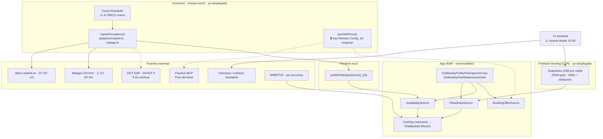

# DATA-PROVIDERS-001 · de dónde salen los datos externos, y quién los sirve

**Estado:** 🔵 Abierto · **documento de decisión, sin código y SIN RAMA PROPIA** — está en master
y las ramas las llevan sus tickets. Su rama original (`chore/DATA-PROVIDERS-001-audit`) se mergeó y
se borró; lo cazo `branch_tell.py`, que es para lo que existe.
· **Avance de la ola:** ✅ ticket 1 (snapshot pre-cocinado) · ✅ ticket 2 (una sola llamada) ·
✅ ticket 3 (ocupación de Madrid) · 🔵 ticket 4 (la UI de la cifra) · 🔴 ticket 5 (Parclick,
bloqueado) · 🔴 ticket 0 (los correos, sin enviar — y con 1 ciudad viva de 5, el NAP es el
multiplicador)
**Fecha:** 30-10-2026 · **Revaloriza** [`plus-roadmap-001.md`](plus-roadmap-001.md) §F5/§F6 y
[`../parking-data-research.md`](../parking-data-research.md) (21-09-2026) con información nueva de
Parclick, Parkopedia y MINETUR.

> **Cómo leer este documento** — misma disciplina que `parking-data-research.md`, porque este
> documento la hereda y la extiende:
> **[MEDIDO]** leído del código de este repo o de una medición registrada aquí ·
> **[VERIFICADO]** comprobado hoy contra la fuente oficial, con enlace ·
> **[SUPUESTO]** no se ha podido confirmar — lleva SIEMPRE cómo comprobarlo ·
> **[INFERENCIA]** deducción nuestra, explícitamente no un hecho.

---

## 0 · Resumen para quien no lea el resto

> ⚠️ **Las decisiones vivas están en la [FASE F](#fase-f--ui-orden-contrato-y-secuencia-30-10-2026)**
> (30-10, escrita *después* de abrir el código): la escalera de la fila y del marcador, por qué una
> lista de cosas no comparables **no se ordena**, el contrato de `/api/parkings` — cuya celda **no es
> un geohash** — y el orden real de los tickets, que corrige el de §D.2. Tres premisas de la FASE E
> no sobrevivieron a esa lectura.

**Tres cosas de la premisa de este encargo estaban desactualizadas, y las tres abaratan el plan:**

1. **F5 no está «planificada»: está ✅ CERRADA en master** [MEDIDO] — cinco países con precio real
   (ES, FR, DE, IT + fallback OSM mundial), resolver de tres escalones, caché de dos niveles y
   vigilancia diaria. F6a (base mundial de parkings) también está cerrada. **Lo único pendiente de
   la ola es F6b: la ocupación en tiempo real.**
2. **El «primer backend propio» ya existe y está desplegado** [MEDIDO]: `functions/` con dos
   funciones v2 en `europe-west1`, nodejs22, 256 MB. Los docs que dicen *«`firebase.json` declara
   `firestore` + `hosting` y CERO functions»* llevan un mes mintiendo. **Blaze ya está activo**, el
   deploy y los secretos ya están estrenados: F6b hereda infraestructura en vez de estrenarla.
3. **MINETUR ya se descarga por provincia, no el país entero** [MEDIDO]
   (`FiltroProvincia/{provinceId}`). Los ~11.400 registros de varios MB son el endpoint sin
   filtrar, que **no usamos**. La trampa de las 16 M de escrituras/mes no es un riesgo del código
   de hoy: sería un riesgo **nuevo**, introducido por centralizarlo.

**Y la recomendación cabe en tres frases:** la única pieza que merece backend propio ahora es la
**ocupación municipal (Madrid + Málaga)**, y cabe entera en la capa gratuita. La base de OSM no
quiere una Cloud Function: quiere **ficheros estáticos pre-cocinados en Hosting**, que es lo que ya
recomendaba el research de septiembre por medición. Y **Parclick no es una fuente de datos para el
mapa**: es una acción sobre un parking ya elegido, y hoy no se puede embarcar en la app sin un correo
contestado.

---

## FASE A · Auditoría del estado actual

### A.1 · Cómo consumimos OSM hoy — **[MEDIDO]**

El flujo completo está dibujado y medido en
[`../parking-data-research.md`](../parking-data-research.md) §1 (21-09-2026) y **sigue vigente**;
no se repite aquí. El resumen de la estructura:

```
GetNearbyPublicParkingsUseCase
  └─ PublicParkingsSource                   (puerto, domain/parkings/)
     └─ CachingPublicParkingsSource          L1 memoria · TTL 30 min
        └─ DiskBackedPublicParkingsSource    L2 Room · 30 días
           └─ OsmPublicParkingsSource         red
              └─ OverpassClient
                 ├─ OverpassQuota            1 pregunta a la vez · espera ≤ 10 s
                 ├─ OverpassWalkPatience     paseo de espejos ≤ 30 s
                 └─ OverpassResponseHealth   ¿este espejo miente?
```

- **No hay registro por país para parkings, y es deliberado**: `OsmPublicParkingsSource.covers()`
  devuelve `true` siempre. La razón está escrita en F6b: la ocupación **no sustituye** la base, la
  **enriquece**.
- **Siete espejos declarados, dos en uso**; los otros cinco están en `EXCLUDED_BY_MEASUREMENT`, cada
  uno con su motivo.
- ⚠️ **No usamos Nominatim.** El geocoder es el de la plataforma Android con **Photon**
  (`photon.komoot.io`) de refuerzo, en `AndroidGeocoderDataSourceImpl`.

### A.2 · Gasolineras — lo que el research de septiembre NO cubría

El lado de combustible es **más maduro que el de parkings** y ya implementa exactamente el patrón
«registro de proveedores por país» que este encargo propone inventar:

| Fuente | País | Transporte | ¿Overpass? |
|---|---|---|---|
| `MineturStationsSource` | ES | feed del ministerio, **por provincia** | no |
| `FranceFuelStationsSource` | FR | feed `data.economie.gouv.fr` + nombres por id oficial | **sólo los nombres** |
| `GermanyFuelStationsSource` | DE | Tankerkönig / MTS-K | no |
| `ItalyFuelStationsSource` | IT | `carburanti.mise.gov.it` | no |
| `OsmFuelStationsSource` | **suelo mundial** (`covers()` = true) | Overpass | sí |
| `OpenVanAverageFuelPricesSource` + `EmbeddedAverageFuelPrices` | medias nacionales | `openvan.camp` + tabla embarcada | no |

- **El registro ya existe**: `FuelStationsRegistry` elige por `covers(countryCode)`.
- **Caché de dos niveles, igual que parkings**: `CachingFuelStationsSource` (memoria, TTL **15 min**)
  → `DiskBackedFuelStationsSource` (Room) → red. [MEDIDO]
- **Ya hay un consumidor de fondo**: `FuelPriceWatchWorker` → `RunFuelPriceWatchUseCase`, periódico
  cada **24 h** [MEDIDO], con dos carriles (seguidas = Plus, alrededor = free).

👉 **Consecuencia para el diseño:** el contrato por país que pide la Fase B.4 **no hay que diseñarlo,
hay que reconocerlo**: está en producción para combustible desde F5 y funciona. Lo que falta es el
eje que no encaja en él, y es el de reserva (§B.4).

### A.3 · ¿Hay backend? Sí, desde antes de este encargo — **[MEDIDO]**

```
functions/  (TypeScript, nodejs22, firebase-functions ^7.4.0, firebase-admin ^14.4.0)
  src/index.ts            setGlobalOptions({ region: 'europe-west1', maxInstances: 10 })
  src/fanout.ts           fan-out de alertas de zona  → onSpotPublished
  src/sharedCarFanout.ts  fan-out de coche compartido → onSharedCarParked
```

Desplegadas y vivas, consultado hoy por API: **`onSpotPublished`** y **`onSharedCarParked`**, las dos
`v2`, `europe-west1`, 256 MB, trigger de Firestore. [VERIFICADO]

- **`europe-west1` no es una elección libre**: el propio KDoc lo ata a que `pap-26` tiene Firestore en
  **`eur3`**, y una función lejos de su base paga latencia y egreso en cada disparo.
- ⚠️ **No existe ni un `onSchedule`** [MEDIDO]: Cloud Scheduler **sí** sería nuevo. Es lo único nuevo.
- ⚠️ Aviso heredado que sigue aplicando: **el MCP `firebase_deploy` es un no-op silencioso**;
  desplegar SIEMPRE por CLI.

### A.4 · Todas las llamadas a servicios externos, clasificadas

Barrido de literales `http(s)` en `shared/` y `app/` [MEDIDO], menos los que no son servicios
(`developer.android.com`, `spdx.org`, `play.google.com/redeem`, `paparcar.com`).

| Servicio | Para qué | Clasificación propuesta |
|---|---|---|
| Overpass ×7 espejos | parkings, gasolineras de suelo, POI del sitio aparcado, red de calles | **(a) ingesta** para la base · **(c) cliente** para POI y calles |
| `sedeaplicaciones.minetur.gob.es` | precios ES por provincia | **(c) se queda en cliente** — ver §C.1 |
| `data.economie.gouv.fr` | precios FR | (c) cliente |
| `creativecommons.tankerkoenig.de` | precios DE | (c) cliente |
| `carburanti.mise.gov.it` | precios IT | (c) cliente |
| `openvan.camp/api/fuel/prices` | medias nacionales | (c) cliente (con tabla embarcada de respaldo) |
| `photon.komoot.io` | geocoder de refuerzo | (c) cliente |
| Ocupación municipal Madrid · Málaga | plazas libres ahora | **(a) ingesta programada** ← lo único que la necesita |
| Parclick MCP | reserva | **(b) proxy**, si se autoriza — ver §B.2 |
| SDKs: Firebase (Firestore/Auth/FCM/Crashlytics) · Google Maps vía `kmp-maps` · RevenueCat | — | (c) cliente, por definición |

**Lo que esta tabla dice y conviene leer dos veces:** de nueve servicios HTTP propios, **ocho están
bien donde están**. El patrón «backend propio como intermediario de todos los proveedores» que
propone el encargo movería ocho llamadas que hoy funcionan, gratis y sin SLA que mantener, para
arreglar una que no existe todavía.

---

## FASE B · Evaluación y recomendación

### B.1 · ¿Merece la pena una Cloud Function para OSM? → **No. Ficheros estáticos, sí**

| Opción | Latencia para el usuario | Coste | Riesgo | Veredicto |
|---|---|---|---|---|
| **(i) Seguir llamando a Overpass desde el cliente** | 1,4 s caliente · 4,7–7,7 s frío · hasta 40 s peor caso | 0 € | uso justo: ~10 k req/día y la doc **pide** montar instancia propia a quien tenga demanda sostenida [VERIFICADO en research §11]; nos pueden cortar | 🟡 lo de hoy |
| **(ii) Ingesta periódica → almacenamiento propio** | **primer byte de CDN**, sin cupo, sin espejos caídos | ~0 € (Hosting ya desplegado) | es un **Derivative Database** ODbL: hay que publicarlo bajo ODbL y atribuir, **a propósito** | 🟢 **recomendada** |
| **(iii) Proxy con caché por celda** | cold start nuestro **+** Overpass igual de lento en cada miss | funciones + egreso | lo peor de los dos: añadimos un salto y el origen lento sigue ahí | ❌ |

**Por qué (ii) y no (iii):** la frecuencia real de cambio del dato decide. Un `amenity=parking` de OSM
cambia en semanas o meses, no en minutos. Un proxy con caché está resolviendo un problema de
**frescura** que no tenemos, y paga por ello un salto extra y un cold start. Un snapshot semanal
resuelve el problema que **sí** tenemos, que es de **disponibilidad y cupo**.

Y ya estaba decidido así por medición: `parking-data-research.md` §2 marca el pre-cocinado como
**«🟢 la mejor apuesta a medio plazo»** y el proxy como **«🟡 Nivel 3»**. Esta revaloración no lo
cambia; lo confirma y le añade que el backend ya existe, así que el job de regeneración ya tiene
dónde vivir.

> ⚠️ **ODbL no es un detalle de pie de página.** Consultar Overpass en vivo es *uso*; **publicar un
> extracto filtrado es una base de datos derivada** y obliga a ofrecerla bajo ODbL además de
> atribuir. La app ya acredita OpenStreetMap con ODbL 1.0 en `LicensesScreen` [VERIFICADO], así que
> el paso que falta es **publicar el fichero y su licencia**, no una renegociación.

#### ⛔ Y una consecuencia de secuencia que afecta a trabajo ya abierto

Hay un ticket abierto —`OVERPASS-A-QUEUE-OF-ONE-MUST-LET-THE-USER-GO-FIRST-001`, con worktree y rama
sin commitear— que añade prioridad a `OverpassQuota` para que **el carril de parkings que el usuario
mira** no espere detrás de un refresco de fondo.

**Si se adopta (ii), ese ticket pierde a su consumidor principal:** los parkings dejarían de pasar por
Overpass, y de los cinco demandantes quedarían POI del sitio aparcado (el único de usuario), red de
calles, nombres de Francia y el suelo de gasolineras. La prioridad seguiría teniendo sentido, pero
dejaría de ser *«lo que se nota»* y pasaría a ser higiene.

👉 **Recomendación: decidir B.1 antes de implementar ese ticket.** No está perdido — el worktree sólo
tiene docs — y si B.1 sale «pre-cocinado», su alcance se reescribe a POI contra fondo, que es más
pequeño.

### B.2 · ¿Parclick en el mismo backend o aparte? → **Mismo backend, puerto aparte, y NO empezar aún**

Tu intuición es la correcta y la suscribo: **mismo backend, proveedor de tipo «reservable»
independiente, activable por país con Remote Config y desactivable si Parclick no autoriza.** Tres
correcciones, y la tercera es la que manda:

**1 · El precio no se puede cachear, y lo dice su propia documentación.** Verificado hoy en
`mcp.parclick.com/llms.txt` [VERIFICADO]: los precios *«son dinámicos y dependen de la ventana de
entrada/salida»* y **advierte explícitamente de que no se reutilicen presupuestos anteriores**. Así
que el patrón «proxy con caché, TTL de minutos» **no aplica al precio**. Como mucho se cachea el
*lugar* (id, nombre, coordenada, `features`, `max_height_cm`), que es justo la parte que OSM ya nos
da gratis. **El proxy con caché para Parclick cachea lo que no hace falta y no puede cachear lo que
sí.**

**2 · `search` exige fechas, y nuestro producto no las tiene.** Un usuario mirando el mapa no ha
dicho cuándo entra ni cuándo sale. Tendríamos que inventarle una ventana («ahora + 2 h») y entonces
el precio que enseñamos **es el de una ventana que el usuario no ha pedido**. Eso choca con la regla
que F6a ya se impuso —*«peek que sólo afirma lo que la fuente dice»*— y con la doctrina de copy del
proyecto. **Conclusión de producto: Parclick no es una capa del mapa, es una ACCIÓN sobre un parking
que el usuario ya ha elegido** («reservar desde…»), con sus fechas pedidas en ese momento.

**3 · No hay marco legal, y es el bloqueo real.** El `llms.txt` **no contiene** términos de uso, uso
aceptable, límites, cuotas, reglas de caché o retención, restricciones de uso comercial, atribución,
programa de afiliados ni SLA — comprobado punto por punto hoy [VERIFICADO]. Y los enlaces llevan
`utm_source=ai-agent` **sin ID de afiliado**, así que por esta vía **no hay comisión**: el incentivo
económico que justificaba la afiliación en el research de septiembre no existe en el MCP.

👉 **Puerta de entrada, no estimación:** el correo a `tech-support@parclick.com` que ya tienes
pendiente **es el prerrequisito**, no un trámite posterior. Hasta que haya respuesta por escrito que
autorice el uso desde una app publicada, lo correcto es dejarlo como **entrada en el registro sin
implementación** — exactamente el patrón que F5 ya usa para los países sin adaptador.

### B.3 · Parclick vs Parkopedia → **ninguno ahora, y no son alternativas**

No compiten: resuelven preguntas distintas.

| | Parclick (MCP) | Parkopedia |
|---|---|---|
| Qué es | **marketplace**: su inventario contratado | **licenciador de datos**: 70 M plazas / 89 países |
| Cobertura | sólo sus parkings. Medido por ti: Madrid 20 (13 firmes), Lisboa 18 (18), Málaga 7 (5), **Berlín/Múnich/Londres/NY: 0** | amplia, pero **no deja medirla antes de firmar** |
| Ocupación real | ❌ no la da | ✅ real y predicha |
| Precio de acceso | 0 € | **sin precio público**, sólo comercial |
| Marco legal | **ninguno publicado** | contrato — ⚠️ leer la **cláusula de caché** antes que el precio |
| Dirección del dinero | debería ser hacia nosotros (comisión) pero **el MCP no la paga** | de nosotros hacia ellos |

**Y el argumento que decide los dos a la vez, que ya estaba verificado en el repo y sigue siendo lo
más importante de este expediente:** el **Reglamento Delegado (UE) 2024/490** obliga a poner en el
Punto de Acceso Nacional la *ubicación, disponibilidad y **tarifas** de aparcamiento*, con plazos **1
de diciembre de 2026** (red TEN-T) y **1 de diciembre de 2028** (resto), gratis y con licencia
reutilizable [VERIFICADO en research §6]. Firmar hoy un contrato caro es comprar dos años de algo que
se está convirtiendo en open data.

👉 **Lo que sí hacer, y cuesta dos correos:**
1. `soporte@cmobility30.es` — endpoint de **producción** del caso de uso 11 del NAP y **qué
   municipios publican de verdad**. Si agrega varios, es **un adaptador en lugar de N**.
2. `tech-support@parclick.com` — uso desde app publicada y afiliación.

El primero tiene más valor esperado que todo el resto de este documento junto, y sigue sin
escribirse desde el 09-09.

### B.4 · Modelo común y contrato de adaptador

**Lo que ya existe no se reinventa** (§A.2): `FuelStationsSource` + `FuelStationsRegistry` con
`covers(countryCode)` ya son el «registro de proveedores por país», en producción. `PublicParkingsSource`
es el puerto equivalente para parkings, y **a propósito sin registro por país**.

Lo que falta es reconocer que hay **tres preguntas distintas**, y que meterlas en un puerto las
confunde:

```
          ¿DÓNDE ESTÁ?              ¿CUÁNTAS QUEDAN?           ¿A QUÉ PRECIO, AHORA?
       PlaceBaseSource            AvailabilitySource          BookingOfferSource
   unidad: un LUGAR            unidad: una MEDIDA          unidad: una OFERTA
   cambia en semanas           cambia en minutos           cambia por ventana horaria
   mundial, gratis             por ciudad, open data       por operador, contractual
   OSM pre-cocinado            Madrid · Málaga · NAP       Parclick (si autoriza)
        │                               │                           │
        └──── fusión por proximidad <40 m ────┘                      │
                        │                                            │
              PublicParking (el modelo que ya fija el roadmap)   acción en el peek,
              { id, source, name, lat, lon, geohash,             NO una capa del mapa
                capacity?, free?, updatedAt, tariffSummary?,
                maxHeightM?, evCharging?, openingHours? }
```

Reglas que el roadmap ya fijó y que este documento **no rediscute**:
- `source` es **procedencia, no confianza**. ⛔ Ningún enum con `CONFIRMED` (colisiona con
  `Spot.confidence` y `SpotStatus.CONFIRMED`). El tipo se llama `AvailabilitySource` y el valor
  oficial es `OFFICIAL`.
- La ocupación **enriquece** la base, no la sustituye: un feed municipal trae sus cuatro parkings.
- ⛔ La fusión por proximidad **necesita su propio testigo**: un emparejamiento fallido *parece un
  dato* (dos parkings donde hay uno) en vez de parecer un bug. Esa trampa ya se pagó una vez cruzando
  catálogos de gasolineras.
- ⛔ La rampa 🟢🟡🔴 es **exclusiva** de la caducidad de plazas [UI-COLOR-DOCTRINE-001]: la ocupación
  lleva cifra de libres en el glifo y «hace X min» en el peek.

**El modelo en `commonMain`, los adaptadores en el backend** — de acuerdo con el encargo, con un
matiz: **los adaptadores de PRECIO de combustible se quedan en el cliente** (§C.1), porque centralizar
un feed que ya funciona por provincia sólo añade coste y un punto de fallo.

### B.5 · Almacenamiento → **tres respuestas, porque hay tres tasas de cambio**

La elección no es una preferencia global: la decide **cardinalidad × frecuencia de cambio**.

| Dato | Cardinalidad | Cambia cada | Almacén recomendado | Por qué |
|---|---|---|---|---|
| **Base OSM** | ~10⁵–10⁶ ES | semanas | **Snapshot JSON gzip por celda en Firebase Hosting** (CDN) | lecturas gratis y cacheadas en CDN; cero escrituras de Firestore; un fichero por celda es inmutable y versionable. Hosting **ya está desplegado** |
| **Ocupación municipal** | ~54 (Madrid+Málaga) | 1–3 min | **Firestore, documento por parking** (`publicParkings/{source}_{id}`, merge) | N pequeñísimo, los clientes necesitan lectura viva y por bounding box geohash; cabe en la capa gratuita (§C.2) |
| **Precios de combustible** | ~11.400 ES | horas | **ninguno: se queda en cliente** | ya se descarga por provincia, gratis, con caché de 15 min + Room. Centralizarlo es la trampa de §C.1 |

⛔ **Documento por celda geohash: descartado para ocupación.** Suena a menos escrituras, pero un
parking que cambia obliga a reescribir la celda entera (amplificación de escritura), rompe el `merge`
por parking y mete a dos fuentes en el mismo documento — que es exactamente donde un fallo de fusión
deja de parecer un bug. Para la base estática, en cambio, **la celda es la unidad correcta**, porque
ahí nada cambia entre regeneraciones.

---

## FASE C · Coste mensual estimado (España primero)

> ⛔ **Aviso de honestidad sobre las cifras unitarias.** Las páginas de precios de Google son
> JavaScript y llegan truncadas a las herramientas de esta sesión; **no hay `gcloud` instalado** en
> esta máquina. Lo que sigue lleva marcada cada cifra, y **las marcadas [SUPUESTO] hay que
> confirmarlas antes de usar este documento para decidir dinero**.

### C.0 · Supuestos unitarios

| Concepto | Valor usado | Marca | Cómo comprobarlo |
|---|---|---|---|
| Cloud Run (2ª gen) Tier 1 `europe-west1` · CPU | $0,000018 / vCPU-s | [VERIFICADO] por búsqueda, no por SKU | `cloud.google.com/run/pricing`, tabla Tier 1 |
| ídem · memoria | $0,000002 / GiB-s | [SUPUESTO] | ídem |
| ídem · peticiones | $0,40 / millón | [VERIFICADO] por búsqueda | ídem |
| Capa gratuita de funciones | la del encargo (2 M inv · 400 k GB-s · 200 k GHz-s) es la de **1ª gen**; la 2ª usa la de Cloud Run | ⚠️ **[SUPUESTO] y es una diferencia real** | `cloud.google.com/run/pricing` §Free tier |
| Firestore · escrituras | $0,09 / 100.000 docs (edición Standard) | [VERIFICADO] por búsqueda — **regional** | SKU de `eur3` en la consola |
| Firestore · recargo multirregión `eur3` | **no confirmado** (históricamente ~×1,5) | ⚠️ **[SUPUESTO]** | `cloud.google.com/firestore/pricing`, selector de ubicación |
| Firestore · capa gratuita | 50 k lecturas · **20 k escrituras** · 20 k borrados · 1 GiB, **al día** | [VERIFICADO] en docs de Firebase | — |
| Cloud Scheduler | 3 trabajos gratis/mes por cuenta de facturación, después ~$0,10/trabajo/mes | [SUPUESTO] | `cloud.google.com/scheduler/pricing` |
| Cloud Storage | no consultado | [SUPUESTO] | — |

**Nota que cambia el marco:** `pap-26` **ya está en Blaze** y ya tiene dos funciones corriendo
[VERIFICADO], así que nada de lo de abajo «estrena el plan de pago». El coste marginal es lo que
importa.

### C.1 · MINETUR — la trampa, medida

Supuesto: 11.400 estaciones, un documento por estación en Firestore, reescritura completa por ciclo.

| Cadencia | Escrituras/día | Escrituras/mes | Coste/mes (a $0,09/100 k, **regional**) | ¿Cabe en la capa gratuita (20 k/día)? |
|---|---|---|---|---|
| cada 30 min | 547.200 | **16,4 M** | ~$14,8 | ❌ la revienta ×27 |
| cada 1 h | 273.600 | 8,2 M | ~$7,4 | ❌ ×13 |
| cada 3 h | 91.200 | 2,7 M | ~$2,5 | ❌ ×4,5 |

Y el coste en dinero **no es el problema principal**: el problema es que **se reescribe lo que no ha
cambiado**. El campo `Fecha` del feed se mueve unas pocas veces al día, no 48.

**Tres formas de evitarlo, de mejor a peor:**
1. 🟢 **No hacerlo.** El cliente ya pide **sólo su provincia**, gratis, con TTL de 15 min y Room
   detrás. El usuario no gana nada medible y el sistema gana un punto de fallo. **Recomendación.**
2. 🟢 **Si algún día hay que centralizarlo: snapshot por provincia en Storage/Hosting.** 52 objetos
   por ciclo en vez de 11.400 documentos → ~2.500 escrituras de objeto/día, céntimos, y el cliente
   lee de CDN.
3. 🟡 **Sólo diffs a Firestore.** Correcto pero exige medir primero qué fracción cambia por ciclo —
   y con ~5–10 % serían ~1,6 M/mes (~$1,5). Sigue siendo peor que (2) por complejidad.

### C.2 · Ocupación municipal Madrid + Málaga — **cabe en la capa gratuita**

Supuestos: ~22 parkings en Madrid + ~32 en Málaga = **54 documentos** (cardinalidad medida en F6b el
09-09 sobre los que pasan el filtro de F6a); ventana 07–23 h = 16 h/día; una función por ciclo que
lee los dos feeds y escribe con `merge`.

| Cadencia | Ciclos/día | Escrituras/día | ¿Capa gratuita 20 k/día? | Invocaciones/mes |
|---|---|---|---|---|
| cada 5 min | 192 | **10.368** | ✅ sí (52 %) | 5.760 |
| cada 10 min | 96 | 5.184 | ✅ sí (26 %) | 2.880 |
| cada 3 min (lo que fija el roadmap) | 320 | **17.280** | ✅ sí, **al 86 % — poco margen** | 9.600 |

- **Cómputo:** ~10 k invocaciones/mes a 256 MB y ~2 s ⇒ del orden de **5.000 GiB-s y 5.000 vCPU-s**,
  dentro de cualquiera de las dos capas gratuitas candidatas. **≈ 0 €.**
- **Cloud Scheduler:** 1 trabajo ⇒ dentro de los 3 gratuitos. **0 €.**
- **Veredicto: ~0 €/mes**, y es la pieza de más valor visible del expediente.
- ⚠️ **Pero a 3 min el margen es del 14 %**, y la capa gratuita de Firestore es **diaria**, no
  mensual: cualquier parking nuevo que se adhiera en Madrid la cruza. **Recomendación: escribir sólo
  cuando el valor cambia** (un parking cerrado de noche no cambia) y empezar a **5 min**. A 3 min sin
  diff, un día de pico se paga.

### C.3 · OSM España semanal — **~0 €, y mejor fuera de GCP**

- Extracto de Geofabrik de España: **~1,4 GB** de descarga, filtrado a unos pocos MB por conjunto de
  celdas [cifra del research §2].
- ⛔ **No dentro de una Cloud Function:** 1,4 GB y minutos de CPU contra los límites de tiempo y
  memoria de una función es pelearse con la herramienta. Va en **CI** (GitHub Actions), que descarga,
  filtra, genera celdas y publica a Hosting. Coste GCP: **0 €**; coste Hosting: dentro de lo ya
  pagado.
- ⚠️ **Dependencia real:** el CI del repo está **muerto desde el 13-09 por facturación**
  (`project_ci_dead_since_2026_09_13`). Este plan **depende de desbloquear ese pago** o de ejecutar el
  job a mano hasta entonces.

### C.4 · Parclick bajo demanda — el coste no es el dinero

Supuesto: 3 interacciones de ficha/usuario/mes que llegan a `quote` (no se puede cachear, §B.2).

| MAU | Llamadas/mes | Coste GCP |
|---|---|---|
| 100 | 300 | céntimos |
| 1.000 | 3.000 | céntimos |
| 10.000 | 30.000 | ~$0,01 de peticiones + cómputo ⇒ **< $1** |

👉 **El riesgo no es económico: es que a 10.000 MAU estaríamos golpeando un endpoint que no publica
cuota, ni SLA, ni términos** (§B.2), desde una app publicada. Eso no se resuelve con presupuesto.

### C.6 · OSM pre-cocinado — **MEDIDO el 30-10-2026, sale 0 €**

Contado contra `overpass-api.de` hoy (`out count`, área `ISO3166-1=ES`): **120.906 `amenity=parking`
en España** — 10.140 nodes, 108.930 ways, 1.836 relations. [MEDIDO]
⚠️ **La consulta tardó 1 m 52 s**, y ese dato vale tanto como el recuento: es exactamente por qué
esto se pre-cocina una vez y no se pregunta por usuario.

| Concepto | Cifra | Marca |
|---|---|---|
| Parkings en España (OSM, sin filtrar) | **120.906** | [MEDIDO] |
| Registro pre-cocinado (id, lat, lon, name?, fee?, access?, maxheight?, capacity?, covered?) | ~150 B JSON | [INFERENCIA] |
| España entera, en crudo | **~18 MB** | [INFERENCIA] |
| España entera, gzip | **~5–6 MB** | [INFERENCIA] |
| Hosting: almacén gratis | **10 GB** → lo usamos al **0,06 %** | [VERIFICADO] |
| Hosting: transferencia gratis | **10 GB/mes** | [VERIFICADO] |
| Hosting: excedente | $0,026/GB almacén · $0,15/GB transferencia | [VERIFICADO] |
| Celda de 3 km en ciudad densa, gzip | ~20–40 KB | [INFERENCIA] |
| Descargas de celda gratis al mes | **~250.000–500.000** | [INFERENCIA sobre cifra verificada] |

**Veredicto: 0 €/mes, y el cupón gratuito no se roza.** A 1.000 usuarios activos con 10 celdas cada
uno son ~10.000 descargas/mes ≈ **0,3 GB** de los 10 GB gratuitos.

⛔ **Y no interviene ninguna Cloud Function.** Hosting sirve **ficheros estáticos por CDN**: la app
pide una URL y la contesta el CDN. La única parte que ejecuta código es el **job de regeneración
semanal**, y va en **CI (GitHub Actions)**, no en una función — el extracto de Geofabrik son ~1,4 GB y
pelearse con los límites de tiempo y memoria de una función no compra nada.

### C.7 · ⛔ Parclick NO es ocupación, y la escala no se parece

| | Qué contesta | Cobertura ES | ¿Se puede pre-cocinar? |
|---|---|---|---|
| **OSM** (ya en producción, F6a) | *dónde hay un parking* | **120.906** [MEDIDO] | ✅ sí — §C.6 |
| **Madrid · Málaga** (F6b) | *cuántas plazas quedan AHORA* | ~54 parkings, 2 ciudades | ✅ sí, cada 5 min |
| **Parclick** | *a qué precio puedo RESERVARLO* | **>900 reservables** [VERIFICADO en research §5] | ❌ **el precio, no** |

Las tres son columnas distintas. Parclick **no sustituye a Madrid/Málaga**: no publica ocupación ni
capacidad — lo dice su propia documentación. Y frente a la base, **900 contra 120.906** no es «lo
cubre casi todo»: es el 0,7 %, y de un dato que la base ya tiene.

⚠️ **Ojo con leer cobertura de las pruebas de `search`:** `limit` tope **20**, así que «Madrid 20»
significa *≥20, truncado*, no «hay 20». Esas pruebas **no miden cobertura**; miden que el tope
funciona.

**Coste si aun así se ingestara el LUGAR (sin precio):** barrer las ~100 ciudades grandes son ~100–300
`search` → céntimos. Pero entrega un subconjunto de lo que OSM ya da gratis. **El coste no es el
problema; es que no añade nada en esa columna.**

### C.8 · Combinar OSM + Parclick — **MEDIDO: son CUATRO estados, no dos**

Decisión del user (30-10): combinar la base de OSM con Parclick, *«ya que OSM ofrece muchísimos
parkings gratuitos al aire libre»*. Medido contra `overpass-api.de` ese mismo día (área
`ISO3166-1=ES`, tres `out count` en una consulta, **3 m 04 s**):

| Estado | Cuántos | % | Marca |
|---|---|---|---|
| `fee=no` — **gratis confirmado** | **30.216** | 25,0 % | [MEDIDO] |
| `fee=yes` — de pago confirmado | 4.682 | 3,9 % | [MEDIDO] |
| **sin etiqueta `fee`** — OSM no lo sabe | **85.894** | **71,0 %** | [MEDIDO] |
| otros valores (`interval`, `donation`…) | ~114 | 0,1 % | [INFERENCIA del descuadre con los 120.906] |
| Parclick — reservable con precio firme | ~900 | 0,7 % | [VERIFICADO en research §5] |

✅ **La premisa del user se confirma en lo grande:** 30.216 gratis confirmados son **33×** todo
Parclick y **6,5×** los de pago. El parking gratuito al aire libre es lo que OSM aporta en exclusiva,
y combinar las dos fuentes es correcto.

⛔ **Y se cae en un detalle que decide la UI:** en el **71 %** no se puede escribir «gratis». Sería
inventar un hecho que la fuente no tiene — la misma lección que dejó `capacity` en F6b (2 de 22 en
Madrid), y la razón por la que el marcador de F6a no lleva cifra.

⚠️ **Lo que esta medición NO dice:** se contó `fee`, **no** «al aire libre» (`parking=surface`), que
es otra etiqueta y no se ha medido.

**Consecuencia de diseño:** la fila combinada necesita estar cómoda **callando** el precio en 7 de
cada 10 casos. Un diseño binario (gratis / de pago) obliga a mentir en el cubo mayoritario.

### C.5 · Alerta de presupuesto

- **Alerta de facturación en `pap-26` a $5/mes** (umbrales 50 % / 90 % / 100 %) — hoy el gasto
  esperado es ~0 €, así que $5 ya es una anomalía y no un falso positivo.
- **Segunda alerta a $20** como red.
- **`maxInstances` explícito en toda función nueva** (las dos actuales están a 10): una función
  programada no puede desbocarse, **pero un trigger de Firestore que escribe Firestore sí** — y la
  función de ingesta escribe `publicParkings`. Si algún día un trigger observa esa colección, el bucle
  es el riesgo real.
- **Presupuesto ≠ tope:** una alerta avisa, no corta. Si se quiere corte duro, hace falta una función
  que desactive la facturación, y eso es otra decisión.

---

## FASE D · Plan revisado

### D.1 · Arquitectura objetivo



### D.2 · Migración por tickets — España primero

El orden que propones es bueno salvo en un punto: **el modelo común ya existe**, así que el ticket 1
no es «crear el contrato» sino «separar los tres puertos», y **la ocupación puede ir antes** porque no
depende de la base.

| # | Ticket | Qué entrega | Criterio de aceptación | Riesgo |
|---|---|---|---|---|
| 1 | `PARKINGS-LIVE-OCCUPANCY-001` (ya existe) | `onSchedule` + `adapters/madrid.ts` + `malaga.ts` → `publicParkings` · fusión <40 m | adaptadores con **fixtures reales** (JSON Madrid, CSV Málaga) · **testigo de la fusión** que falle cuando un emparejamiento duplica un parking · escritura sólo si cambia | ⚠️ Málaga es **CC BY-SA**: su ocupación no puede mezclarse en una base que redistribuyamos |
| 2 | `DATA-THREE-PORTS-001` | separar `PlaceBaseSource` / `AvailabilitySource` / `BookingOfferSource`; `PublicParkingsSource` queda como base | ningún call site elige proveedor; `AvailabilitySource.OFFICIAL` sin `CONFIRMED` | bajo — es refactor con guard |
| 3 | `OSM-PRECOOKED-SNAPSHOT-001` | job de CI: Geofabrik → celdas → Hosting, **publicado bajo ODbL** | una celda servida por CDN con la misma forma que hoy da Overpass · fichero de licencia publicado · `LicensesScreen` nombra la base derivada | ⚠️ **depende del CI muerto** · ODbL hay que cumplirlo a propósito |
| 4 | `NAP-MEASURE-BEFORE-ADAPTER-001` | **un correo y una medición**, no código: qué municipios publican de verdad | lista de municipios que contestan, escrita en el doc | ninguno: es el ticket más barato y el de mayor valor esperado |
| 5 | `PARCLICK-OFFER-BEHIND-A-FLAG-001` | proxy + puerto `BookingOfferSource`, apagado | **no se empieza sin respuesta por escrito** de Parclick | 🔴 legal, no técnico |

⛔ **Y lo que NO entra:** centralizar los precios de combustible (§C.1) y el proxy con caché delante
de Overpass (§B.1).

### D.3 · Qué sustituye o modifica de `plus-roadmap-001.md`

| En el roadmap | Qué cambia |
|---|---|
| §F6 y F6b: *«es el primer backend propio; `firebase.json` declara `firestore` + `hosting` y CERO functions»* | ❌ **Falso desde hace un mes.** `functions/` existe con 2 funciones v2 desplegadas y Blaze activo. Lo único nuevo es **Cloud Scheduler** |
| §F6b: `scheduler` cada **3 min** | 🟡 **matizado**: cabe en la capa gratuita al 86 %, sin margen. Empezar a **5 min** y escribir sólo si cambia (§C.2) |
| §F6: base mundial = Overpass en cliente | 🟡 **candidata a sustitución** por snapshots pre-cocinados (§B.1), que es lo que ya recomendaba el research de septiembre |
| §F6 capa 3: *«Marketplaces con API y comisión: Parclick (directo)»* → `PARKING-AFFILIATE-001` | 🟡 **reencuadrado**: hay API pública (MCP, gratis, sin key) pero **sin términos y sin comisión**. Deja de ser «afiliación» y pasa a ser «acción sin marco legal» (§B.2) |
| §F5 | ✅ **sin cambios: está cerrada.** Y sus adaptadores de precio **se quedan en cliente** |
| `parking-data-research.md` §2 y §12 | ✅ **confirmado, no sustituido** |

### D.4 · Fallback en cliente y corte sin romper lo publicado

La versión publicada es **1.5.0 (vc16)**, y lee Overpass directamente. Por tanto:

- ⛔ **Todo corte es ADITIVO.** El snapshot de CDN y la colección `publicParkings` son **fuentes
  nuevas**; una app vieja que no las conoce sigue preguntando a Overpass y sigue funcionando. Nunca se
  retira el carril de Overpass del cliente mientras haya versiones publicadas que lo usen.
- **La caché de disco es la red de seguridad que ya está puesta**: Room guarda 30 días de parkings.
  Si el snapshot no responde, el orden es snapshot → Room → Overpass.
- **El interruptor va en Remote Config, no en el `versionCode`**: `parkings_base_source` con valores
  `overpass` | `snapshot`, por país. Así el corte se prueba con un porcentaje y se revierte sin
  release.
- ⚠️ **Lectura pública de `publicParkings` exige su regla**: lectura abierta, escritura **sólo la
  función**. Va en `firestore.rules` y en la suite de reglas ejecutadas que ya existe (30 tests).

---

## FASE E · Decisiones del user (30-10-2026) y arquitectura acordada

### E.1 · ⛔ Omitir OSM donde haya feed municipal — **FALSIFICADO, medido**

Propuesta del user: *«en las zonas que integremos por ciudades, si en esa zona tenemos parkings por
OSM podríamos omitir los de OSM; tendríamos riesgo de perder alguno pero frente a los 120.000 no es
un riesgo alto»*.

Medido contra `overpass-api.de` el 30-10 (área `name=Madrid`, `admin_level=8`):

| En el municipio de Madrid | Cuántos | Marca |
|---|---|---|
| `amenity=parking` en OSM | **5.537** | [MEDIDO] |
| Rotacionales con ocupación en el feed municipal | **~22** (los que pasan el filtro de F6a) | [MEDIDO en F6b, 09-09] |

⛔ **Omitir OSM en Madrid no pierde «alguno»: pierde el 99,6 %** — de 5.537 a ~22, y justo en la
ciudad con más usuarios. El feed municipal cubre **sus** rotacionales adheridos, no los parkings de
la ciudad.

**La preocupación de fondo era la correcta y es otra:** el duplicado (el mismo parking dos veces).
Eso no se resuelve borrando la base, se resuelve con la **fusión por proximidad <40 m** que F6b ya
fija — y con su testigo, porque un emparejamiento fallido *parece un dato*, no un bug.

✅ **Regla confirmada, la que ya estaba escrita:** la ocupación **enriquece** la base, **nunca la
sustituye**.

### E.2 · Prioridad de fuentes — **aceptada tal cual la propuso el user**

> *«priorizando las 5 ciudades, seguido de OSM, y Parclick como plus para rellenar las ciudades que
> falten»*

Es correcta, y además cada escalón contesta una pregunta distinta, así que no compiten:

| Prioridad | Fuente | Qué aporta en exclusiva | Cobertura ES |
|---|---|---|---|
| 1 | Madrid · Málaga · Zaragoza · Vigo · Pamplona | **plazas libres AHORA** (+ tarifas en Madrid) | 5 ciudades |
| 2 | OSM (base) | **dónde hay un parking**, y 30.216 **gratis confirmados** | 120.906 |
| 3 | Parclick | **reservable con precio firme** | ~900 |

⚠️ **¿Ciudades en vez de Parclick?** No es un «o»: ciudades es **profundo y estrecho** (un adaptador
a medida por ciudad, dato que nadie más tiene), Parclick es **ancho y fino** (un adaptador para ~900,
pero sin términos y sin ocupación). El orden de arriba lo resuelve.

### E.3 · Arquitectura acordada: fusión en el BACKEND, una sola llamada

Decisión del user: *«debería estar todo en cloud functions y el front limitarse a pedir parkings…
esa fusión de 3 interfaces la podríamos hacer en firebase y hacer una sola llamada»*.

✅ **Aceptada, y es MEJOR que lo que proponía §B.4**, por tres razones que no estaban en la mesa:
1. **La trampa de la fusión <40 m se implementa UNA vez**, no una por plataforma — decisivo para un
   KMP que va a iOS.
2. La lógica de **licencias** (el share-alike de Málaga contamina) vive en un solo sitio.
3. El cliente **conserva el puerto que ya tiene** (`PublicParkingsSource`): la división en tres
   puertos se mueve al backend. **La «opción 4» deja de ser trabajo de cliente.**

⛔ **Con UN ajuste que no es opcional: la base NO se sirve desde Firestore.** Firestore cobra **por
documento leído**, y la base son 120.906 documentos (5.537 sólo en Madrid):

| Usuarios activos | Lecturas/mes [SUPUESTO: 10 zonas × 200 docs] | Capa gratuita (50 k/día ≈ 1,5 M/mes) | Coste |
|---|---|---|---|
| 1.000 | ~2 M | ❌ superada | ~$0,3 |
| 10.000 | ~20 M | ❌ ×13 | **~$12–18/mes y subiendo con cada usuario** |

**La forma que da lo que el user pide y cuesta ~0:**

```
App  ──1 sola llamada──►  https://paparcar.com/api/parkings?cell=<geohash>
                              │  (Hosting rewrite → Cloud Function)
                              │  Cache-Control: public, max-age=300, s-maxage=600
                              │  ⇒ el CDN cachea la respuesta FUSIONADA   [VERIFICADO]
                              ▼
                        mergeCell()  · europe-west1
                          ├─ base OSM        ← fichero semanal (Storage/Hosting)   0 €
                          ├─ ocupación viva  ← Firestore (colección pequeña, 5 ciudades)
                          └─ Parclick        ← catálogo semanal + marca `reservable`
```

- **Una llamada, fusión en servidor, el front recibe cada parking con los campos que tenga** —
  exactamente lo pedido.
- **El CDN hace que la función corra una vez por celda y por TTL GLOBALMENTE, no por usuario**:
  Firebase documenta este patrón justamente *«para reducir el coste de ejecución de la función»*
  [VERIFICADO].
- ⚠️ **Coste a vigilar, no el de hoy:** con una sola respuesta, el TTL lo manda el dato más
  perecedero (la ocupación, 5 min). A ~200 celdas activas son ~1,2 M invocaciones/mes [SUPUESTO]. Si
  crece, la válvula de escape es **partir en dos llamadas** (base con TTL de una semana, ocupación con
  TTL de 60 s), que es más barato y algo más de código en cliente.

### E.4 · ⛔ `CarParking` → `PublicParking`: no hay nada que renombrar

- **`CarParking` no existe en el código** (`grep` vacío). El modelo ya es **`PublicParking`**, en 58
  ficheros. [MEDIDO]
- Lo que existe es la palabra **inglesa de copy «car park»**, y es **deliberada**: en inglés
  `parking` ya significa **tu propia sesión** (*«Mark parking»*), así que la instalación de un tercero
  tuvo que llamarse de otra forma [COPY-SPOT-IS-NOT-A-PARKING-001].
- ⛔ **Renombrar el copy a «public parking» sería una regresión**: colisiona con «Mark parking» y
  rompe la tabla de vocabulario en 9 locales. **Código `PublicParking`, copy «car park». Ya es
  así.**

### E.5 · Precio «desde» en la fila y en el marcador — sí, con ventana, y hay una COLISIÓN de ranura

**En la fila: sí se puede**, y «desde» es la forma honesta para un precio dinámico — es un suelo,
no un presupuesto. Pero **necesita declarar su ventana**: `desde 8 € / 2 h`. Un «desde 8 €» sin
ventana es un precio de una ventana que el usuario no pidió.
- Implementación: el catálogo semanal cosecha un **precio de referencia** con una ventana fija
  (p. ej. martes 10–12 h) y se etiqueta **orientativo**. El **firme** sólo aparece tras pedir fechas.
- ⚠️ Agrava el hueco legal de §B.2: enseñar precio orientativo de un proveedor **sin términos**.

**En el marcador: hay UNA ranura y ahora compiten TRES hechos** — plazas libres (F6b la reservó),
«desde X €», y «Gratis» (30.216). F6a dejó el marcador sin cifra **a propósito** para no enseñar al
usuario a desconfiar de una ranura que dice dos cosas distintas en dos versiones.

Escalera propuesta — **un solo hecho por marcador, el de mejor evidencia**:
1. ¿ocupación viva? → **«42 libres»** (lo más accionable y lo más perecedero)
2. ¿reservable con referencia? → **«desde 8 €»**
3. ¿`fee=no`? → **«Gratis»**
4. el **71 %** restante → **nada**

⚠️ Es **diseño de UI, no de datos**: decidirlo al tocar la pantalla, no aquí. Lo que este doc fija
es que **el 71 % tiene que poder no decir nada** y que la ranura no admite dos hechos a la vez.

---

## FASE F · UI, orden, contrato y secuencia (30-10-2026)

> Esta fase contesta las cuatro preguntas abiertas (A/B/C/D) **después de abrir el código**, no
> antes. Tres premisas de la FASE E no sobrevivieron a esa lectura, y las tres la simplifican.

### F.0 · Lo que el código dice y la FASE E daba por otra cosa

**1 · ⛔ El marcador no está «sin cifra»: está sin CIFRA y CON PALABRA — la ranura YA está ocupada.**
[MEDIDO en `PaparcarMapMarkers.kt:1662`] `PublicParkingMarker(feeLabel)` dibuja una **cápsula con la
tarifa escrita** cuando `FeeInfo` es `FREE` o `PAID`, y un **disco pelado** cuando es `UNKNOWN`
([MAP-A-CAR-PARK-MARKER-SAYS-WHAT-IT-COSTS-001]). La fila hace lo mismo en su `trailing`
[MEDIDO en `HomePublicParkingRows.kt`].

Así que la decisión de F6a que hay que respetar es **más estrecha** de lo que suponía §E.5: lo que el
marcador no lleva es **una CIFRA**, y no la llevaba *porque la única cifra disponible era el aforo
total* (`capacity`, 2 de 22 en Madrid). F6b reservó esa ranura para **plazas libres**. La cuenta viva
no viola esa decisión: **la cumple**. Lo que sigue prohibido es que la ranura diga el aforo.

**2 · ✅ La cápsula tiene DOS líneas, y la segunda no es un segundo hecho: CUALIFICA al primero.**
[MEDIDO en `NearbyCapsuleMarker(primaryText, secondaryText)`] La gasolinera escribe el precio arriba
y **qué combustible es** debajo, con su razón en el KDoc: *«una cifra sin sujeto hace que el lector
tenga que recordar qué quema su coche»*.

👉 Eso disuelve la mitad del problema de §E.5. No hay que inventar gramática para «desde 8 € / 2 h»
ni para «42 libres / hace 3 min»: la ranura es un par **hecho + cualificador**, ya existe, y lo único
que falta por decidir es **quién se queda el par**.

**3 · ⛔ El standout de parkings ya se intentó, y se cayó anoche.**
[MEDIDO en `2a6b9c746`, 30-10 00:36, worktree `../Paparcar-homeux`] El prototipo del rediseño de la
home enseñaba «2,10 €/h»; al abrir el código, el importe **no existe** (`FeeInfo` es sí/no). Se
retiró con tres razones escritas, y conviene citarlas porque **las tres siguen en pie**:

| Forma del chip | Por qué se cayó | ¿La ocupación lo desmiente? |
|---|---|---|
| «más barato» | no hay importe en ninguna fuente de la base | ❌ no — y Parclick tampoco lo arregla (§B.2: el firme exige fechas) |
| «más cercano» | **redundante**: `NearbyOrdering.publicParkings` ordena sólo por distancia ⇒ el más cercano **es** la primera fila | ❌ no |
| «gratis» | ya lo dice la fila en su `trailing`, con su doctrina (`UNKNOWN` → nada) | ❌ no |

👉 **Ninguna de las tres resucita.** Lo que la ocupación añade es un cuarto hecho que **el orden por
distancia no puede decir** — y eso decide B (§F.2), no A.

### F.1 · A) Escalera de un solo hecho — **ACEPTADA**, con el orden matizado y dos invariantes nuevos

**Decisión:** disponibilidad fresca como dato principal y tarifa conocida como secundaria. La fila,
la cápsula del mapa y la ficha aplican la misma frescura. Si falta ocupación, se conserva la tarifa.
La ficha reserva espacio para el aforo, con su propia etiqueta. Véase
[PARKINGS-PUT-LIVE-AVAILABILITY-FIRST-001](parkings-put-live-availability-first-001.md).

| # | Condición | Primaria | Cualificador (2.ª línea / meta del peek) |
|---|---|---|---|
| 1 | ocupación viva **y fresca** | **«42 libres»** · 0 ⇒ **«Completo»** | «hace 3 min» |
| 2 | oferta reservable con referencia | **«desde 8 €»** | **«2 h»** (la ventana, nunca implícita) |
| 3 | `fee = PAID` / `FREE` | «De pago» / «Gratuito» | — (lo de hoy, sin tocar) |
| 4 | el **71 %** restante | **nada** — disco pelado, `trailing` vacío | — |

**Por qué 2 va encima de 3 y aun así «Gratuito» nunca se pierde:** «desde 8 €» y «De pago» son **la
misma afirmación dicha con distinta precisión**, así que la precisa gana. Pero `fee=no` y una oferta
de pago **se contradicen**, y una contradicción no se resuelve eligiendo: ⛔ si alguna vez coinciden,
manda **la base** («Gratuito») y la discrepancia **se registra**, porque significa que una de las dos
fuentes está mal emparejada — que es el fallo de fusión de §C.3 asomando por la UI.

#### ⛔ Invariante nuevo 1 · una cuenta viva CADUCA, y al caducar BAJA la escalera

Es el hecho más perecedero de la app (la fuente se mueve cada 1-3 min) y viaja por dos cachés: el CDN
y el disco. ⛔ **Un número viejo no se enseña viejo: se deja de enseñar.** Pasada su frescura, la
superficie cae al escalón 3 (la tarifa) en vez de mostrar una cifra rancia — y el peek sigue diciendo
«hace X min», que es lo único honesto cuando el dato ya no manda.

- La frescura se mide contra el **`updatedAt` de la FUENTE**, no contra cuándo lo pedimos nosotros:
  entre los dos hay el TTL del CDN, y medir por el nuestro haría «fresco» un dato de 10 minutos.
- Umbral propuesto: **3× la cadencia de la fuente ⇒ 10 min** [SUPUESTO]. Cómo comprobarlo: medir en
  los feeds de Madrid y Málaga cuánto tarda de verdad en moverse el campo, en hora punta y de noche.
- ⛔ **Y por eso la ocupación NO se persiste en Room.** La caché de disco guarda 30 días
  [MEDIDO: `PublicParkingCacheEntity`], y un recuento de plazas libres de hace tres semanas es
  exactamente la mentira que este invariante existe para impedir. **La base se persiste; la medida,
  nunca.** Un arranque en frío sin red enseña el escalón 3, que es verdad.

#### ⛔ Invariante nuevo 2 · la cifra no se tiñe, y «completo» no es rojo

La rampa 🟢🟡🔴 es **exclusiva de la caducidad de plazas** [UI-COLOR-DOCTRINE-001]. Un parking lleno no
es una alerta: es un dato. La cifra va en la tipografía del marcador y en `onSurfaceVariant` como el
precio de la gasolinera, que ya tiene la misma prohibición escrita.

#### Dónde vive la escalera, y por qué NO es un caso de uso

Función pura de nivel superior en `domain/parkings/`, al lado de `PublicParking`, con el precedente
explícito de `FuelStandouts`: *«una función pura y no un caso de uso a propósito — su resultado no
aparece nunca en un diagnóstico y no cambia nunca un pin: sólo decide qué dice una fila de sí
misma»* [DET-VERDICT-NOT-PREDICATE-001]. Devuelve un tipo sellado (`ParkingHeadline`) y **los strings
los resuelve presentación**, como `publicParkingKindLabel`.

Testigo: un test que recorra los cuatro escalones **y** la caducidad — con el umbral quitado, el test
de la cifra rancia tiene que ponerse rojo.

### F.2 · B) Ordenar cosas no comparables → **no se ordenan: el usuario declara el eje**

⛔ **Ni score compuesto ni ponderación.** Un descampado gratis sin garantía y un cubierto de pago con
plaza garantizada no tienen un orden correcto que un test pueda fijar: cualquier peso que les
pongamos es **nuestra opinión escondida dentro de un número**, y el usuario no puede ni verla ni
discutirla. `PublicParkingFilter` ya se negó a esto por falta de dato (*«ordenar por un precio que no
existe exigiría inventárselo, y un orden inventado es peor que no ofrecerlo»*); por falta de
**comparabilidad** la negativa es más fuerte todavía.

**Decisión, tres piezas y ninguna nueva:**

1. **El orden sigue siendo la DISTANCIA, y no cambia.** Es el único eje comparable, y la fila ya lo
   dice de sí misma: *«la distancia primero — es lo que decide entre dos parkings»*.
2. **El eje lo declara el usuario con un chip**, que es el mecanismo que ya existe (`FREE` · `PAID` ·
   `COVERED` · `NO_LOW_CLEARANCE`). Cuando haya ocupación entra **uno** más: **«Con plazas libres»**
   — y ⛔ con la misma doctrina que `FREE`: significa *sabemos que ahora tiene huecos*, así que
   **excluye lo desconocido**, que es el 99,6 % en Madrid. Es un filtro, **no un orden**.
3. **El hecho que el orden no puede decir lo dice la fila de sí misma** — y eso ya es la escalera de
   §F.1. ⛔ **No hace falta un badge aparte: la escalera ES el badge.** El `trailing` que hoy dice
   «Gratuito» dirá «42 libres», y es la misma ranura.

#### ⛔ Y nada se adelanta en la lista — todavía, y con la medición escrita

Tentación obvia: copiar `FuelStandouts.rankOf` y subir arriba el parking con cuenta viva, como sube
la gasolinera más barata. ⛔ **No, y la diferencia es de COBERTURA, medida:** el precio lo tiene la
mayoría de las gasolineras de un país con feed; la ocupación la tienen **~22 de 5.537 en Madrid
(0,4 %)** [MEDIDO en §E.1]. Agrupar «con cuenta primero», que es literalmente lo que hace el carril de
combustible (`thenBy { price == null }`), encabezaría el carril **casi siempre con una fila lejana** —
y el adelanto de la gasolinera más barata se justificó con una medición concreta (dos a 1,809 € y la
más barata a diez filas de scroll), no con la simetría.

👉 **Lo que falta para decidirlo es una medición, no una opinión:** la **diferencia de distancia entre
el parking más cercano y el más cercano CON cuenta viva**, en Madrid y en Málaga, sobre posiciones
reales. Si la mediana es de pocos cientos de metros, el adelanto se gana; si es de kilómetros, el chip
ya lo resuelve. Hasta entonces, **no se adelanta nada** [SUPUESTO declarado, con su forma de medirlo].

### F.3 · C) Contrato de `/api/parkings` y esquema del backend

#### ⛔ C.1 · La celda **no es un geohash**: es la zona que el cliente YA usa

Tres razones, y la tercera es la que muerde:

1. **No encaja.** La rejilla del cliente es de **3 km de lado** [MEDIDO: `ParkingZoneGrid.CELL_METERS`]
   y un geohash no tiene ese escalón: precisión 5 son ~4,9 km, precisión 6 son ~1,2 × 0,6 km.
2. **Rompe la caché que ya está pagada.** Todo el invariante *«una zona se pregunta una vez y
   panoramizar sale gratis»* y los 30 días de Room cuelgan de `ParkingZoneGrid.zoneOf()`. Cambiar de
   rejilla es tirar esa caché y volver a pedir lo mismo con otra llave.
3. ⛔ **Un `Double` en la URL destruiría el acierto del CDN, en silencio.** La llave de caché del CDN
   es la URL **como texto**. `zoneOf()` da un centro en grados, y `40.4125` formateado por Kotlin/JVM
   y por Kotlin/Native **no tiene por qué escribirse igual**: dos ortografías de la misma zona son dos
   entradas de CDN, o sea la mitad de aciertos y el doble de ejecuciones de la función, **sin un solo
   error visible**.

**Decisión: la celda es el PAR DE ÍNDICES ENTEROS de la rejilla** — `bandIndex` y `columnIndex`, que
`zoneOf()` ya calcula con `floor()` y luego tira. Un entero tiene **una sola ortografía** en toda
plataforma.

```
GET https://paparcar.com/api/parkings?cell=<band>_<col>&v=1
                    │
                    └─ Hosting rewrite → mergeCell() · europe-west1 · anónima
```

- ⛔ **La rejilla pasa a estar en DOS sitios** (Kotlin y TypeScript) y eso es un contrato que nadie
  comprueba — la trampa que ya pagamos con `workData`. **Testigo obligatorio:** una tabla de fixtures
  `(lat, lon) → cell` versionada y leída por **los dos** lados; si una constante deriva, los dos tests
  se ponen rojos. Falsificable moviendo `CELL_METERS` un metro.
- ⛔ **Y `geohash` desaparece del plan entero**, no sólo de la URL: §B.5 lo quería para que el cliente
  consultara Firestore por bounding box, y con la fusión en el backend **el cliente ya no lee
  Firestore**. Los 5 feeds caben en una colección que la función lee completa.

#### C.2 · La respuesta: procedencia **por campo**, y la fusión que se delata

```jsonc
{
  "cell": "4506_-412", "generatedAt": 1762000000, "baseVersion": "2026-W44",
  "licences": [ { "id": "odbl-1.0", "source": "osm", "attribution": "© OpenStreetMap contributors" },
                { "id": "cc-by-4.0", "source": "madrid", "attribution": "Ayuntamiento de Madrid" } ],
  "parkings": [{
    "id": "osm:w123456",                          // namespace:idLocal — la base manda el id
    "mergedFrom": ["osm:w123456", "madrid:42"],   // ⬅ el TESTIGO de la fusión
    "name": "…", "operator": "…", "kind": "UNDERGROUND", "lat": 40.41, "lon": -3.70,
    "capacity": 300, "fee": "PAID", "maxHeightM": 2.1, "openingHours": "…",
    "availability": { "free": 42, "total": 300, "updatedAt": 1762000000,
                      "source": "madrid", "sourceKind": "OFFICIAL", "licence": "cc-by-4.0" },
    "offer": { "fromMinor": 800, "currency": "EUR", "windowMinutes": 120,
               "provider": "parclick", "firm": false, "licence": "parclick-tos" }
  }]
}
```

- **`source` es un NAMESPACE de texto** (`osm` · `madrid` · `malaga` · `parclick`), no un enum de
  confianza. El tipo con valores sigue siendo `AvailabilitySource` y su valor oficial `OFFICIAL`.
  ⛔ Ningún `CONFIRMED`, en ningún nivel.
- **La procedencia va por campo sólo donde los campos pueden discrepar**: la base entera es de una
  fuente, pero `availability` y `offer` traen la suya y su licencia. Un `source` suelto en la raíz
  mentiría en cuanto hubiera dos.
- ⛔ **`mergedFrom` no es telemetría, es el testigo**: un emparejamiento fallido deja **dos registros
  con un id cada uno a 12 m**, y eso se puede afirmar en un test. Sin ese campo, el fallo *parece un
  dato*, que es la trampa que ya mordió cruzando catálogos de gasolineras.
- ⛔ **`fee` nunca se deriva de `offer` ni al revés.** Son fuentes distintas y la escalera de §F.1 ya
  decide quién habla.
- `v=1` en la URL: el día que el esquema cambie, el CDN no puede servir lo viejo a un cliente nuevo.

#### ⛔ C.3 · La fusión <40 m: uno a uno, y **ante la duda NO se fusiona**

40 m a secas no basta: en el centro de Madrid un subterráneo y uno de varias plantas pueden estar a
30 m **y ser dos instalaciones de verdad**.

1. **Emparejamiento uno a uno por par más cercano**: un registro municipal reclama **como máximo un**
   registro de la base, y viceversa.
2. ⛔ **Ambigüedad ⇒ no se fusiona.** Si hay un segundo candidato dentro del mismo radio, se dejan los
   dos y se marca `ambiguousPairing`. Es la doctrina de fallo asimétrico del proyecto aplicada aquí:
   un duplicado es **visible y evidente** para el usuario; una fusión equivocada **atribuye plazas
   libres a otro parking**, que es un hecho inventado.
3. **Testigo falsificado en LAS DOS direcciones** (y con fixtures reales, JSON de Madrid y CSV de
   Málaga): un test que se ponga rojo cuando un par conocido se queda sin fusionar, y otro que se
   ponga rojo cuando dos instalaciones distintas se fusionan.

#### ⛔ C.4 · El share-alike de Málaga se AÍSLA por artefacto, no por buena intención

Málaga publica con **CC BY-SA**, y el share-alike **se pega a lo que redistribuyes**. El aislamiento
tiene que ser estructural:

1. ⛔ **El snapshot semanal publicado bajo ODbL no contiene NI UN valor de ocupación.** Es el único
   artefacto que redistribuimos como base de datos, y se queda 100 % OSM. El share-alike no tiene por
   dónde entrar.
2. La ocupación viaja **en su propio subobjeto, con su propia `licence`**, y se **pasa tal cual** (un
   número y su hora): no la transformamos, no la agregamos con nada, no derivamos nada de ella.
3. La respuesta por celda lleva su **manifiesto `licences`**, y `LicensesScreen` nombra cada fuente
   con su licencia — la pantalla ya acredita OSM con ODbL 1.0, así que es una fila más, no una pieza
   nueva.
4. ⚠️ **Lo que esto NO resuelve** [SUPUESTO, y hay que decirlo]: si meter el número en el mismo objeto
   JSON que un registro derivado de OSM cuenta como *adapted material*, es una pregunta legal y aquí
   no se contesta. **Cómo comprobarlo, y es barato:** escribir al portal de datos abiertos de Málaga
   preguntándolo —contestan— y leer el texto de su licencia concreta. Entra en el mismo correo que ya
   hay pendiente con `soporte@cmobility30.es`.
5. 🟢 **Válvula de escape si la respuesta es mala:** Málaga sale de la respuesta fusionada y su
   ocupación se pide aparte. Se pierde «una sola llamada» **sólo para Málaga**, no para el sistema.

#### ⛔ C.5 · El TTL es propiedad de la RESPUESTA, no del endpoint — y ahí está el coste

§E.3 avisaba de que con una sola respuesta *«el TTL lo manda el dato más perecedero»*, y estimaba
~1,2 M invocaciones/mes. **Pero el dato perecedero sólo existe en 5 ciudades.** Una celda de Cuenca no
tiene nada que caduque en minutos, así que no hay ninguna razón para darle el TTL de Madrid:

| Celda | `Cache-Control` | Celdas [SUPUESTO] | Invocaciones/mes |
|---|---|---|---|
| con fuente de ocupación (5 ciudades) | `s-maxage=120, stale-while-revalidate=60` | ~15 | ~324.000 |
| sin fuente de ocupación (el resto) | `s-maxage=86400` | ~185 | ~5.500 |
| | | | **~330.000** |

Contra las ~1,2 M de la estimación de §E.3: **un cuarto del cómputo y la ocupación más fresca** (120 s
en vez de 300). La función emite su propio `Cache-Control` según lo que acaba de fusionar, que es una
línea de código, no una arquitectura.

- ⛔ **La respuesta tiene que ser ANÓNIMA.** Un CDN no cachea lo que lleva `Set-Cookie` ni lo que
  depende de quién pregunta, así que la función no lee auth y no personaliza nada. Encaja con la
  doctrina: **nunca se gatea VER** un parking, así que no hay nada que personalizar. [SUPUESTO sobre
  el detalle exacto de Hosting; cómo comprobarlo: publicar la función y mirar `age` / cabeceras de
  caché en la respuesta real, no en la documentación.]
- ⚠️ Y una consecuencia de higiene: la tabla de Room se llama **`osm_public_parkings`** [MEDIDO]. En
  cuanto las filas vengan fusionadas, el nombre miente. Se renombra en el ticket que lo cambie
  (migración **20 → 21**), no después.

### F.4 · D) Orden de tickets — **y una dependencia que §D.2 se saltaba**

⛔ **El endpoint fusionado no puede ser el primer ticket: no tendría base que fusionar.** La función no
puede llamar a Overpass por petición —ésa es la opción (iii) ya descartada en §B.1—, así que
**el pre-cocinado (ticket 3 de §D.2) tiene que ir ANTES del endpoint**, no después. Y la alternativa
—sacar la ocupación ya, fusionando en el cliente— es exactamente lo que §E.3 existe para evitar: se
escribiría dos veces, una por plataforma.

🟢 **Y `DATA-THREE-PORTS-001` (ticket 2 de §D.2) se CAE del plan.** Con la fusión en el backend, los
tres puertos viven allí; en el cliente el puerto sigue siendo `PublicParkingsSource` con una
implementación nueva. §E.3 ya lo dijo —*«la opción 4 deja de ser trabajo de cliente»*— y la
consecuencia es que ese ticket no tiene contenido. **Un refactor sin consumidor no es un refactor.**

| # | Ticket | Qué entrega | Bloqueo |
|---|---|---|---|
| **0** | los **dos correos** (`soporte@cmobility30.es` · `tech-support@parclick.com`) | lo único que se hace **esperando**, así que empieza primero aunque no sea código. Y ahora lleva una pregunta más: la licencia de Málaga (§C.4) | ninguno |
| **1** | ✅ `OSM-PRECOOKED-SNAPSHOT-001` — **HECHO `4117dd16b`** (02-11), publicado y verificado en vivo | Geofabrik → filtro → celdas por índice entero → Hosting, bajo ODbL | 🟢 ninguno. ⛔ Y el «CI muerto» que este doc daba por hecho **era falso**: runs verdes 27-10 y 29-10 (verificado 02-11) |
| **2** | `PARKINGS-ONE-CALL-MERGED-001` | rewrite + `mergeCell()` + contrato §F.3 + TTL por respuesta + cliente detrás de Remote Config (snapshot → Room → Overpass) | ninguno tras 1. **Ya entrega valor con la base sola**: el carril deja de pagar Overpass |
| **3** | `PARKINGS-LIVE-OCCUPANCY-001` (ya existe) | `onSchedule` 5 min + adaptadores + fusión §C.3 con su testigo + escribir sólo si cambia | ninguno tras 2 — y **el cliente no se toca**: los campos aparecen en una respuesta que ya sabe leer |
| **4** | `PARKINGS-A-LIVE-COUNT-OUTRANKS-A-TARIFF-001` | la escalera §F.1 (fila + marcador + peek), el chip de §F.2, la caducidad, Dev Catalog + galería, **9 locales** | tras 3 — y **encaja con el rediseño de la home**, que es la autoridad de diseño de esa pantalla |
| **5** | `PARCLICK-OFFER-BEHIND-A-FLAG-001` | proxy + `offer` + botón en el peek, apagado | 🔴 **no se empieza sin respuesta por escrito** |

👉 **El primero que se abre con código es el 1.** Es el que más máquina trae (extracto de 1,4 GB,
`osmium`, generación de celdas, publicación ODbL) y también el único cuyo premio se nota sin esperar a
nada: hoy el carril del usuario paga **4,68 s en frío, 7,72 s en Málaga y hasta 504** [MEDIDO en los
tickets de Overpass], y pasa a ser **un fichero de CDN**.

### F.5 · El ticket de prioridad de Overpass → **se abre, y NO espera a esto**

`OVERPASS-A-QUEUE-OF-ONE-MUST-LET-THE-USER-GO-FIRST-001` estaba 🔴 bloqueado por §B.1. **B.1 ya está
decidido, así que se desbloquea** — y la respuesta es que **se abre igual**, por tres razones:

1. ⛔ **El carril de parkings no desaparece de la cola: pasa a ser el fallback.** §D.4 fija que todo
   corte es **aditivo** y que Overpass **nunca** se retira del cliente mientras haya versiones
   publicadas que lo usen (1.5.0 vc16 lo usa). El orden queda snapshot → Room → Overpass: el
   demandante sigue ahí, sólo que raro.
2. **La colisión del KDoc sobrevive intacta, con otro sujeto.** Era *red de calles durante el viaje*
   vs *carril de parkings al llegar*; pasa a ser *red de calles durante el viaje* vs **POI del sitio
   aparcado al confirmar el pin** — y eso ocurre en el **mismo instante**, con el usuario mirando. No
   es un caso más raro: es el mismo caso.
3. **Es prerrequisito de una tarea del rediseño de la home** (2.3, el refresco del carrusel como sexto
   demandante), y el rediseño está commiteado esperando. Esa dependencia no pasa por aquí.

👉 **Lo que cambia en su alcance es el RELATO, no el trabajo:** deja de ser *«lo que se nota en el
carril de parkings»* y pasa a ser *«lo que se nota al confirmar un pin»*. Los `Foreground` se
reasignan — `OverpassPlaces` y el fallback de gasolineras primero, `OsmPublicParkings` mientras siga
siendo un camino vivo; `OverpassRoadNetwork`, los nombres de Francia y el carrusel en `Background` —
y el ticket **se queda del mismo tamaño**: la cola con prioridad, la anti-inanición, los seis
consumidores declarados y sus dos tests falsificados. **Se puede abrir hoy, en paralelo, sin tocar
nada de este expediente.**

## Consumidores auditados

| Consumidor de esta decisión | Estado |
|---|---|
| `plus-roadmap-001.md` §F5/§F6 | ⏳ nota de puntero añadida en esta tarea |
| `parking-data-research.md` | ✅ confirmado; este doc lo extiende sin contradecirlo |
| `parkings-live-occupancy-001.md` (F6b) | ⏳ hay que corregir «estrena el primer backend», la cadencia de 3 min y su **posición en la secuencia** (va 3.ª, no 1.ª — §F.4) |
| `OVERPASS-A-QUEUE-OF-ONE-...-001` (abierto, worktree aparte) | 🟢 **desbloqueado: se abre, con el relato reescrito** (§F.5). Ya no depende de este expediente |
| `DATA-THREE-PORTS-001` (propuesto en §D.2) | ⛔ **se cae del plan** (§F.4): con la fusión en el backend no tiene contenido en el cliente |
| `parking-availability-vendor-001.md` | ✅ sin cambios: sigue siendo «no comprar» |
| `firestore.rules` + suite de reglas | ⏳ regla de `publicParkings` (lectura abierta, escritura **sólo la función**) cuando entre el ticket 3 |
| `LicensesScreen` | ⏳ ticket 1: la base derivada ODbL · ticket 3: una fila por fuente municipal con su licencia (§C.4) |
| `ParkingZoneGrid` + su gemelo en TypeScript | ⏳ ticket 2: **contrato en dos lenguajes**, exige la tabla de fixtures compartida (§C.1) |
| `PublicParkingCacheEntity` / tabla `osm_public_parkings` | ⏳ ticket 2: el nombre miente en cuanto las filas vengan fusionadas · migración **20 → 21** · ⛔ la ocupación **no** se persiste (§F.1) |
| `NearbyOrdering.publicParkings` · `PublicParkingFilter` | ⏳ ticket 4: el orden **no cambia** (§F.2); entra un chip y nada más |
| `HomePublicParkingRow` · `PublicParkingMarker` · `PublicParkingPeek` | ⏳ ticket 4: los tres leen **la misma** función de escalera (§F.1) |
| `UX-THE-HOME-MUST-EARN-ITS-FIRST-GLANCE-001` (worktree `../Paparcar-homeux`) | ⚠️ es la **autoridad de diseño** de esa pantalla y ya retiró un standout de parkings (`2a6b9c746`). El ticket 4 entra **después** o dentro de su plan, nunca en paralelo |
| `web/content/{es,en}.json` | ⏳ sólo si la ocupación se promete públicamente (tabla de consumidores de `CLAUDE.md`) |
| Ficha de Play | ⛔ **no se toca hasta que esté publicado** (su disparador es el build publicado, no el producto) |
