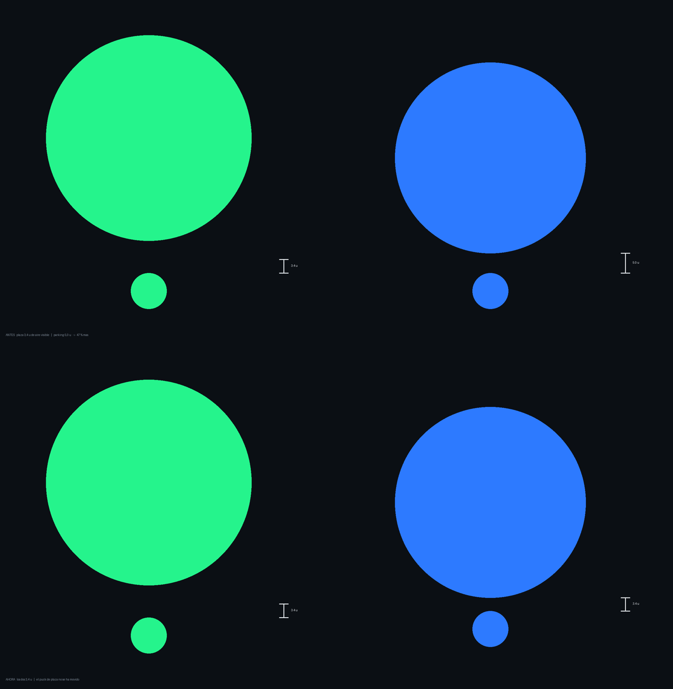

# MAP-A-DISC-THAT-CARRIES-NO-DATA-NEEDS-NO-RING-001 · el marcador de parking

**Estado:** ✅ Done · rama `fix/MAP-A-DISC-THAT-CARRIES-NO-DATA-NEEDS-NO-RING-001` · issue #89
También cierra [MAP-THE-FAMILY-LINE-IS-THE-ONE-YOU-CAN-SEE-001].

## Problema
Dos cosas del marcador de parking, vistas en device en tema oscuro:
1. lleva un borde negro en oscuro (blanco en claro) que no aporta y «debería invertirse»;
2. parece llevar **algo más de aire** al punto que el resto de la familia.

## 1 · El borde: ya no existe, y ahora está escrito POR QUÉ
El contorno que el user vio es el de `19243d2a0`: un `Stroke` de `surface` alrededor del relleno
azul, defendido en su propio comentario con que «un puck azul oscuro no se funda con las teselas
oscuras». **`8fcf038ff` (PR #59) lo borró** al hacer del parking sin tarifa un disco macizo — el
build del reporte era una release anterior.

Lo que faltaba era la regla, porque el argumento viejo sigue siendo tentador. Queda escrita en el
KDoc de `NearbyDiscMarker`:

> **El anillo neutro es de los cuerpos cuyo COLOR ES UN DATO, no de los que son identidad.**

- Plaza: el relleno **es** el dato (rampa de frescura, de verde a rojo). Su contraste con la tesela
  depende de qué esté diciendo ese día → necesita el anillo.
- Parking: el relleno es identidad fija (`PapColor.carPark`), ya elegida para contrastar con las dos
  teselas → el anillo no separa nada, sólo añade un segundo cuerpo.

## 2 · El aire: la percepción era REAL, y medida
Medido sobre las constantes del fichero (viewBox 72 × 82):

| | borde de relleno | sobresale | borde **visible** | tapa del punto | **aire visible** |
|---|---|---|---|---|---|
| Plaza (puck r29 + contorno de papel 3,2) | 63,0 | +1,6 | **64,6** | 68,0 | **3,4 u** |
| Parking (disco 48, sin contorno) | 63,0 | 0 | **63,0** | 68,0 | **5,0 u** |

**47 % más de aire en el parking**, con la misma constante. Ni «no deriva de la constante» (sí
deriva) ni «es percepción» (no lo es): **la constante estaba escrita sobre el borde del RELLENO,
que nadie ve**. El puck de plaza esconde 1,6 u de gap bajo su propio contorno, porque ese contorno
va *centrado* en el radio y media pluma cae fuera.

### Diseño
`MARKER_DOT_GAP` pasa a significar lo que siempre dijo —**el aire que se VE**— y vale **3,4**: lo
que la plaza ya enseñaba y el user aprobó en [MAP-EVERY-MARKER-SITS-THE-SAME-HEIGHT-OVER-ITS-DOT-001].
Cada cuerpo declara cuánto sobresale su silueta (`SPOT_BODY_OVERSHOOT_U` = media pluma del contorno;
`NEARBY_BODY_OVERSHOOT_U` = 0) y el centro del punto se **deriva**.

Resultado: **el puck de plaza no se mueve ni un píxel** (`SPOT_DOT_CY` sigue siendo 72,5) y el punto
del disco y de la cápsula sube 1,6 u ≈ **1,0 dp** a 46 dp de ancho. La sombra viaja con su punto:
su tapa era el literal `71,4`, que sólo valía para el único punto que había.

## Criterio de éxito
`MarkerGeometryTest`, 4 testigos sobre las constantes reales:
- el aire visible es el mismo en plaza y en disco/cápsula;
- `SPOT_DOT_CY` sigue valiendo 72,5 — si cae, el arreglo del parking se llevó por delante la plaza;
- el punto del cuerpo sin contorno se ACERCA, no se aleja, y exactamente lo que el contorno esconde;
- lo que sobresale se deriva del grosor que lo causa, no es un literal.

Falsificados devolviendo `NEARBY_DOT_CY = SPOT_DOT_CY`: caen 2 de 4.

## ⛔ Lo que no se ha podido ver en device
Un pantallazo del mapa con los marcadores. El flavor `mock` no autentica Maps (su key no cubre el
paquete `.mock`) así que no dibuja overlays, y el apaño `-PmockAsProd` choca con el paquete prod que
hay instalado en el emulador, de otra sesión — que no se toca. La figura de arriba está generada
**desde las constantes del fichero**, a escala. Confirmarlo en mano queda para el user.

## Consumidores auditados
`grep` de `drawSpotDot` / `drawSpotShadow` — 5 sitios:

| Sitio | Veredicto |
|---|---|
| `FreeSpotMarker` · marcador de plaza en ruta | exento — es el cuerpo con contorno, usa el valor por defecto |
| `NearbyCapsuleMarker` (gasolinera y parking con tarifa) | **cerrado** — pasa a `NEARBY_DOT_CY` |
| `NearbyDiscMarker` (parking sin tarifa) | **cerrado** — pasa a `NEARBY_DOT_CY` |
| Marcador de clúster | exento — lleva su propio contorno (3,4), misma familia que la plaza |
| `TagMarker` del coche | exento y ya documentado — otro viewBox (104 × 88) y otra familia |
