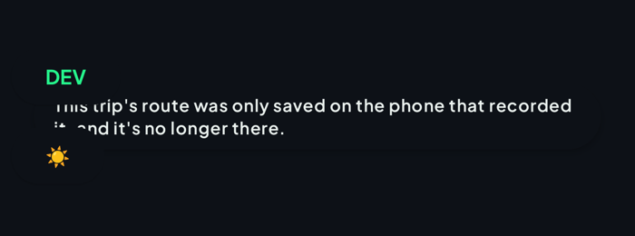
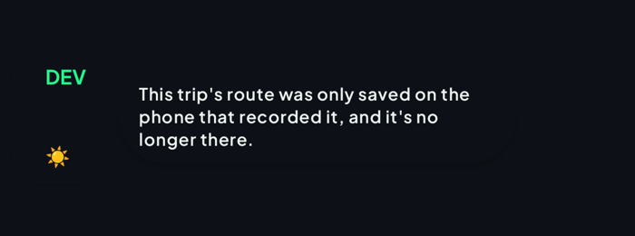

# UI-A-PILL-IS-FOR-A-LABEL-NOT-A-SENTENCE-001 · la píldora del aviso de ruta

**Estado:** ✅ Done · rama `fix/UI-A-PILL-IS-FOR-A-LABEL-NOT-A-SENTENCE-001`

## Cómo apareció
Sacando por fin capturas de las PRs de hoy. **La primera captura ya lo enseñó**, que es exactamente
para lo que existe [PR-A-VISUAL-CHANGE-SHOWS-ITSELF-001].

`RouteNoticePill` se escribió para **«Recalculando ruta…»**: una etiqueta corta, en cápsula
(`CircleShape`), y ahí se ve perfecta. En [TRIP-A-ROUTE-THAT-ONLY-LIVES-HERE-SAYS-SO-001] y
[TRIP-A-REFUSED-ROUTE-IS-NOT-A-BLANK-MAP-001] le metí **dos frases enteras** sin mirarlo en pantalla.

## El defecto
Una cápsula tiene el radio **a la mitad de su alto**. En cuanto el texto pasa a dos líneas ese radio
se dispara, los casquetes laterales se comen el principio y el final de la frase, y el resultado se
lee como texto suelto sobre un rectángulo mal puesto — no como un aviso.

| antes | después |
|---|---|
|  |  |

## Diseño
- **Cápsula sólo cuando cabe en una línea.** La forma pasa a depender de si hay spinner: el spinner
  acompaña al único texto corto que existe («Recalculando…»), así que esa condición ya distingue
  «etiqueta» de «frase» sin añadir un parámetro que alguien tenga que acordarse de pasar.
- **Techo de ancho** (`widthIn(max = 280.dp)`) en vez de `fillMaxWidth`: sin él la frase se estira de
  borde a borde y deja de leerse como algo que FLOTA sobre el mapa.
- Un punto más de aire vertical, que dos líneas lo piden.

## ⛔ Lo que esto enseña, y no es sobre esquinas
Las tres píldoras pasaron la suite entera —3594 tests— y **ninguno las mira**: el repo no tiene tests
de Compose UI. El único testigo posible era una captura, y la captura tardó en llegar. La regla de
enseñar las PRs no es burocracia: es el único guardarraíl que hay para esta clase de defecto.
