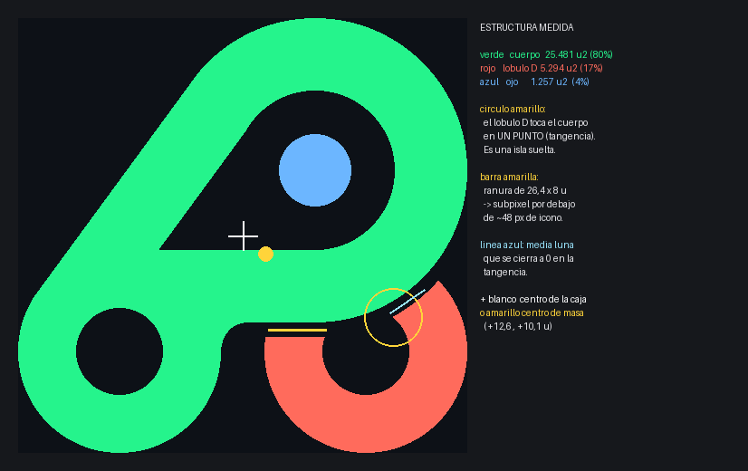
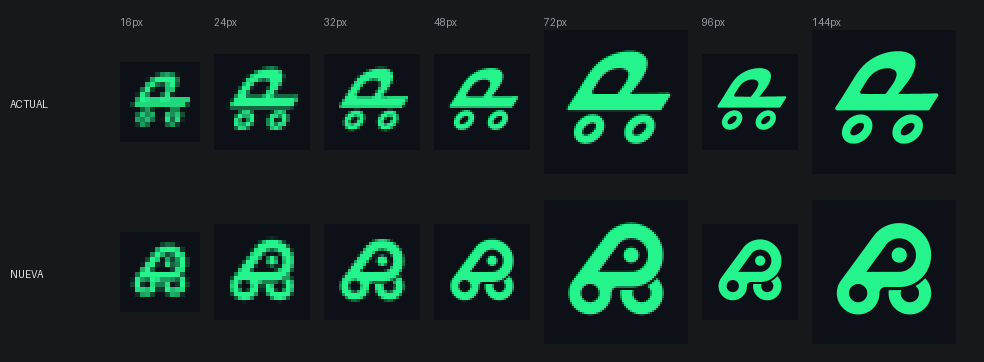
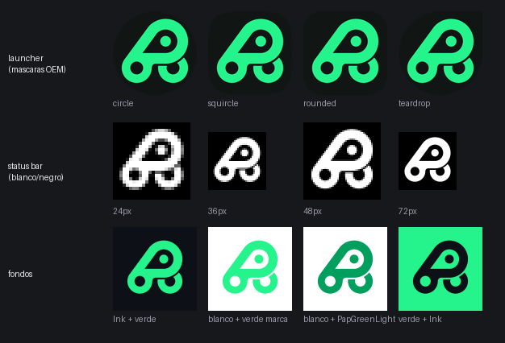

# Revisión de la nueva propuesta de logo · `paparcar_logo_remastered`

> **21-09-2026** · ticket [`BRAND-A-NEW-MARK-EARNS-ITS-SURFACES-001`](../backlog/brand-a-new-mark-earns-its-surfaces-001.md)
> ✅ **Sustituido el 21-09-2026** por el **Compás B+** (§ 6.2), sin disco y en todas las superficies.
> Este documento es la revisión que llevó hasta ahí; se conserva tal cual — con sus dos
> rectificaciones (§ 0) — porque el razonamiento importa tanto como el resultado.
> Estado y nombres al día: [`README.md`](README.md).
>
> 📛 **Los nombres y la estructura de la carpeta están en [`README.md`](README.md)**: *Trazo* (2022,
> el de la app), *Fluida* (la P orgánica, sólo ráster), *Compás* (la P geométrica, lo que se revisa
> aquí) y *Compás B+* (el Compás corregido). Este documento se escribió antes de tener esos nombres,
> así que «la propuesta» = **Compás**.

---

## 0 · Tres correcciones a lo que dice este documento

Escritas antes que nada porque cambian cómo se lee el resto.

1. ⛔ **La rueda derecha abierta NO es un defecto.** Era mi crítica número uno —«no lee como
   decisión, lee como fallo de render»— y es **falsa**. Está separada a propósito para que el cuerpo
   siga leyéndose como **P**; la hoja de construcción del diseño lo dice literalmente
   (`reference/source/paparcar-construccion-comparativa.png`): *«la rueda derecha SE MANTIENE SEPARADA: forma
   parte deliberadamente del coche sin borrar la lectura de la P»*. El objetivo es sostener **tres
   lecturas a la vez** — P de Parking, punto de ubicación en el hueco, y coche. Lo único que
   sobrevive de aquella crítica es el coste: entre 32 y 64 px esa rueda pierde lectura.
2. ⛔ **El lóbulo derecho no «toca» el cuerpo, y sus remates no tienen «anchura cero».** Ver § 2.1.
3. ⛔ **Hay un choque de tangencias que este documento no vio**, y lo detectó el user: el bajo del
   cuerpo (`y = 168`) y el techo de los agujeros de rueda (`y = 160`) quieren ser la misma línea y
   están a **8,03 u**. Ver § 6.2.

Todas las cifras de aquí están **medidas sobre el asset**, no estimadas: el SVG se rasterizó a 4–8 px
por unidad y se analizó por componentes conexas, transformada de distancia (chamfer 5-7-11), círculo
mínimo envolvente y recuento de longitudes de tramo. Cuando algo es opinión, lo digo.

---

## 1 · El asset

### 1.1 Ficheros

| | origen | en el repo |
|---|---|---|
| SVG | `…/paparcar_logo_remastered/SVG/Recurso 3.svg` | [`reference/source/paparcar-mark-2026-original.svg`](reference/source/paparcar-mark-2026-original.svg) |
| PNG | `…/paparcar_logo_remastered/1x/Recurso 2.png` | [`reference/source/paparcar-mark-2026-original-1x.png`](reference/source/paparcar-mark-2026-original-1x.png) |

Copiados **byte a byte** (sha256 verificado contra el origen). No se han tocado.

De ellos salen dos derivados nuevos, también sin cablear a nada:

- [`reference/paparcar-mark-2026.svg`](reference/paparcar-mark-2026.svg) — copia limpia, **misma geometría coordenada a
  coordenada**. Cambia tres cosas, ninguna geométrica: el CSS `<style>` pasa a atributo `fill`, el
  verde pasa a `PapGreen`, y salen los ids de Illustrator.
- [`reference/ic_launcher_foreground_2026.xml`](reference/ic_launcher_foreground_2026.xml) —
  VectorDrawable con el encuadre resuelto, para poder verlo en device sin tocar producción.

### 1.2 PNG

| | |
|---|---|
| Dimensiones | **248 × 240** px |
| Formato | PNG 8 bits/canal, **RGBA** (color type 6), no entrelazado, 5.515 bytes |
| Densidad | 2.834 px/m ≡ 72 dpi (metadato `pHYs`, irrelevante para Android) |
| Transparencia | Sí, y **limpia**: 26.434 px totalmente transparentes, 31.535 opacos, 1.551 con alfa parcial (sólo el antialias del borde) |
| Color | **un único RGB: `#24F885`**. Los píxeles de antialias conservan ese RGB y varían sólo el alfa ⇒ alfa **no premultiplicado**, que es lo correcto |
| Caja de tinta | (0,0)–(247,239) · **toca los cuatro bordes** |
| Proporción | 248:240 = **1,033:1**. No es cuadrado, no es 1:1, no es ninguna proporción de icono |

**Es un export 1× del SVG, no un máster.** Lo verifiqué rasterizando el SVG a 248 × 240 y comparando:
Δα máximo 87/255 y sólo en píxeles de borde — es decir, diferencias de antialias entre dos
rasterizadores, no discrepancias de forma. No hay nada en el PNG que no esté en el SVG.

**Y es demasiado pequeño para cualquier uso real**: Play pide 512 × 512, el mipmap xxxhdpi pide 192,
la feature graphic 1024 × 500. Escalar 248 → 512 es subir un 106 % desde un ráster.

### 1.3 SVG

```
viewBox="0 0 248 240"     sin width/height
3 formas: <circle> + 2 <path>
fill vía CSS:  <defs><style>.cls-1 { fill:#24f885 }</style></defs>
```

**Lo que NO tiene** — y esto es casi todo lo bueno que se puede decir de un SVG: sin `<mask>`, sin
`clipPath`, sin `<filter>`, sin degradados, sin `transform` en ningún nodo, sin trazos (`stroke`),
sin `<image>` embebida, sin `<text>`, sin `xlink:href`, sin dependencias externas, sin objetos
ocultos, sin paths duplicados. Tres formas, tres rellenos, nada más.

**Lo que sí tiene y molesta:**

| Hallazgo | Gravedad | Por qué |
|---|---|---|
| Relleno por **clase CSS** (`.cls-1`) en `<defs><style>` | ⚠️ real | Android **no lee SVG en absoluto** (hay que convertir sí o sí), y el CSS dentro de SVG es justo lo que peor sobreviven los conversores y los renderizadores no-navegador: si la clase se pierde, las tres formas caen a negro. En navegador funciona perfecto. **Resuelto en la copia limpia.** |
| **161 segmentos** donde bastarían ~25 (path A: 41, path B: 120, casi todos cúbicas micro) | ⚠️ producción | Es el rastro de un *expand + flatten* de Illustrator. No afecta al render ni al peso (3,7 KB), pero hace el fichero **no editable**: no puedes mover un radio, tendrías que reconstruirlo. Como salida está bien; como máster de marca, mal. |
| `id="Capa_2"`, `data-name="Capa 2"`, `id="Logo"` | ✅ inocuo | Ruido de Illustrator. Fuera en la copia limpia. |
| Sin `width`/`height` | ✅ inocuo | Con `viewBox` el SVG escala al contenedor, que en web es lo que se quiere. Declarados en la copia limpia por higiene. |
| `#24F885` ≠ `PapGreen` `#25F48C` | ⚠️ real | **ΔE00 = 1,66** — por encima del umbral de percepción (~1,0) y por debajo de "claramente otro color" (~2,3). Lado a lado se nota; por separado no. Contraste sobre Ink 13,37:1 (vs 12,97:1 del actual). El proyecto tiene **un** verde de marca y prohíbe literales: se normaliza. **Resuelto en la copia limpia.** |

**¿Es realmente vectorial y está limpio?** Sí, y además **bien construido**. Medí la desviación de
los arcos respecto a círculos perfectos: RMS ≤ 0,09 unidades sobre un lienzo de 248 — menos del
0,04 %. El disco central es un `<circle>` exacto. No es un calco automático de un ráster; alguien lo
dibujó con primitivas y luego lo aplanó.

**¿Necesita vectorización o re-dibujo?** No. Necesita una limpieza mecánica (hecha) y, si va a ser el
máster de marca para los próximos años, una reconstrucción desde primitivas (opcional, § 6).

**¿Funcionará en Android?** Sí, una vez convertido a VectorDrawable — no usa ni una sola
característica SVG que VectorDrawable no soporte. El
[candidato](reference/ic_launcher_foreground_2026.xml) lo demuestra: tres `<path>` con `fillColor`,
un `<group>` con escala y traslación, y nada más.

> **Verificado, no supuesto**: el candidato se metió temporalmente en
> `app/src/main/res/drawable/` y se corrió `:app:processProdDebugResources` → BUILD SUCCESSFUL, con
> su `.flat` en `merged_res/prodDebug/`. Es decir, **AAPT2 lo acepta**. El fichero temporal se borró
> acto seguido: en el repo no queda ninguna referencia.

**¿Problemas de escalado?** Ninguno geométrico: es vector puro, sin trazos (los trazos son lo que se
rompe al escalar). Los problemas de escalado que tiene son **de composición** y están en § 3.

---

## 2 · Cómo está construido



Reconstruido desde las coordenadas, el dibujo es esto:

| Elemento | Geometría exacta | Grosor |
|---|---|---|
| Cabeza del pin | corona: exterior R 84, interior r 44, centro (164, 84) | **40 u** |
| El ojo | disco r 20, concéntrico en (164, 84) | — |
| Contraforma | el círculo r 44 más una cola en punta hacia abajo-izquierda, cerrada por una recta horizontal en y = 128 | — |
| Pata diagonal | banda recta tangente a la cabeza, a ~45° | **40,8 u** |
| Lóbulo izquierdo | corona: exterior R 56, agujero r 24, centro (56, 184) | **32 u** |
| Lóbulo derecho | corona: exterior R 56, agujero r 24, centro (192, 184) | **32 u** |

Otras cifras:

- Tinta: **53,8 %** de la caja 248 × 240 · **49,3 %** de su círculo mínimo envolvente.
- Círculo mínimo envolvente: centro **(124,0 , 128,5)**, r **143,8**.
- Centro de masa: **(136,6 , 130,1)** frente al centro de la caja (124, 120) → **+12,6 / +10,1 u**
  (5,1 % y 4,2 % del lado).
- Islas de tinta: **tres** — cuerpo 25.481 u² (80 %), lóbulo derecho 5.294 u² (17 %), ojo 1.257 u² (4 %).

### 2.1 Los defectos estructurales

> ⚠️ **Esta sección está rectificada dos veces.** La primera versión decía que el lóbulo *tocaba* el
> cuerpo en una tangencia de anchura cero. Las dos cosas eran falsas y las dos las medí mal. Lo
> que sigue es lo que sale de volver a medir. Dejo escrito el error porque el fallo —dar por
> topológico lo que era un hueco— es justo el que un análisis así puede repetir.

**① El lóbulo derecho es una isla suelta, y nunca toca el cuerpo.**
Son dos piezas separadas por un hueco **constante de 7,26 u** (mínimo real, entre el ápice del
lóbulo en (232,0 · 144,8) y el cuerpo en (226,6 · 140,0)). El hueco es el arco de la media luna: el
lóbulo se dibuja a radio 91,393 desde el centro de la cabeza, y el cuerpo llega a 84 → 7,39 u de
separación nominal en todo el recorrido. **Es una decisión de dibujo, no un accidente.**

**② El acabado: cuatro esquinas en una marca que es toda radios.**
Medidos sobre el path, los ángulos interiores del lóbulo:

| Dónde | Ángulo | Qué es |
|---|---|---|
| (206,6 · 165,0) | **69,5°** | remate superior del anillo abierto |
| (169,5 · 175,8) | **68,9°** | remate de la repisa contra el agujero |
| (232,0 · 144,8) | **85,4°** | ápice: el arco R56 cruzando la media luna |
| (136,6 · 176,0) | **97,1°** | punta de la repisa — se lee **a escuadra**, porque el arco R56 ahí es casi vertical |

Ninguno es un cuchillo ni tiene anchura cero: son vértices normales. Pero son **cuatro remates sin
terminar** en un dibujo donde todo lo demás tiene radio, y uno de ellos es el único corte plano de
la marca. Es un defecto de acabado, no de estructura.

**③ El detalle fino se va en bloque.**
El hueco contra el cuerpo (**7,3 u**) y la ranura bajo la repisa (**26,4 × 8 u**) son el 2,5 % y el
2,8 % del diámetro envolvente: llegan a 1 px a los **52 px** y **47 px** de icono, y desaparecen
**a la vez**. Por debajo de ~48 px el lóbulo se funde con el cuerpo y la marca tiene otra silueta.
Éste es el único límite medible de verdad, y es el que decide dónde puede usarse la marca completa.

### 2.2 Lo que está bien y conviene no tocar

- Los arcos son arcos de verdad (§ 1.3).
- El ojo está **concéntrico** con la cabeza del pin — que es lo correcto para un pin, aunque
  ópticamente quede desplazado arriba-derecha dentro de la contraforma en gota.
- La diferencia de grosor **40 (cabeza y pata) vs 32 (ruedas)** parece compensación óptica
  deliberada: los lóbulos son un 33 % más pequeños que la cabeza y su trazo baja sólo un 20 %. Es
  una decisión defendible, no un error (ver § 6).

---

## 3 · Comportamiento como icono




### 3.1 Por tamaño

Con la marca ocupando el 76 % del icono (su círculo envolvente), sobre Ink:

| px | qué sobrevive | lectura |
|---|---|---|
| **16** | 4 contraformas de 1–10 px y el ojo reducido a **2 px** | ilegible — pero se mantiene como **un bloque coherente**, que es más de lo que hace el actual (se rompe en 8 migas) |
| **20–24** | gota + ojo + rueda izquierda; la derecha es un borrón | "algo con un agujero", no "un pin con ruedas" |
| **32** | tres contraformas claras; la ranura y la media luna **ya no están**, el lóbulo derecho se funde con el cuerpo | reconocible si ya sabes qué es |
| **48** | todo, con la ranura a 1 px justo | primera talla donde el dibujo es el dibujo |
| **72–96** | cómodo | la silueta empieza a ser propia |
| **≥144** | excelente | aquí es donde esta marca gana |

Medido en negativo (lo que se cierra antes que nada): el **percentil 5 de los huecos cerrados** del
mark nuevo es el 2,78 % del diámetro envolvente frente al 3,89 % del actual — pero el **percentil 25**
es 8,43 % frente a 6,32 %. Traducido: **el nuevo tiene un único elemento demasiado fino (la ranura) y
por lo demás respira MÁS que el actual.** La regla práctica que sale de ahí:

> La ranura llega a 1 px a los **~48 px** de icono. Todo lo demás del dibujo aguanta hasta **~16 px**.
> Arreglar la ranura sube el suelo de la marca de 48 px a 16 px de un solo cambio.

### 3.2 Por superficie

| Superficie | Veredicto |
|---|---|
| **Launcher · adaptive icon** | ✅ Con el encuadre del candidato (círculo envolvente = 66 dp centrado) **no lo recorta ninguna máscara**: circle, squircle, rounded, teardrop. Verificado: radio máximo 32,996 dp sobre un límite de 33. ⛔ Tal cual sale del export es **full bleed**: pegarlo sin encuadrar lo decapita en cuanto la máscara es un círculo. |
| **Themed icon (Android 13+)** | ✅ Mejor que el actual, incluso. La capa `monochrome` se tiñe entera, así que lo único que la salva son las contraformas — y el nuevo las tiene de verdad (agujeros), no trazos finos. |
| **Icono pequeño de Ajustes (24–32 dp)** | ⚠️ Borroso. Lee como mancha con tres motas. |
| **Notificación · small icon (monocromo)** | 🔴 **Su peor superficie.** Blanco sobre negro la irradiación cierra las contraformas mucho antes que verde-sobre-Ink: a mdpi 24 px es un borrón blanco. Y aquí pesa: hay un FGS **permanente** y `ic_notification_logo` se usa en **17 sitios**. |
| **Acceso directo / widget** | ⚠️ Igual que el launcher, pero los shortcuts se dibujan a ~48 dp con un badge encima: justo el tamaño límite. |
| **Play Store (512)** | ✅ Sobra resolución. ⛔ El PNG entregado (248) **no sirve**: hay que generar desde el SVG. |
| **Splash** | ✅ Es su talla natural (el disco se enmascara a círculo y la marca va dentro). |
| **Favicon 16/32** | 🔴 A 16 px es una mancha. Lo mismo le pasa al actual: un favicon a 16 px necesita **variante simplificada**, no la marca completa. |
| **Web (header ~40 dp)** | ⚠️ Justo por debajo del umbral cómodo. A 40 px la ranura no está. |
| **Redes sociales (avatar circular, se ve a 32–64)** | ⚠️ Depende de la red; a 32 px pierde el lóbulo derecho. |
| **Fondo claro con el verde de marca** | 🔴 **Contraste 1,42:1.** La marca sola sobre blanco es casi invisible. No es culpa del dibujo nuevo (al actual le pasa igual), pero el nuevo tiene más área de tinta y por tanto la mancha es mayor. Sobre claro hay que usar disco Ink o `PapGreenLight` (`#009F5E`, 3,01:1) — el proyecto ya lo tiene resuelto. |

### 3.3 Problemas concretos buscados

- **Líneas que desaparecen**: sólo la ranura (8 u) y la media luna en su extremo. Ningún trazo del
  dibujo desaparece — son todos ≥32 u.
- **Detalles que se mezclan**: el lóbulo derecho con el cuerpo, por debajo de ~40 px.
- **Zonas demasiado finas**: el hueco contra el cuerpo (7,3 u) y la ranura (8 u) — los dos negativos,
  no positivos: ningún trazo de la marca es fino.
- **Formas que pierden reconocimiento**: el lóbulo derecho deja de leerse como rueda por debajo de
  ~40 px; pasa a leerse como bulto.
- **Contraste**: sólo el caso verde-sobre-claro (§ 3.2).
- **Centrado**: el centro de masa está a +12,6 / +10,1 u del centro de la caja. Centrar por caja lo
  deja bajo y a la derecha. **Centrar por círculo envolvente ya lo corrige casi entero** (su centro
  es (124,0 , 128,5): en x está clavado, en y queda +8,5).
- **Exceso de espacio vacío**: el cuadrante superior izquierdo (0,0)–(100,100) está **vacío**. En una
  caja cuadrada eso pesa; dentro de un disco, no tanto, porque la diagonal del dibujo se acomoda bien.
- **Peso visual descompensado**: sí, hacia abajo-derecha, por los dos lóbulos. Es lo que da la
  sensación de "apoyado" — es carácter, no defecto, siempre que el encuadre lo compense.

---

## 4 · Evaluación visual

### 4.1 Qué es

Un **pin de mapa tumbado en diagonal** — cabeza redonda con su punto dentro, punta hacia abajo-izquierda —
fundido con **dos ruedas** en la base. Una sola masa continua, monolineal, todo arcos, sin contorno
ni sombra ni degradado. Es una marca **geométrica y construida**, frente a un actual que es
**dibujado**.

### 4.2 Fortalezas

- **Silueta propia.** A partir de 48 px es difícil de confundir: el contorno exterior (triángulo
  redondeado con dos lóbulos bajos y una gota arriba) no lo tiene nadie más en el sector.
- **Dice lo que es el producto.** Plaza (pin) + coche (ruedas). El actual sólo dice "coche", y el
  producto no va de coches: va de **dónde** están.
- **Es sistema, no ilustración.** Compás y regla: R 84/44/56/24/20, ángulos a 45°. Eso significa que
  se puede re-dibujar, adaptar y extender sin que se note la costura. El actual no: sus grosores son
  variables y sus ruedas son elipses giradas -40°, imposibles de reproducir sin el fichero original.
- **Funciona como knockout.** Sus contraformas son agujeros reales, así que invertirla (marca oscura
  sobre disco claro) no pierde nada.
- **Funciona como letra.** Lee como una "a" o una "P" geométrica, lo que junto al nombre *Paparcar*
  es una ventaja: parece la inicial. Al lado del wordmark encaja muy bien.
- **Es más moderna en el sentido correcto** — geometría plana, alto contraste, foco único — que es
  hacia donde va la iconografía de app en 2026: minimalismo geométrico y un solo punto focal, no más
  detalle ([DesignRush](https://www.designrush.com/best-designs/apps/trends/mobile-app-icon-design),
  [Envato](https://elements.envato.com/learn/icon-design-trends)).

### 4.3 Debilidades

- **Tarda un latido en leerse.** El actual se reconoce como coche al instante; el nuevo primero lee
  como forma abstracta y *después* como pin con ruedas. En un thumbnail de Play compitiendo con otros
  20 iconos, ese latido cuesta.
- **Las dos ruedas no son gemelas.** La izquierda es un anillo cerrado; la derecha es una "C" abierta
  con un pico. Entre 32 y 64 px esa asimetría no lee como decisión: lee como **error de renderizado**.
  Es, para mí, su problema visual más serio — por delante del acabado.
- **Sin línea de suelo.** El actual apoya en una losa horizontal que dice "aparcado". El nuevo flota
  en diagonal — dice "movimiento", que es literalmente lo contrario de lo que celebra el producto.
  No está mal; está *dicho al revés*. (Contraargumento honesto: el producto también va de *ir a
  buscar* una plaza, y ahí la diagonal funciona.)
- **La contraforma en gota tiene una base recta** (y = 128) que corta el arco de golpe. Es lo que la
  hace leer como pin y no como "o", así que es intencionado — pero es el único punto donde una recta
  choca contra un arco sin transición.
- **Densidad.** 49,3 % de tinta dentro de su envolvente. A tamaños pequeños en blanco sobre negro,
  la irradiación la cierra.

### 4.4 Simetrías, tangencias, espacios negativos

- **Simetrías intencionadas**: los dos lóbulos comparten y = 184 y R 56 y r 24. Buena base.
- **Asimetrías intencionadas**: la cabeza es mayor que los lóbulos; la pata baja a 45°. Correcto.
- **Asimetría NO intencionada** (o al menos no legible como tal): anillo cerrado vs anillo abierto.
- **Tangencias**: la pata es tangente a la cabeza — limpio. El lóbulo derecho **no** es tangente a
  nada: corre a 7,39 u del cuerpo en todo su recorrido (§ 2.1).
- **Espacios negativos**: la contraforma en gota es el mejor espacio negativo del dibujo, grande y
  con forma propia. El agujero de la rueda izquierda es limpio. La media luna y la ranura son los dos
  débiles.

---

## 5 · Comparación con el logo actual

| | **Actual (2022)** | **Nueva (2026)** |
|---|---|---|
| Qué es | un coche de perfil, trazo suelto, dos ruedas elípticas flotando bajo una losa | un pin de mapa tumbado fundido con dos ruedas |
| Construcción | dibujada a mano, grosores variables, elipses giradas -40° | compás y regla, R exactos, todo arcos |
| Tinta / envolvente | 44,4 % | 49,3 % |
| Elemento más fino | 6 u sobre un envolvente de 77 (**7,8 %**) | 8 u sobre 288 (**2,8 %**) — pero es un elemento único |
| Piezas | 3 (cuerpo + 2 ruedas) | 3 (cuerpo + lóbulo suelto + ojo) |
| A 16 px | se **rompe en 8 migas** | aguanta como un bloque |
| A 24–32 px | legible como coche | legible como forma, no como concepto |
| A ≥ 96 px | encantador pero "de boceto" | propio y sistemático |
| Blanco/negro 24 px | conserva 3 contraformas abiertas | pierde la derecha |
| Como letra junto al nombre | no | sí (lee como "a"/"P") |
| Reproducibilidad | necesitas el fichero: nadie redibuja esas elipses | cualquiera lo redibuja con radios |

### Qué mejora
Sistematicidad, propiedad de la silueta, significado (plaza + coche, no sólo coche), comportamiento
como knockout y como themed icon, integridad a 16 px, y encaje junto al wordmark.

### Qué empeora
Inmediatez de lectura, gemelidad de las dos ruedas, y el comportamiento en **monocromo pequeño**, que
en esta app no es un caso marginal: hay una notificación persistente.

### Qué se gana
Una marca que se puede **gobernar**: un máster, radios, un solo verde, y reglas derivables en vez de
copiadas a mano en once ficheros.

### Qué se pierde
El calor del trazo. El actual tiene una imperfección simpática — parece dibujado por una persona.
El nuevo es correcto y frío. Eso es un cambio de posicionamiento, no una mejora técnica, y es
legítimo quererlo o no quererlo.

### Riesgos
1. **Saturación conceptual.** "Pin + coche" es de los conceptos más dibujados que existen: sólo
   IconScout lista más de 124.000 iconos "car map pin"
   ([IconScout](https://iconscout.com/icons/car-map-pin), [Flaticon](https://www.flaticon.com/free-icons/map-pin-car)).
   El concepto **no diferencia**; sólo puede diferenciar la ejecución.
2. **Lecturas no deseadas.** Yo veo, por este orden: una "a", un pin con ruedas, un ciclomotor de
   perfil, un caracol. La del caracol es la que vigilaría, porque el producto vende *rapidez* para
   encontrar sitio. No es un veredicto: es algo que hay que preguntarle a cinco personas que no
   conozcan la app, enseñándoles el icono a 48 px sin nombre.
3. **Coste de migración.** 21 superficies, varias **ya publicadas** (Play, `paparcar.com`). Un cambio
   a medias deja la web y la ficha prometiendo la marca anterior, en dos idiomas, indefinidamente.
4. **La regla 6/7 muere.** La *Compensación Óptica del Logo* de `CLAUDE.md` existe porque las ruedas
   actuales son **trazos**. Las nuevas son coronas rellenas: no hay nada que compensar. Esa regla no
   se edita, se reescribe.

### Dónde el actual sigue siendo superior
- **Small icon de notificación a mdpi (24 px), monocromo.** Aquí gana el actual, y no por poco.
- **Reconocimiento a la primera** de un usuario que nunca ha visto la app.
- **Favicon 16 px** — empate a malo, pero el actual al menos sugiere un vehículo.

### Conclusión razonada

**El cambio tiene sentido, pero no como sustitución pieza a pieza.**

El problema del logo actual no es estético: es que **no es un sistema**. Sus grosores son variables,
sus ruedas son elipses giradas que nadie puede redibujar, y su path está copiado literalmente en
**25 ficheros** del repo (`grep -rl "M92.28,57.77"`): 15 fuentes —6 VectorDrawable de `:app`, 5 de
`composeResources`, 2 HTML de Play, el favicon, `icons.mjs` y `docs/assets`— más 10 páginas
generadas en `hosting/public`. Eso ya obligó a documentar en `CLAUDE.md` una pareja de números
mágicos (trazo 6 sobre oscuro, 7 sobre claro) porque no había de dónde derivarlos. Ese coste se paga
en cada tarea que toca marca.

La propuesta nueva sí es un sistema, y encima dice lo que el producto hace en vez de decir sólo
"coche". Eso es una mejora de fondo, no de gusto.

Pero **no está terminada.** Y "terminada" aquí es literal, no una figura: sus cuatro remates son
esquinas sin radio en una marca que por lo demás es toda arcos, y su detalle fino (7,3 y 8 u)
desaparece en bloque por debajo de 48 px. Ninguna de las dos cosas es una emergencia; las dos se
notan. Y hay una decisión de producto aparte: el icono de notificación pequeño, donde el actual es
mejor y donde esta app pasa mucho tiempo.

Mi recomendación, en orden: **(1)** rematar las cuatro esquinas —está hecho y medido, ver § 6.1—,
**(2)** decidir si el detalle fino sube de 7–8 u a ~12, **(3)** generar las superficies desde un
único máster con un script, **(4)** vivir con el icono nuevo en el home screen una semana antes de
tocar Play, **(5)** decidir aparte si el small icon lleva la marca completa o una variante
simplificada.

> ✅ **(5) decidido el 24-09: la marca completa, en todas las superficies.** Se probó la variante
> simplificada (la compacta, ejemplo `09`) como marca única y se descartó al ver las dos
> rasterizadas a 48 y 24 px. Hay UNA marca y ningún umbral — detalle y coste asumido en
> [`README.md`](README.md) § *Una sola marca, a propósito*.

---

## 6 · Correcciones recomendadas

Clasificadas dos veces, como se pidió: por **naturaleza** (¿es un defecto o es gusto?) y por
**urgencia** (¿bloquea la sustitución?).

### Imprescindibles — bloquean cualquier sustitución

| # | Qué | Naturaleza | Por qué |
|---|---|---|---|
| 1 | **Rematar las cuatro esquinas del lóbulo** con radios r 4–6 | **Corrección técnica** | Son los únicos ángulos de una marca que es toda arcos, y uno se lee a escuadra. ✅ **hecho y medido** — ver § 6.1 |
| 2 | **Verde → `PapGreen` `#25F48C`** | Corrección técnica | ΔE00 1,66 respecto al token. El proyecto tiene un verde y prohíbe literales. ✅ hecho en la copia limpia |
| 3 | **CSS `<style>` → atributo `fill`** | Corrección técnica | El CSS en SVG es lo que peor sobrevive fuera del navegador. ✅ hecho en la copia limpia |
| 4 | **Nunca usar full bleed**: encuadrar por círculo envolvente | Corrección técnica | Sin encuadre, cualquier máscara circular lo decapita. ✅ resuelto en el candidato (radio 33 dp exactos) |

### Recomendables — no bloquean, pero se notan

| # | Qué | Naturaleza | Por qué |
|---|---|---|---|
| 5 | **Ensanchar la ranura de 8 u a ≥12 u**, o eliminar la repisa | Mejora visual | Sube el suelo de legibilidad de la marca de ~48 px a ~16 px de un solo cambio |
| 6 | **Redondear el remate a escuadra** de la repisa (x ≈ 141) | Corrección técnica | Es el único remate plano de un dibujo que es todo radios |
| 7 | **Subir el detalle fino de 7–8 u a ~12 u** (bajar la repisa a y = 180, abrir la media luna) | Mejora visual | Sube el suelo de legibilidad de ~48 px a ~32. ⚠️ Probado: engorda el centro-abajo. Es una decisión, no un arreglo |
| 8 | **Hacer gemelas las dos ruedas** (cerrar la derecha, o abrir la izquierda igual) | Mejora visual | Entre 32 y 64 px la asimetría lee como fallo de render, no como decisión. ⚠️ Cambia el carácter del dibujo: es la propuesta más invasiva de la lista y puede estar en contra de la intención del diseño |
| 9 | **Recentrar ópticamente** | Mejora visual | El centro de masa está a +12,6/+10,1. Encuadrar por envolvente ya corrige la x entera y deja +8,5 en y |

### Opcionales — preferencia, nada más

| # | Qué | Naturaleza | Nota |
|---|---|---|---|
| 10 | **Reconstruir los paths desde primitivas** (161 segmentos → ~25) | Preferencia (higiene de producción) | No cambia un píxel. Cambia que el máster se pueda editar dentro de dos años |
| 11 | **Subir el trazo de las ruedas de 32 a 34–36 u** | **Preferencia personal** | La diferencia 40/32 es compensación óptica defendible. Mi ojo pediría 34. No hay dato que lo respalde: es gusto |
| 12 | **Variante simplificada para ≤32 px** (sin repisa, sin media luna) | Mejora visual | Práctica estándar. Resolvería el small icon de notificación sin tocar la marca principal |

> **Lo que NO propongo, a propósito**: cambiar el concepto, mover el ojo, cambiar los radios de la
> cabeza, girar el conjunto, o añadir nada. El dibujo está bien pensado; lo que le falta son remates.

### 6.1 · Los remates, aplicados

`paparcar-mark-2026-refined.svg` (ya borrado, ver 6.2) era la marca con el punto 1 hecho. **El ojo y el cuerpo
salen intactos, coordenada a coordenada**: sólo cambia el lóbulo, y cambia entero — se reconstruyó
analíticamente con `master/rebuild_lobe.py`.

Antes de tocarlo, el script reproduce el lóbulo original con `cap_t=0, fillet_apex=0, fillet_tip=0`:
comparado por raster contra el SVG limpio da **885 píxeles distintos de 238.080, sólo 86 por encima
de 64/255** — todo antialias. Esa es la prueba de que la reconstrucción es fiel antes de corregir
nada.

| | Original | Rematado |
|---|---|---|
| Esquina más cerrada | **68,9°** | **147,3°** |
| Remates planos | 1 | 0 |
| Hueco contra el cuerpo | 7,26 u | **7,39 u** |
| Path del lóbulo | 924 car · 41 cúbicas aplanadas | **226 car · 7 arcos y una recta** |
| Área de tinta (marca entera) | 32.037 u² | 32.005 u² (**−0,1 %**) |

Los cuatro acuerdos: **r 5** en la punta de la repisa, **r 6** en el ápice, **r 5** en el remate del
anillo, **r 4** donde la repisa muere contra el agujero.

Dos cosas aprendidas que valen para el próximo que toque esta geometría:

- ⛔ **Un acuerdo radial sobresale.** El primer remate del anillo lo puse con el centro en el punto
  medio del grosor: dejaba el hueco contra el cuerpo en **4,97 u** en vez de 7,39, o sea creaba un
  cuello más fino que el que arreglaba. El bueno es **tangente a las dos curvas**, y entonces por
  construcción no puede sobresalir.
- ⛔ **Los flags de un arco SVG no se adivinan.** Con dos extremos y un radio hay **cuatro** arcos
  posibles (dos centros × dos sentidos). Elegir `large`/`sweep` a ojo escoge a veces el otro centro
  y el arco sale a otro sitio — pasó tres veces seguidas aquí, una de ellas con un bulto visible.
  `rebuild-lobe.py` los **deriva del centro real** (`arc_c`), no los escribe a mano.

**Lo que cuesta:** el original remata el anillo en una punta larga que a 120 px se ve más dinámica.
La versión rematada cambia ese gesto por un final limpio. No es objetivamente mejor — es más
consistente con el resto del dibujo. Si el afilado es intencionado, no es un defecto: es una firma,
y entonces esta corrección sobra.

> ⚠️ Superado por **§ 6.2**: los remates del lóbulo están dentro del Compás B+, que además arregla
> la tangencia y baja la masa. `paparcar-mark-2026-refined.svg` se borró.

### 6.2 · El choque de tangencias, y el Compás B+

Lo vio el user, no este análisis. **El bajo del cuerpo y el techo de los agujeros de rueda quieren
ser la misma línea y están a 8,03 u.** Las dos son tangencias legítimas, a círculos distintos:

| Línea | Qué es | Tangente a |
|---|---|---|
| `y = 128` | base plana de la gota | círculo **r 44** de la cabeza (84 + 44) |
| `y = 160` | techo de los dos agujeros de rueda | círculo **r 24** de la rueda (184 − 24) |
| `y = 168` | bajo del cuerpo, recta de 39,4 u | círculo **R 84** de la cabeza (84 + 84) |
| `y = 176` | techo de la repisa | **nada** |

Medido: la recta `y = 168` pasa a 16 u del centro de **los dos** agujeros, cuyo radio es 24 — o sea
les entra 8 u por dentro. Para ser tangente tendría que estar en 160.

**Dos vías que parecen la solución y no lo son:**

- ⛔ **Subir el bajo a `y = 160`.** Es lo primero que probé y **rompe el cuenco de la P**: ese bajo
  no es una línea suelta, *es el punto más bajo del R 84*. Entre `x = 164` y `199,8` una recta a
  160 va por encima del arco y amputa el trozo de cuenco pegado a la rueda derecha.
- ⛔ **Encoger la cabeza a R 76** (su fondo cae en 160 y el cuenco se conserva). Rompe un enrase que
  el dibujo sí tenía: **la cabeza y el lóbulo derecho comparten borde derecho en `x = 248`**
  (`164+84` = `192+56`). Con R 76 la cabeza se queda en 240 y la rueda sobresale 8 u.

**La que sí:** bajar los lóbulos de `y = 184` a `y = 192`. El techo de los agujeros (`192 − 24`)
cae en 168, la cabeza no se toca y el enrase derecho se mantiene.

### La tangencia cobró en alto, y se devolvió en ancho

Bajar los lóbulos deja el lienzo en `248 × 248`: cuadrado. **La marca no había adelgazado, pero lo
parece** — creció 8 u de alto sin crecer de ancho, y el ojo lee esa diferencia como un dibujo más
alto y más estrecho. *La vio el user en el render, igual que la tangencia.*

La devolución es la simétrica: **cabeza y rueda derecha se trasladan `+8` en x**, juntas. Juntas
porque comparten el borde derecho (`164+84` = `192+56`) y ese enrase es lo que ya había matado la
vía del `R 76`; moverlas a la vez lo conserva intacto. **La rueda izquierda no se toca**, y eso no
es cortesía: es la que apoya el lienzo en `x = 0` y la que lleva el acuerdo r 34.

Lo que **no** cambia, y es la razón de que traslaciones sí y escalas no: la tangencia (`y = 168` no
depende de x), el hueco de la media luna (7,39 u, medido desde un centro que se movió lo mismo que
el arco), el acuerdo (`r = LC.y − under_y`, sin x dentro) y los tres anillos. Lo que **sí** se
estira son la pata y el bajo del cuenco — justo donde una P se abre.

⚠️ Con una excepción que hay que reseguir a mano: **la punta de la gota fija el borde inferior de la
pata**. Dejarla en 68 con la cabeza 8 u más lejos adelgaza la pata a 30,8 (de 33,1) sin que nadie lo
pida. `TIP_X = 71` la devuelve a 33,2. *Una constante que se mide contra una pieza que se ha movido
deja de medir lo que medía.*

`mark/paparcar-mark-compas-b.svg`, generado por `master/build_marks.py`:

### El hueco de la rueda derecha no era uno, eran dos

También lo vio el user en el render: *el hueco es más estrecho por un lado de la rueda que por el
otro*. Medido punto a punto (distancia mínima de cada punto del lóbulo al cuerpo): **7,393 u en la
media luna y 10,000 u en la ranura** de la repisa — un **35 %** de diferencia en la misma rueda.

No era un descuido, son **dos piezas con historias distintas que el ojo lee como un canal**: la media
luna es un arco concéntrico con la cabeza (hueco constante, heredado en 7,393 del dibujo original) y
la ranura son dos horizontales paralelas (`shelf_y − under_y`, subida de 8 a 10 en el propio B+).
Cada una coherente consigo misma; juntas, no.

Se igualan **en 10** —no en 7,39— porque 10 u aguantan hasta iconos de **~37 px** donde 7,39 se
cerraba a los **~51**, y eso cierra el pendiente que este análisis dejó abierto. Verificado: el
mínimo del canal pasa de `7,393` a `10,000`.

⛔ *Dos piezas que el ojo lee como una sola tienen que compartir su número, aunque cada una lo derive
de su propia geometría.* Ninguna estaba mal por separado — por eso sobrevivió cuatro vueltas.

| | Compás | Compás B+ |
|---|---|---|
| Bajo del cuerpo = techo del agujero | no · 8,03 u | **sí · 168** |
| Canal de la rueda derecha | 7,39 / 10 (35 % de diferencia) | **10 / 10** |
| Anillos (cabeza / rueda / pata) | 40 / 32 / 40,3 | **34 / 32 / 33,2** |
| Consistencia de trazo `p90/p10` | 1,31 | **1,13** |
| Tinta / envolvente | 49,3 % | **44,6 %** (Fluida: 44,7 %) |
| Acuerdo al lóbulo izquierdo | r 16 (mínimo geométrico) | **r 34** — la S |
| Ranura | 8 u | 10 u |
| Esquinas sin radio en el lóbulo | 4 | **0** |
| Esquinas vivas en TODO el dibujo | 5 (4 del lóbulo + el pico de la gota) | **0** — auditado al generar |
| Lienzo | 248 × 240 (1,033) | **256 × 248** (1,032) |
| Círculo envolvente | r 143,80 en (124,0 · 128,5) | **r 149,44 en (128,0 · 132,44)** |
| Path | 3.402 car | **473 car**, paramétrico |

⛔ **La repisa desaparece en cualquier solución de tangencia**, y eso no es una decisión estética:
vivía en los 8 u de desajuste. Al hacer coincidir las dos líneas se queda sin sitio. En el Compás B+
sobrevive porque baja a `y = 178`, donde el agujero ya no llega — pero el hueco en el que vivía ya
no es el mismo.

---

## 7 · Referencias externas y encaje en el sector

No pude hacer búsqueda inversa por imagen — lo que sigue es análisis conceptual y de silueta, con las
fuentes que sí pude verificar.

**Tendencia 2026.** La iconografía de app va hacia geometría plana, alto contraste y un solo punto
focal; el minimalismo y la línea limpia siguen siendo la apuesta segura porque son las que aguantan
en interfaces densas ([DesignRush](https://www.designrush.com/best-designs/apps/trends/mobile-app-icon-design),
[Envato Elements](https://elements.envato.com/learn/icon-design-trends),
[Envato Author Hub](https://author.envato.com/hub/icon-design-trends-2026/)). La propuesta encaja
exactamente ahí: forma única, plana, sin degradado, alto contraste sobre fondo oscuro.

**Color.** El verde neón sitúa a Paparcar en la familia visual de la movilidad europea —
[Bolt](https://1000logos.net/bolt-logo/) y [Grab](https://logos-world.net/grab-logo/) son verdes, y
los de micromovilidad (Lime) también. Eso es **encaje**, no copia: ninguno usa un pin ni ruedas.
Riesgo real y bajo: el verde solo no diferencia.

**Concepto.** Aquí está el problema de diferenciación, y es serio: "pin de mapa + coche/plaza" es uno
de los conceptos más dibujados del stock. IconScout lista **más de 124.000** iconos "car map pin";
Flaticon, 1.683 sólo en esa búsqueda exacta ([IconScout](https://iconscout.com/icons/car-map-pin),
[Flaticon](https://www.flaticon.com/free-icons/map-pin-car)). El patrón dominante del sector es un
**pin azul con una "P" dentro**. La propuesta se aparta de ese patrón en tres cosas concretas — el
pin va **tumbado**, no hay "P", y el pin está **fundido** con las ruedas en una sola masa — y eso es
lo que la salva de ser genérica. Pero conviene tenerlo claro: **lo que diferencia no es la idea, es
la ejecución.**

**Competencia directa en España.** Telpark, ElParking, Parclick, Wesmartpark, e-park, Parquo
([Xataka Móvil](https://www.xatakamovil.com/aplicaciones/siete-aplicaciones-para-encontrar-aparcamiento-facilmente-en-ios-y-android),
[MAPFRE](https://www.motor.mapfre.es/coches/noticias-coches/las-aplicaciones-moviles-para-aparcar-en-espana/)).
No pude verificar sus marcas desde aquí; ninguno de ellos hace lo mismo que Paparcar (plaza liberada
por la comunidad), pero **compiten en el mismo estante de Play** y ahí el icono es lo único que se ve.
Verificación pendiente y barata: abrir la búsqueda "aparcamiento" en Play y mirar la parrilla.

**¿Parece genérico?** A ≥48 px, no. Por debajo de 32 px, sí — pero eso le pasa también al actual y a
la mitad del sector.

---

## 8 · Revisión preliminar de diferenciación

**No es un estudio jurídico y no afirmo que exista infracción de nada.**

Lo que sí puedo decir con lo que tengo:

- **No he encontrado ninguna marca conocida con esta silueta.** La combinación concreta —pin tumbado
  a 45°, ojo concéntrico, dos coronas en la base, todo fundido en una masa monolineal— no la
  reconozco en ninguna app de parking, movilidad, navegación o coches.
- **El riesgo no está en la silueta, está en el concepto**, que es de dominio público y está
  saturado en stock (§ 7). Un concepto saturado no genera conflicto legal; genera **falta de
  distintividad**, que es un problema de marketing y, en registro, un problema de carácter distintivo.
- **Parecidos de familia, no de forma**: verde neón + geometría redondeada te pone cerca de Bolt,
  Grab y Lime. Ninguno comparte estructura.
- **Lecturas no deseadas** (§ 5, riesgo 2): "a" minúscula, ciclomotor, caracol. Ninguna es
  problemática legalmente; la del caracol sí lo sería comercialmente.

**Qué hacer de verdad, si el cambio avanza** — esto sí es accionable y barato:

1. Búsqueda figurativa en [EUIPO eSearch plus](https://www.euipo.europa.eu/en/trade-marks/before-applying/availability)
   por **clasificación de Viena** (la búsqueda de similitud de marcas figurativas se hace por esos
   códigos, [EUIPO](https://www.euipo.europa.eu/en/the-office/help-centre/searches/faq-vienna-classification)).
   Los códigos a cruzar: **26.1** (círculos y elipses), **18.1** (vehículos, ruedas) y el del pin.
2. La misma búsqueda en la [Global Brand Database de la OMPI](https://www.wipo.int/en/web/classification-vienna),
   restringida a clases de Niza **9** (software) y **39** (transporte/aparcamiento).
3. Búsqueda inversa por imagen del PNG (Google Lens / TinEye) — es la comprobación que yo no puedo
   hacer y la que más rápido descarta un parecido evidente.

---

## 9 · Recomendación de implementación

### Estado hoy

| | |
|---|---|
| ¿Técnicamente preparado? | **Casi.** El asset es vector limpio y convierte a VectorDrawable sin perder nada. Falta el punto 1 de § 6 |
| ¿Sustituido? | **No.** Cero referencias tocadas |
| ¿Máster definido? | Sí, nuevo: [`docs/branding/reference/paparcar-mark-2026.svg`](reference/paparcar-mark-2026.svg) |

### ¿PNG, SVG o ambos?

**El máster es el SVG. El PNG no debe existir en el repo como fuente.**

- El PNG entregado es un preview 1× de 248 px. No alcanza para Play (512), ni para xxxhdpi (192,
  justo), ni para la feature graphic (1024 × 500). Escalarlo sería subir un ráster.
- Del SVG salen **todos** los formatos que hacen falta: VectorDrawable para Android, `<svg>` inline
  para la web, PNG a cualquier densidad para Play y los mipmaps legacy.
- El PNG original se conserva en `reference/source/` **sólo como evidencia de qué se revisó**, nunca como
  origen de nada.
- ⛔ **La forma de terminar con nueve versiones inconsistentes es tener nueve orígenes.** Es
  exactamente lo que pasa hoy: `grep -rl "M92.28,57.77"` devuelve **25 ficheros** con el path del
  logo actual escrito dentro. La recomendación fuerte es que la sustitución, si llega, incluya un
  **script generador** (`docs/branding/build.mjs` o una tarea Gradle) que escupa las superficies
  desde el SVG. Sin eso, el cambio de logo compra un logo nuevo y hereda el mismo problema.

### Orden de trabajo si se aprueba

1. **Diseño** cierra los puntos 1 y 5–7 de § 6 y devuelve un SVG nuevo. Sólo entonces empieza lo demás.
2. **Un ticket, un máster, un generador.** Las 21 superficies salen del script, no a mano.
3. **Android primero, y sólo Android**, en una build local: launcher, themed icon, splash, notificación,
   widget. Vivir con ello una semana en el Oppo y el Pixel.
4. ~~**Decidir el small icon** (marca completa vs variante simplificada, § 6 punto 12) con la
   notificación persistente delante, no en abstracto.~~ ✅ **Decidido el 24-09: la completa, sin
   variante y sin umbral.**
5. **`CLAUDE.md`**: reescribir *Compensación Óptica del Logo* — la marca nueva no tiene trazos.
   Actualizar `README.md` línea 59 para que apunte al máster, no a `paparcar_logo.xml`.
6. **Web** en la misma tarea (`logoMark()` en `web/lib/icons.mjs`, `favicon.svg`, `apple-touch-icon`,
   `og-card*`), reconstruir con `node web/build.mjs` y pasar `WebSiteParityGuardrailTest --rerun-tasks`.
7. **Play al final y aparte**: icono 512, 11 feature graphics, y **comprobar una por una** si la
   marca aparece dentro de las 72 capturas — la pantalla de auth (`PaparcarLogo`) y la cresta del
   paywall (`PaparcarMark`) la llevan, así que cualquier preset que pase por ahí hay que regenerarlo
   con `web/tools/prepare-assets.py` y `--es shot <preset>`.
8. **Verificación**: `./gradlew testAll`, `assembleProdDebug` + `assembleMockDebug`, instalación en
   device, y barrido final de referencias huérfanas.

### Riesgos de la implementación

- **Assets muertos**: los 10 mipmap PNG legacy y `ic_logo_color.xml` (que ya hoy es el disco azul de
  2022 y está desalineado con la marca actual) son candidatos a borrarse, no a regenerarse. Decidirlo
  explícitamente, no por omisión.
- **Superficies ya publicadas**: Play y `paparcar.com`. Un cambio parcial se queda publicado.
- **`ic_notification_logo` es un knockout `evenOdd`** con la forma cortada dentro de un disco. Con la
  marca nueva el anidamiento es de tres niveles (disco → marca → contraforma → ojo) y hay que
  verificarlo **en device**, no en el preview de Android Studio.

---

## 10 · El ráster ancestro, medido contra el Compás B+

> **25-09-2026.** Fuente: `prueba_paparcar_icon_compact.png` (en
> `Documents\Paparcar\2026\icons_logo_paparcar\paparcar_logo_remastered\`, 2170×725 px, RGBA).
> `prueba_paparcar_icon_compact_fondo.png` es **el mismo fichero**: sha256 idéntico (`020e7aa5…`).

Este ráster es **el dibujo del que salió la vectorización a mano** (`Recurso 3.svg`, copiado aquí
como `reference/source/paparcar-mark-2026-original.svg`), que a su vez es el punto de partida del
maestro paramétrico. No es la Fluida: es el **ancestro directo** de la marca actual, y por eso esta
comparación dice algo que la de la Fluida no podía decir — la diferencia es atribuible al **paso a
regla**, no a un estilo ajeno.

### 10.1 · Método

Los tres dibujos rasterizados en el mismo marco, **normalizados por ALTURA** (H=600, mismo
rasterizador, umbral de alfa al 50 %), recortados a su bbox de tinta. IoU con alineación por
centroide + búsqueda fina de desplazamiento entero. Los ángulos de los tramos rectos, con RANSAC
(rms ≤ 0,4 px en los tres). Las circunferencias, con Kåsa **centrado** sobre los píxeles de borde.

### 10.2 · Lo medido

| | **Ráster** (ancestro) | Vector a mano | **Compás B+** |
|---|---|---|---|
| IoU contra el ráster | — | 0,910 | **0,876** |
| Proporción W/H | 1,035 | 1,033 | 1,032 |
| Tinta / alto² | 0,544 | 0,556 | **0,508** |
| Grosor mediano (crestas) | 0,1600 H | 0,1667 H | **0,1360 H** |
| Modulación p90/p10 | 1,33 | 1,29 | **1,11** |
| Ojo · radio | **0,0912 H** | 0,0826 H | **0,0799 H** |
| Ojo · centro | (0,673 · 0,361) | (0,682 · 0,349) | (0,692 · 0,338) |
| Canal cuerpo↔rueda derecha | **0,0267 H** | 0,0310 H | **0,0403 H** |
| Holgura ojo↔pared del cuenco | 0,0967 H | 0,0990 H | **0,1197 H** |
| Contraforma de la cabeza (r equiv.) | 0,1992 H | 0,1892 H | **0,2137 H** |
| Hueco de la rueda izquierda (r) | 0,0987 H | 0,0992 H | 0,0960 H |
| Espalda exterior | **55,8°** | 53,8° | **53,1°** |

### 10.3 · Conclusiones

**1. La proporción NO cambió** (1,035 → 1,032). Esto lo separa del caso de la Fluida, donde el
formato era la mitad del asunto. Aquí el rectángulo es el mismo y el dibujo se lee distinto.

**2. Lo que cambió es el VACIADO, y las seis medidas van en el mismo sentido.** Ojo más pequeño,
canal más ancho, más holgura, contraforma mayor, trazo más fino y más igual. *El Compás no
adelgazó: vació.* Ése es el motivo medible de que se perciba menos sólido ocupando el mismo hueco.

**3. La vectorización a mano ya había empezado a andar ese camino** — en el ojo (0,0912 → 0,0826) y
en el canal (0,0267 → 0,0310) está a medio camino. El paso a regla no inventó la dirección: la
remató.

**4. Y a diferencia de la Fluida, aquí el modelo SÍ puede**: las diferencias son valores de
parámetros que el maestro ya tiene (`R_EYE`, `channel`, `r_cntr`, `r_hole`, `tip_x`), no una forma
que el modelo no sepa representar.

### 10.4 · Hojas

Generadas con `shapes.py` (máscaras + métricas, PIL puro) en el scratchpad de la sesión:
`cmp-marcas.png` (los tres a la misma altura) · `ov-png-vs-compas.png` y `ov-png-vs-orig.png`
(superposición: rojo = sólo el ráster, azul = sólo el candidato) · `cmp-zooms.png` (ojo y canal
ampliados).

### 10.5 · Lo que se hizo con esa medida: el maestro, ajustado al ancestro

> **25-09-2026**, misma tarea. El encargo del user fue *«quiero el logo este, con nuestros colores y
> bien alineado»*. No se calca: **se ajustan los mandos que el maestro ya tenía**.

Búsqueda por descenso coordinado sobre los parámetros de `spec()`, maximizando el solape con el
ráster (mismo marco, normalizado por altura). Resultado: **IoU 0,875 → 0,960**. Lo que movió cada
mando:

| Mando | Compás B+ | Ajustado |
|---|---|---|
| `R_EYE` | 20 | **21,5** |
| `R_CNTR` (contraforma) | 50 | **46** |
| `R_HOLE` (agujeros de rueda) | 24 | **23** |
| `R_LOB` (radio de rueda) | 56 | **53** |
| `channel` | 10 | **6** |
| `FILLET` (acuerdo del lóbulo izq.) | 34 | **18** |
| `CAP_T` (remate del anillo abierto) | 10 | **4** |
| `dx` (cabeza y rueda dcha.) | +8 | **−4** |
| `lob_y` (altura de las ruedas) | 192 | **183** |
| `TIP_X` | 71 | **70,5** |

Y las cifras de forma vuelven a las del original: tinta **0,546** contra 0,543 · grosor mediano
**0,160** contra 0,157 · modulación **1,28** contra 1,33 · ojo **0,090 H** contra 0,091 · canal
0,023 H contra 0,027 · contraforma 0,200 H contra 0,199. Lienzo **244×236**, anillos **38 / 30 / 37**
(el trazo **modula**, ya no es casi monolineal), **cero esquinas vivas**.

**Tres cosas que NO se heredan del ráster, y lo que cuestan:**

1. **El canal desigual** (6,5 de un lado, 5 del otro) se iguala a 6 — es la corrección que compró el
   ejemplo `03-canal`.
2. **La punta de la gota** se deja en r7 en vez de casi en pico — es `04-punta`, la que dejó la marca
   sin un solo ángulo vivo.
3. Las dos juntas cuestan **0,0019 de solape** (0,9615 → 0,9596). *Un defecto de trazado no se hereda
   sólo porque esté en el original.*

**⚠️ El precio cambia de sitio, y está medido** (LANCZOS + umbral, píxeles reales): con el canal en
6 u la rueda derecha **funde con el cuerpo por debajo de ~28 px**. De 24 px para abajo la marca sale
en **dos trozos** (silueta + ojo) en vez de desmigarse en tres como la anterior. Abajo se lee como la
compacta; arriba mantiene el canal que sostiene la P.

**Dos defectos del maestro que salieron al hacerlo:**

- ⛔ **El lienzo se truncaba en silencio.** La cabecera escribe el `viewBox` con `%d`: un alto de
  236,5 salía como 236 y **recortaba media unidad del dibujo** sin que fallara nada. Ahora `canvas()`
  exige lienzo entero y el ajuste se resolvió moviendo `R_LOB` a 53 (cuesta 0,0004 de solape).
- ⛔ **El ejemplo `09-compacta` había dejado de ser la compacta.** Su fila apuntaba a `CHOSEN`, y el
  día que la elegida volvió a ser la completa el ejemplo pasó a ser **un duplicado del 04** con el
  texto de otra forma — byte por byte el mismo dibujo. Ahora lleva sus propios parámetros. *Un
  ejemplo que se define por referencia a la elegida deja de ser un ejemplo en cuanto la elegida
  cambia.*

**Propagado en la misma tarea** (todo generado, nada a mano): las 11 superficies vía
`export_surfaces.py`, `propuesta.html` vía `dossier.py`, y la web con `node web/build.mjs`
(`--check` OK). **Pendiente y aparte**: los PNG de Play, que se re-renderizan con Chrome headless
desde los dos HTML de `docs/release/play-listing/assets/`.

### 10.6 · El peso a la derecha: se encuadra por el centro ÓPTICO

El user lo vio en el lanzador: *«el logo tiene bastante peso para la derecha»*. Medido, es cierto y
es **del dibujo**, no del ajuste: el centroide de tinta cae **+12,6 u a la derecha** del centro
geométrico (5,2 % del ancho). El ráster ancestro va a +4,9 % y el Compás B+ anterior a +4,7 % — la
familia entera lleva cabeza y rueda derecha a un lado y sólo la pata al otro.

Lo que lo hacía visible era el **encuadre**: las once superficies centraban por el **círculo mínimo
envolvente**, que es un criterio geométrico — centra la CAJA y deja la MASA a la derecha.

**El arreglo va en el encuadre, no en el dibujo**, y de un solo criterio salen las dos cosas que
pedía el encargo: `optical_frame()` fija el centro en el centroide de tinta y mide el radio
envolvente **desde ahí** (151,58 contra 141,65). Consecuencias:

- la marca queda **centrada de masa** — el aire sobra por la derecha, que es donde faltaba;
- y sale al **93,4 %** del tamaño anterior, o sea *«algo más pequeño»*, sin un número a mano.

Verificado sobre el XML **regenerado**, no sobre una simulación: en la baldosa de 108 dp el dibujo
pasa de 215 a 202 px de ancho (93,9 %), su caja se corre 10 px a la izquierda y su centroide cae
**exactamente en el centro del marco**.

⚠️ **Eso corre la vara de `F_IN_CIRCLE`**: el 0,70 se calibró contra el envolvente *geométrico*, así
que en esa vara la marca pasa a ocupar **0,654** — entre el launcher de 2022 (0,643) y Photos
(0,740), o sea dentro del rango que se midió. Si alguna vez se vuelve a medir, hay que comparar la
misma vara.

⛔ **Y salió una nota que llevaba tiempo mintiendo**: `NOTE_ADAPT` — el comentario que viaja dentro
del `ic_launcher_foreground.xml` generado — decía *«el círculo mínimo envolvente a radio 33 dp
exactos»*. Ni era el mínimo (ahora es el óptico) **ni eran 33 dp** (son 25,2 desde que se calibró
`F_IN_CIRCLE`; los 33 son la safe zone, que es otra cosa y el propio fichero explica que tomarla
como objetivo fue el error que hubo que corregir). Corregida.

**Ejemplo `11-pico`**: la elegida con `tip_r=0`, la punta de la gota en ángulo vivo como el ráster.
Sube el solape a 0,9615 y a cambio la marca deja de tener cero esquinas vivas (el generador la
audita: `11 pico → 1 <-- (70.5,130.0) 126 deg`). **No está cableada**: la elegida conserva la punta
redondeada.

### 10.7 · Un paso más fino, sin romper la figura

El user, con el lanzador delante: *«el trazo algo más fino, que no parezca tan mancha… sin romper la
figura, claro»*. El ajuste al ráster había devuelto **todo** el grosor del original (0,160 H de
grosor mediano contra los 0,136 del Compás B+), y a tamaño de icono eso se lee como masa.

**Se adelgaza por el HUECO, no por la silueta.** El contorno exterior no se mueve ni un punto: lo que
crece son las contraformas.

| | Compás B+ | Ajuste al ráster | **Adelgazada · 1.er paso** |
|---|---|---|---|
| Contraforma de la cabeza | r50 | r46 | **r49** |
| Agujeros de rueda | r24 | r23 | **r25,5** |
| `TIP_X` | 71 | 70,5 | **67,5** |
| Anillos (cabeza / rueda / pata) | 34 / 32 / 33 | 38 / 30 / 37 | **35 / 27,5 / 36,2** |
| Grosor mediano | 0,136 H | 0,160 H | **0,147 H** (−7,9 %) |
| Tinta / alto² | 0,508 | 0,543 | **0,513** |

⚠️ **`TIP_X` baja porque la pata engorda sola**: con la contraforma +3 la pata pasa de 37,0 a 38,7
sin que nadie la toque — el borde superior de la pata es tangente a la cabeza, así que abrir el
cuenco la ensancha. Bajar `TIP_X` a 67,5 la devuelve a 36,2.

⚠️ **Y aleja del ráster a propósito**: el solape baja de **0,960 a 0,919**. La marca ya no *es* el
ráster; es el ráster menos un adelgazado pedido. Queda escrito para que nadie lea ese 0,919 como un
ajuste que salió peor.

**La figura no se rompe, y se comprueba, no se afirma:**

| | piezas | huecos | canal | grosor mín. | trozos a 64/48/32/24/20/16 px |
|---|---|---|---|---|---|
| Antes | 3 | 2 | 0,0257 H | 0,1247 H | 3 · 3 · 3 · 2 · 2 · 2 |
| Ahora | 3 | 2 | **0,0257 H** | 0,1147 H | **3 · 3 · 3 · 2 · 2 · 2** |

Mismas piezas, mismos huecos, canal idéntico (no se tocó), ojo idéntico, cero esquinas vivas y el
mismo comportamiento a cada tamaño real. Lo único que sube es la holgura ojo↔pared (0,1027 →
0,1153 H), que es el cuenco abriéndose.

⛔ **La lista de ejemplos vuelve a ser una historia, no un atajo**: `10-ancestro` recupera *sus*
parámetros (el ajuste puro, solape 0,960) en vez de apuntar a `CHOSEN`, y la elegida pasa a ser su
propia vuelta, `12-adelgazada`. Es el mismo error que ya había cazado en `09-compacta`: una fila que
se define por referencia a la elegida deja de ser un ejemplo en cuanto la elegida cambia.

### 10.8 · Dos pasos más: el trazo hasta el peso del B+, y el hueco reabierto

**Más fino todavía.** El primer paso prometido —contraforma r50, agujeros r26— se midió antes de
aplicarlo: **−1,6 %** de grosor mediano. *Un paso que no se ve no es un paso*, así que la vuelta
buena fue la siguiente. Valores finales: contraforma **r51**, agujeros **r26,5**, `TIP_X` **65**.

| | Compás B+ | Ajuste al ráster | 1.er paso | **FINAL** |
|---|---|---|---|---|
| Anillos (cabeza/rueda/pata) | 34 / 32 / 33 | 38 / 30 / 37 | 35 / 27,5 / 36,2 | **33 / 26,5 / 35,3** |
| Grosor mediano | 0,136 H | 0,160 H | 0,147 H | **0,140 H** (−12,5 %) |
| Tinta / alto² | 0,508 | 0,543 | 0,513 | **0,493** |
| Solape con el ráster | 0,875 | 0,960 | 0,919 | **0,883** |

📏 **Referencia para no pasarse**: en grosor mediano la marca está ya en **0,140 H** contra los
**0,136** del Compás B+. Queda un escalón (r52 / r27 / `TIP_X` 63,5) para igualarlo exactamente; por
debajo de eso no ha existido nunca nada en este proyecto.

**El hueco entre la rueda derecha y la cabeza, reabierto: 6 → 8 u.** Pedido así: *«un poquito de más
espacio, como en el Compás B+ anterior»* — aquél llevaba 10. Y no es sólo aire, que es lo que dijo la
medida antes de elegir:

| canal | hueco medido | trozos a 64/48/32/28/24/20 px |
|---|---|---|
| 6 u (antes) | 0,0256 H | 3 · 3 · 3 · 3 · **2 · 2** ← la rueda se funde con el cuerpo |
| 7 u | 0,0300 H | 3 · 3 · 3 · 3 · 3 · 3 |
| **8 u (ahora)** | **0,0340 H** | **3 · 3 · 3 · 3 · 3 · 3** |
| 10 u (Compás B+) | 0,0424 H | 3 · 3 · 3 · 3 · 3 · 3 |

Con 6 u la rueda derecha **fundía con el cuerpo por debajo de ~28 px** y la marca salía en dos
trozos; **basta con 7** para que aguante las tres piezas. Con 8 el dibujo llega entero hasta **16 px**
— mejor de lo que aguantaba el Compás B+, que a 20 px ya perdía una rueda, porque ahora el trazo es
más fino y el hueco relativo mayor. El solape con el ráster ni se entera (0,885 → 0,883).

**Figura intacta** en las dos vueltas: 3 piezas, 2 huecos, ojo idéntico, cero esquinas vivas, grosor
mínimo 0,110 H. Zoom del hueco a 6 / 8 / 10 u en `canal-zoom.png`.
