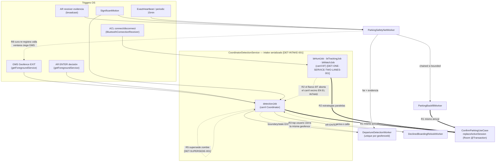

# 03 · Inventario de workers, servicios, receivers y entrypoints — y mapa de carreras

> **Origen:** Subagente C · refactor de solo-lectura · 2026-08-18.
> **Re-barrido contra master el 2026-09-16** [DOCS-03-WORKERS-ENTRYPOINTS-MUST-MATCH-MASTER-001]:
> `shared/src/androidMain/.../detection/**`, `.../bluetooth/**`, los ficheros que se llevaron piezas
> a `commonMain`, `app/src/main/AndroidManifest.xml` y `PaparcarApp`. Lo que no se pudo confirmar con
> código sigue marcado **NO VERIFICADO**; lo que se confirmó ese día lleva **✅ 16-09**.
>
> ⛔ **Aquí se cita FICHERO + SÍMBOLO, nunca `fichero:línea`.** El doc de agosto estaba lleno de
> `:485`, `:1165`, `:394` y para septiembre casi ninguno apuntaba a lo que decía: el mismo mes trajo
> `d7880ac7` (un solo servicio, dos carriles), la reorganización de paquetes de detección y el pivote
> de trayectos. Una línea caduca en el commit siguiente y **caduca en silencio**; un nombre de función
> se rompe con el rename, que es visible. El número de línea solo se admite cuando lo que importa es
> *"esto está dentro de un fichero de 2.700 líneas"*.

## 0 · Qué cambió desde el barrido de agosto (para quien venga del doc viejo)

| Antes (18-08) | Ahora (16-09) | Por qué |
|---|---|---|
| **2 servicios FGS** propios, 2 notificaciones (1001 / 1003) | **1** (`CoordinatorDetectionService`), notificación 1001 | `BluetoothDetectionService` BORRADO; el carril BT entra por el mismo intake en slots de job propios [DET-ONE-SERVICE-TWO-LANES-001] |
| 11 acciones del servicio, incluido `ACTION_BT_OVERRIDE` | **17 acciones**; el trío `BT_OVERRIDE`/`BT_TRIP_START`/`BT_TRIP_STOP` retirado por `ACTION_BT_CONNECTED`/`ACTION_BT_DISCONNECTED` | el arbitraje dejó de ser un intent propio: se resuelve DENTRO del intake |
| 11 workers | **15** en `detection/worker/` (12 de detección + 3 que solo viven ahí) | nacen `DeclinedBoardingRelookWorker`, `FuelPriceWatchWorker`, `MonthRecapWorker`, `DeleteVehicleRemoteWorker` |
| `DrivingRouteStoreImpl` (prefs, cap 500 pts) | `RoomDrivingRouteStore` en **commonMain**, Room, sin cap | [TRIP-A-LONG-DRIVE-KEEPS-ITS-ORIGIN-001] |
| `GeofenceEventBusImpl` (`Channel(UNLIMITED)`) | `SharedFlowGeofenceEventBus` en **commonMain** (`replay=0`, buffer 64) | un canal entrega a UN consumidor y bufferiza sin nadie: semántica equivocada para una superficie de observación [IOS-F0-04] |
| Cura de valla con `clearCureThrottle` | `FenceRegistrationLedger` (§A) + stamp `markFenceStatePoisoned` (§B) | [DET-FENCE-REREGISTER-BY-CAUSE-001]: la ausencia de una clave significaba tres cosas distintas |
| 3 llamadores de `ConfirmParkingUseCase` | **5** | ver §4.1 |

## 1 · Inventario de actores

### 1.1 Workers — `detection/worker/` (15 ficheros) ✅ 16-09

**De detección (12):**

| Clase | Qué lo dispara | Qué hace | Qué escribe | Con quién compite | ¿Idempotente? | Reintentos | Tags |
|---|---|---|---|---|---|---|---|
| `RegisterActivityTransitionsWorker` | Periódico **12 h** KEEP desde `PaparcarApp`, `MainActivity` (al conceder el permiso) y `BootCompletedReceiver` | Re-registra las transiciones AR en GMS | Registro AR (vía `ActivityRecognitionManagerImpl`) | Los otros call sites de `registerTransitions()` — mitigado por `RE_REGISTER_MIN_INTERVAL_MS` = 30 min | Sí (KEEP + `FLAG_UPDATE_CURRENT`) | ×3 | — |
| `ClearActiveParkingSessionWorker` | `WorkManagerParkingSyncScheduler.enqueueClearActiveParkingSession`, encadenado en `parking_chain_$sessionId` con APPEND_OR_REPLACE **detrás del save** (antes era unique propio sin orden y podía resucitar la sesión [PARK-RELEASE-THE-SCREEN-NEVER-SAW-001]) | Flip `isActive=false` en Firestore (update targeted) | Firestore `parkingHistory/{sessionId}` | `SaveNewParkingSessionWorker` (también apaga la previa) — update targeted, convergente | Sí | ×3, exp 30 s, red | [PIPE-002] |
| `UpdateParkingSessionAddressAndPlaceWorker` | `enqueueUpdateParkingSessionAddressAndPlace` → APPEND_OR_REPLACE a la misma cadena | Sube address+POI a Firestore | Firestore sesión | **Carrera documentada en el propio código**: puede correr antes de que el save haya creado el doc → NOT_FOUND; mitigada por el encadenado + retry | Sí | ×3, exp 30 s, red | [PIPE-002][BUG-WORKER-001] |
| `FirstParkNudgeWorker` | Periódico **24 h** KEEP vía `syncSchedule` desde `PaparcarApp` | Nudge "aparca una vez" si `EvaluateFirstParkNudgeUseCase` lo aprueba | `AppPreferences` + notificación | Nadie (autolimitado por el caso de uso) | Sí | success siempre | [DET-TOGGLE-002] |
| `DepartureDetectionWorker` | Unique `DepartureDetectionWorker_$geofenceId` (REPLACE) desde el servicio (EXIT boundary, EXIT stale, AR mid-trip) y desde el despacho del safety-net | Decide y procesa la SALIDA (veredicto en `RunDepartureCheckUseCase`); un EXIT juzgado falso llama a `markFenceStatePoisoned` | Vía use case: Room clearActive, spot publicado, geofence removida | `handleWatchdogDeparture` (tap del usuario) y el honest-close | Sí a nivel de encolado (unique+REPLACE); la resolución la protege el use case | `Result.retry()` solo en `ProcessFailedRetry`; inconclusos ×`MAX_INCONCLUSIVE_ATTEMPTS`=3, exp 15 s | [DET-SOLID-001][DET-RECONCILE-001] |
| `ReportSpotWorker` | `WorkManagerReportSpotScheduler` (unique `ReportSpotWorker_$spotId`, REPLACE) | Publica el spot liberado; descarta si expiró en cola (TTL anclado al RELEASE, política en `SpotTtlPolicy`) | Firestore `spots` | Nadie (payload autocontenido) | Sí | ×5, exp 30 s, red | [SPOT-OFFLINE-TTL-001] |
| `GeofenceJanitorWorker` | Periódico **12 h** KEEP + `enqueueOnce` REPLACE con `trigger`, que nombra al reloj que preguntó: `app-start`, `boot`, `app-update`, `post-sync`, `shared-car-push` (o `periodic`) | Restaura vallas de sesiones activas (pasando por `FenceRegistrationLedger.shouldRegister`); barrido reparador de `getActiveDuplicates()` | GMS geofences; `clearActiveById` sobre los duplicados stale (+`pendingSync`) | La cura del safety-net (misma valla — hoy ambos preguntan al MISMO ledger) | Sí (re-add idempotente) | ×3 | [GEOF-001][VEH-ACTIVE-FENCE-001][DET-FENCE-REREGISTER-BY-CAUSE-001] |
| `SaveNewParkingSessionWorker` | `enqueueSaveNewParkingSession` (cadena unique, REPLACE) desde `ConfirmParkingUseCase` | Sube la sesión nueva + apaga la previa; `NonCancellable` | Firestore sesión nueva + flag de la previa | El update encadenado detrás | Sí (set por id) | ×5, exp 30 s, red | [BUG-WORKER-002][DET-PIN-PROVENANCE-001] |
| `ParkingBackfillWorker` | **Encadenado DETRÁS** de `DepartureDetectionWorker` por el safety-net, solo si `preconfirmed && backfillBounded` | Reconstruye el pin de LLEGADA en el fix de despertar (reliability baja) vía `ConfirmParkingUseCase`; demota a ZONA si la precisión no sostiene un punto | Room+Firestore sesión nueva, notificación revertible | **El coordinator vivo** (mismo arrival) — guard `detectionRuntime.isRunning`; la resolución nudge-only — veredicto en `EvaluateBackfillDeferralUseCase` | Sí de facto (el confirm reemplaza la activa; se abstiene ante guard) | **Nunca reintenta** — todas las salidas son `Result.success()` | [DET-RECONCILE-001][DET-BACKFILL-TAINT-001][DET-BACKFILL-MUST-NOT-PIN-A-MOVING-CAR-001] |
| `ParkingSafetyNetWorker` | Periódico **15 min** KEEP + `enqueueCheckNow` (unique `_now`, REPLACE, `RUN_AS_NON_EXPEDITED_WORK_REQUEST`) desde **10 fuentes** (§1.6) | El cerebro del reconcile aparcado: cura la valla, re-sella ancla+pasos, despacha la salida, prompt "¿sigues aparcado?", reaper del FGS fantasma (`shouldReapGhostDetectionFgs`), detectores de kill, sync de sig-motion y de la alarma exacta | Prefs `parking_safety_net` (ancla, pasos, seal, stamps de poisoned/stale-exit, heartbeat), GMS geofence, encola `DepartureDetectionWorker`(+backfill), notificaciones, telemetría | El coordinator vivo (guard `isRunning`); el janitor (misma valla); las 10 fuentes colapsan en un unique-work REPLACE | Sí (evaluador puro + stamps a disco) | success siempre, **sin retry** | [DET-SAFETY-NET-001][ANCHOR-PERSIST-001][DET-RECONCILE-001][DET-CONJUNCTION-001][OEM-KILL-001][DET-FGS-REAPER-001] |
| `EnrichParkingSessionWorker` | `WorkManagerParkingEnrichmentScheduler` (unique por sessionId, REPLACE) tras el confirm | Geocoder + POI + snap del route a OSM una vez (`routeSnapped`); backfill pin-a-pin de los pins `safety_net_backfill` | Room sesión (address/place/route) → dispara el update de Firestore | La cadena de sync (indirecto) | Sí (flag `routeSnapped`) | ×3, exp 30 s; al agotar acepta la ruta cruda | [DET-ROUTE-SNAP-STORE-001][ROUTE-GAP-HONEST-001] |
| `DeclinedBoardingRelookWorker` **(nuevo)** | Unique por geofence (REPLACE) desde el servicio cuando la escalera AR responde `TickOnly` | Compra UN fix, una vez, tras `RELOOK_DELAY_SECONDS`=90; veredicto en `shouldArmAfterDeclinedBoarding` | Nada propio: arma el servicio o calla | Los watchers que quedaron atrás (todos responden `None` entre el radio de la valla y 300 m) | Sí (unique REPLACE: una ráfaga de ENTERs programa UNA mirada) | — | [DET-A-DECLINED-ARM-IS-NOT-SILENCE-001] |

**Viven en `detection/worker/` sin ser detección (3):** `FuelPriceWatchWorker` (periódico 24 h KEEP,
lo sincroniza `fuel/FuelWatchScheduler`), `MonthRecapWorker` (periódico 24 h KEEP desde
`PaparcarApp`), `DeleteVehicleRemoteWorker` (one-shot desde `WorkManagerParkingSyncScheduler`, ×3 exp
30 s con red). Se listan porque el conteo de la carpeta engaña al leer "11 workers de detección".

### 1.2 Receivers (7) ✅ 16-09

| Clase | Qué lo dispara | Qué hace | Qué escribe | Con quién compite | ¿Idempotente? | Tags |
|---|---|---|---|---|---|---|
| `ParkingConfirmationReceiver` | Botones de notificación | Reenvía al intake del servicio vía `startForegroundService`. Enruta **SEIS** acciones: CONFIRMED / DENIED / ACK / REVERT / DEPARTURE_CONFIRMED / **USER_STOP** (`ROUTABLE_ACTIONS`); las constantes son alias de las del servicio, que es la única fuente de verdad | Nada (forward puro) | Nada — serializa el intake | Sí | [BUG-SERVICE-107][DET-STOP-BUTTON-001] |
| `BootCompletedReceiver` | `BOOT_COMPLETED` (incl. el sintético de Android 15+ al salir de force-stop) y `MY_PACKAGE_REPLACED` | Re-registra AR + re-encola los periódicos (KEEP) + `GeofenceJanitorWorker.enqueueOnce` con trigger BOOT o APP_UPDATE | Registro AR; colas de WorkManager | `PaparcarApp.onCreate` (mismos enqueues) — KEEP lo hace inocuo | Sí | [GEOF-RESTORE-001] |
| `GeofenceEnterReceiver` | PendingIntent broadcast de la valla ENTER gemela | Solo encola `enqueueCheckNow(SOURCE_GEOFENCE_ENTER)` | Nada directo | — | Sí | [DET-RETURN-ANCHOR-001] |
| `GeofenceExitWitnessReceiver` | PendingIntent broadcast de la valla testigo | SOLO loguea (decision-free por contrato) | Solo log | — | Sí | [DET-EXIT-WITNESS-001] |
| `ExactHeartbeatReceiver` | Alarma exacta (`setExactAndAllowWhileIdle`, ~5 min aparcado) | Re-arma el tick siguiente + `enqueueCheckNow(SOURCE_EXACT_ALARM)` | Prefs `exact_heartbeat` | — | Sí | [DET-EXACT-HEARTBEAT-001] |
| `ActivityTransitionReceiver` | Carril AR de EVIDENCIA (IN_VEHICLE ENTER+EXIT, ON_BICYCLE) | Estampa `DepartureEventBus` con true-time; hints al coordinator; acelera el safety-net con `SOURCE_AR_ENTER` y `SOURCE_AR_EXIT` | `DepartureEventBus` (espejo en prefs) | El carril de DECISIÓN (`ACTION_AR_TRANSITION`) recibe el MISMO ENTER — ambos estampan el mismo true-time | Sí | [DET-G-01][DET-SOLID-001][DET-BIKE-NOT-A-CAR-001] |
| `BluetoothConnectionReceiver` | ACL_CONNECTED / ACL_DISCONNECTED (manifest, exported + permiso) | **Patrón de trabajo mínimo**: resuelve el vehículo por MAC, estampa lo que solo el broadcast atestigua (instante del connect + fix de origen, en un solo `edit`) y reenvía **UN intent por flanco** al intake. Ya no arbitra: el arbitraje, el grabador del viaje, la caza del disconnect y la vigilancia de salida se resuelven en el servicio | `BtConnectionStore` | **El coordinator en vivo** — el arbitraje lo aborta DENTRO del intake | Sí | [DET-ONE-SERVICE-TWO-LANES-001][DET-TIERS-001][DET-BT-RECEIVER-EXPORT-001] |

### 1.3 Servicios ✅ 16-09

| Clase | Qué lo dispara | Qué hace | Qué escribe | Con quién compite | Tags |
|---|---|---|---|---|---|
| `CoordinatorDetectionService` | **17 acciones**: START/STOP_TRACKING, USER_STOP, ARRIVAL_HANDOFF, BOARDED_AWAY, FOLLOW_DEPARTURE, SENTRY_WAKE, RESUME_SENTRY, GEOFENCE_EXIT (`getForegroundService` de GMS), AR_TRANSITION (decisión), CONFIRMED/DENIED/ACK/REVERT, DEPARTURE_CONFIRMED, **BT_CONNECTED/BT_DISCONNECTED**; intent null = sticky restart (stop sin promover) | Único dueño del arm/track de AMBOS carriles. **Intake `Channel(UNLIMITED)` de un solo consumidor** [DET-INTAKE-001]: cada intent se procesa a completitud y el teardown se decide una vez por comando (`stopSelfResult(startId)` veta stops stale). Arma con el gate `coordinatorMayArm` (`domain/detection/ParkingStrategyResolver.kt`); honest-close y arrival-resolution en `NonCancellable`; SENTRY residente. **2.728 líneas** — la clase gorda que queda por auditar de [DET-VERDICT-NOT-PREDICATE-001] | `DetectionRuntimeState`, `PendingDetectionStore`, `SentryResidenceStore`, `UserStopStore`, `DrivingRouteStore` (Room), stamps del safety-net; encola el worker de salida, el relook y los checks | Consigo mismo (jobs supersedidos), con el safety-net y su backfill, con el carril BT (mismo host), con el pin manual | [DET-INTAKE-001][DET-SUPERSEDE-001][DET-ENDED-VETO-RACE-001][DET-RESIDENT-FGS-001][DET-ONE-SERVICE-TWO-LANES-001] |
| `ForegroundServiceController` | Helper del servicio | `promote` (tipo `location` solo si el permiso está concedido, si no sin tipo) / `stopForegroundAndSelf(startId)` con veto de stops stale / `removeNotification` | — | — | [BUG-FGS-100][BUG-FGS-001a][DET-INTAKE-001] |

**Cinco slots de job, un solo host** (`@Volatile` en el servicio): `detectionJob` (Coordinator),
`btHuntJob` (caza del disconnect), `btTrackingJob` (grabador del viaje), `btWatchJob` (vigilancia de
salida tras un CONNECT), `sentryWatchJob`. Así se lee hoy la doctrina: *carriles separados = slots +
use cases separados, mismo host*; lo prohibido sigue intacto — **cero señales BT en el scoring**.

⛔ `BluetoothDetectionService` **no existe** desde `d7880ac7`. Si un doc, un test o un comentario lo
nombra como actor vivo, está caducado.

### 1.4 Entrypoints, schedulers y stores ✅ 16-09

| Clase | Rol | Estado que posee | Notas de concurrencia |
|---|---|---|---|
| `GeofenceManagerImpl` | Registra **3 vallas** por parking: EXIT (`getForegroundService` al servicio), ENTER gemela y testigo EXIT (broadcast). `NEVER_EXPIRE` y `NO_INITIAL_TRIGGER` **las tres** | Registro GMS + `FenceRegistrationLedger` | `removeGeofence` borra las tres por id y hace `forget` en el ledger; cada re-registro resetea el INSIDE/OUTSIDE de GMS (ventana ciega — la razón del ledger) |
| `FenceRegistrationLedger` **(nuevo)** | El único sitio donde un carril pregunta "¿hace falta registrar otra vez?" | En memoria **a propósito** | Un proceso nuevo no tiene registro y por tanto SIEMPRE registra: es justo el caso (force-stop, reboot, update) que no se puede saltar. Solo apunta registros con ÉXITO |
| `WorkManagerParkingSyncScheduler` | Encola save/clear/update, el borrado remoto de vehículo y el restore de vallas | — | `parking_chain_$sessionId` con REPLACE/APPEND_OR_REPLACE |
| `WorkManagerParkingEnrichmentScheduler` · `WorkManagerReportSpotScheduler` | Encolan enrich / report spot | — | Unique por sessionId / spotId, REPLACE |
| `ExactHeartbeatScheduler` | Alarma exacta one-shot ~5 min mientras aparcado; `sync()` en CADA tick del safety-net | Prefs `exact_heartbeat` | Un solo punto de armado/desarmado; auto-sana tras process kill |
| `SignificantMotionMonitor` | Sensor one-shot `TYPE_SIGNIFICANT_MOTION`; en SENTRY → `ACTION_SENTRY_WAKE` directo, si no → `enqueueCheckNow(SIG_MOTION)` | `armed` + cooldown en memoria | `@Synchronized`; `applyRearmCooldown` centraliza el anti-tormenta [DET-SENTRY-COOLDOWN-001] porque cuatro espejos llaman a `sync` y un cooldown que cualquiera pudiera esquivar no sería un cooldown |
| `PendingDetectionStore` | Registro durable de un arm vivo (armId, heartbeat, sawDriving) | Prefs `parking_safety_net` | Escribe el servicio, lee/limpia el safety-net (watchdog never-silent) |
| `SentryResidenceStore` | Stamp durable de residencia SENTRY | Mismo prefs | Escrito por `enterSentry`, limpiado en toda salida deliberada; leído por 2 detectores de kill |
| `UserStopStore` **(nuevo)** | Stamp durable "el usuario paró la detección en T" | Mismo prefs | Un solo slot: el periodo de silencio es propiedad de la última intención del usuario, no de una sesión. Lo limpia un arm MANUAL [DET-STOP-BUTTON-001] |
| `DepartureEventBusImpl` | Último AR ENTER (true-time), `@Volatile` + espejo en prefs | Prefs `departure_event_bus` | Estampado por AMBOS carriles AR (idempotente, mismo true-time) |
| `SharedFlowGeofenceEventBus` **(commonMain)** | Eventos de valla in-process | `MutableSharedFlow(replay=0, buffer 64)` | Difunde a todos los suscriptores y **descarta si no hay ninguno**; solo se emite el `Exited` de boundary |
| `TripTrailImpl` | Ring buffer a disco de fixes one-shot | Prefs `trip_trail`, `MAX_POINTS`=60, `MAX_AGE_MS`=12 h | `synchronized(lock)`; dedupe por timestamp |
| `RoomDrivingRouteStore` **(commonMain)** | Ruta conducida del viaje en curso | Room, una fila por fix admitido, **sin cap** | Append O(1); último punto cacheado en memoria e hidratado de la tabla, para que un proceso renacido siga decimando contra lo que persistió. La regla de admisión es pura y compartida (`DrivingRoute.admit`) |
| `DepartureWatchResumerImpl` | `ACTION_RESUME_SENTRY` desde momentos foreground | Cooldown en memoria (`AUTOMATIC_RETRY_COOLDOWN_MS`=60 s) | Una pregunta, un contestador [DET-WATCH-RESUME-RACE-001] |
| `ActivityRecognitionManagerImpl` | Registra AR en dos carriles (broadcast evidencia + `getForegroundService` decisión) | Throttle `RE_REGISTER_MIN_INTERVAL_MS`=30 min | Cada re-registro re-entrega la última transición stale a AMBOS carriles [DET-AR-FIRST-001b]. El ENTER de EVIDENCIA viaja en el request broadcast siempre-activo, no en el PendingIntent de arm |
| `ArrivalHandoffDetectionImpl` **(nuevo)** | Manda el handoff de llegada del safety-net por su PROPIA acción, no prestada la de "voy conduciendo" | — | FGS start desde un worker que ya es foreground; si la plataforma lo rechaza, se PREGUNTA [DET-HANDOFF-NOT-MANUAL-001] |
| `ManualParkingDetectionImpl` | `start()`=START_TRACKING (FGS) · `stop()`=STOP_TRACKING (cancela el auto-confirm tardío) · `stopByUser()`=USER_STOP (estampa el outcome y abre el silencio) · `answerPrompt()` = las mismas acciones que los botones | — | Los tres últimos con `startService` pelado: el servicio ya está en foreground corriendo la sesión en cuestión |
| `AndroidDetectionSideRecords` **(nuevo)** | Implementación Android de los contratos comunes de side-records | Mismo fichero, mismas claves y formatos | Envoltorio fino [IOS-F0-06]: el servicio y los workers mantienen su camino directo; re-cablearlos es del split del safety-net |
| `sensor/AndroidDetectionStepAnchors` + `AndroidStepCounterSource` / `AndroidStepDetectorSource` | Ancla de pasos y las dos fuentes de conteo | Escribe en el prefs `parking_safety_net` con los prefijos `ANCHOR_*` del worker | Tercer escritor del fichero compartido — ver §4.3 |
| `BluetoothParkingDetector` | Lógica del flanco DISCONNECT (stateless, cancelación cooperativa) | — | Confirma vía `ConfirmParkingUseCase` |
| `BluetoothDepartureDetector` **(nuevo)** | Gemelo de salida: el coche emparejado CONNECTÓ con una plaza aún retenida → vigila si de verdad se va | — | Stateless; el dueño del scope y del FGS es el `btWatchJob` del servicio. **No confirma, publica ni cierra nada**: solo aporta el testigo que al carril le faltaba [DET-A-BT-CONNECT-IS-A-DEPARTURE-001] |
| `AndroidBluetoothScanner` | Bonded devices + estado conectado (lee `BtConnectionStore`) | — | — |
| `BtConnectionStore` · `AndroidBtConnectStampReader` **(nuevo)** | Última conexión + set conectado-ahora por vehicleId · lectura del par (instante, fix) | Prefs `bt_identity` | El receiver escribe las dos claves en un solo `edit` porque **son un solo hecho**: un instante sin su lugar deja medir un viaje desde ninguna parte [DET-A-BT-CONNECT-KNOWS-WHERE-THE-CAR-IS-001] |

### 1.5 Manifest (`app/src/main/AndroidManifest.xml`) ✅ 16-09

- **Servicios (3 declarados, 1 propio)**: `CoordinatorDetectionService` (`foregroundServiceType="location"`,
  `exported="false"`); `androidx.work.impl.foreground.SystemForegroundService` con `tools:node="merge"`
  para darle el tipo `location` que su AAR no declara (su único cliente es el safety-net, que pide un
  fix GPS) [DET-SAFETY-NET-FGS-IS-TYPED-DATA-SYNC-001]; y `PaparcarMessagingService`
  (`exported="false"` **con** intent-filter `MESSAGING_EVENT`: solo la librería de Firebase, en este
  mismo proceso, despacha ese evento). Un comentario marca el sitio donde estuvo
  `BluetoothDetectionService`.
- **Receivers (8)**: los 7 de §1.2 más `widget.ParkedWidgetReceiver` (`APPWIDGET_UPDATE`,
  `exported="false"`), que no es de detección. `GeofenceEnterReceiver`,
  `GeofenceExitWitnessReceiver` y `ExactHeartbeatReceiver` van sin intent-filter (PendingIntent
  explícito). `BluetoothConnectionReceiver` es `exported="true"` + permiso `BLUETOOTH_CONNECT`:
  obligatorio, el stack BT no entrega a componentes no exportados [DET-BT-RECEIVER-EXPORT-001].
- ⚠️ **El intent-filter de `ParkingConfirmationReceiver` lista 4 acciones y el receiver enruta 6**
  (le faltan `DEPARTURE_CONFIRMED` y `USER_STOP`). **Resuelto el 16-09, ya no es un NO VERIFICADO:
  es inocuo.** Los seis `PendingIntent.getBroadcast` de `AppNotificationManagerImpl` hacen
  `setClass(context, ParkingConfirmationReceiver::class.java)`, así que son intents **explícitos** y
  el filter no participa en la entrega. Queda como ruido: el filter no describe lo que el receiver
  hace.
- **Permisos FGS: `FOREGROUND_SERVICE` y `FOREGROUND_SERVICE_LOCATION`, y solo esos dos.**
  `FOREGROUND_SERVICE_DATA_SYNC` salió del manifiesto en
  [DET-SAFETY-NET-FGS-IS-TYPED-DATA-SYNC-001] y desde AGP 9.4.0 tampoco aparece en el fusionado ni
  en el APK/AAB [FGS-DATA-SYNC-IS-NO-LONGER-INJECTED-001]. Además: `SCHEDULE_EXACT_ALARM`,
  `ACTIVITY_RECOGNITION`, `BLUETOOTH_CONNECT`, `RECEIVE_BOOT_COMPLETED`,
  `REQUEST_IGNORE_BATTERY_OPTIMIZATIONS`, las tres de ubicación, `POST_NOTIFICATIONS` e `INTERNET`;
  y `ACCESS_ADSERVICES_*`/`AD_ID` con `tools:node="remove"` (no mostramos anuncios).

### 1.6 Las 10 fuentes de `enqueueCheckNow` ✅ 16-09

Once constantes `SOURCE_*`, doce call sites, **diez fuentes distintas** aparte de `SOURCE_PERIODIC`:

| Fuente | Quién la manda |
|---|---|
| `sig-motion` (×2) | `SignificantMotionMonitor` |
| `app-start` | `PaparcarApp` |
| `detection-end` (×2) | `CoordinatorDetectionService` |
| `ar-enter` · `ar-exit` | `ActivityTransitionReceiver` |
| `geofence-enter` | `GeofenceEnterReceiver` |
| `exit-stale` | `CoordinatorDetectionService` |
| `bt-connect` · `bt-park` | `CoordinatorDetectionService` ⚠️ **ya no el receiver ni un servicio BT** |
| `exact-alarm` | `ExactHeartbeatReceiver` |

## 2 · ¿Pueden DOS actores armar, confirmar o cerrar una sesión A LA VEZ?

**SÍ — por diseño hay múltiples escritores.** La serialización es total DENTRO del
`CoordinatorDetectionService` (intake [DET-INTAKE-001]) y **desde `d7880ac7` eso cubre también el
carril BT**, que antes vivía en otro proceso lógico. Entre servicio, workers y dominio no hay lock
global: guards por par + la transacción Room como última línea.

1. **Dos confirmadores del mismo arrival** — el coordinator vivo y `ParkingBackfillWorker`. El guard
   es `detectionRuntime.isRunning` leído al entrar, y **no cubre** la ventana si el coordinator arma
   DESPUÉS de esa lectura y ANTES del confirm del worker. Sigue **NO VERIFICADO** que esa
   sub-ventana esté cerrada; la defensa real es `replaceActiveSession` (transaccional) + la carta
   revertible. (Field 2026-07-20: pin fantasma a 96 m.)
2. **Estrategias paralelas BT / Coordinator** — siguen siendo dos estrategias, ya **no dos
   servicios**: un solo FGS, una sola notificación (1001), y el arbitraje del flanco BT se resuelve
   dentro del intake, que procesa un comando a completitud. Lo que el intake no borra es que el
   `detectionJob` del Coordinator puede estar corriendo cuando entra el `BT_DISCONNECTED`: quien lo
   aborta es el handler, en orden, no una carrera entre procesos.
3. **Dos cerradores de la misma salida** — `DepartureDetectionWorker` (con reintentos) y
   `handleWatchdogDeparture` (tap del usuario). **Verificado el 16-09 y ya no es un NO VERIFICADO:**
   `ProcessConfirmedDepartureUseCase` arranca con `getActiveSessionByGeofence(geofenceId)` y TODO lo
   destructivo (publicar el spot, `clearActiveParkingSession`, `markProvisionalDeparture`,
   `retractParkingSession`) vive dentro de `if (session != null)`. El segundo cerrador encuentra
   `null`, no publica ni cierra nada y solo repite dos colas idempotentes
   (`departureEventBus.reset()` y `removeGeofence`). ⚠️ Eso hace benigno el **segundo pase**, no el
   solape: dos cerradores que LEEN antes de que cualquiera escriba siguen siendo check-then-act.
4. **El invariante final es la transacción Room**: `UserParkingDao.replaceActiveSession`
   (`@Transaction`, deactivate-then-insert) garantiza ≤1 activa por vehículo *por operación*; y aun
   así el janitor mantiene el barrido de `getActiveDuplicates()` "que no deberían existir" — el
   propio código admite que carreras legacy/sync los producen.
5. **El armado sí está serializado**: todo trigger entra por el intake y el arm cancela el job
   anterior; dos arms simultáneos del Coordinator son imposibles en un proceso. Lo que ocurre es
   Coordinator armado + carril BT vivo (punto 2), hoy en slots distintos del MISMO servicio.

## 3 · Mapa de carreras conocidas

| # | Carrera | Actores | Recurso en disputa | Guard actual ✅ 16-09 |
|---|---|---|---|---|
| R1 | **Doble colocador del arrival** (pin fantasma 2026-07-20) | Coordinator vivo vs `ParkingBackfillWorker` | La sesión activa del vehículo | Skip si `detectionRuntime.isRunning` + deferral a la resolución nudge-only (`EvaluateBackfillDeferralUseCase`, stamp escrito por el servicio en el abort) + backfill encadenado DETRÁS de la salida |
| R2 | **Estrategias paralelas BT/Coordinator** | Carril BT vs carril Coordinator, **mismo servicio** | La sesión del vehículo y el pin | `ParkingStrategyResolver` + gate `coordinatorMayArm` [DET-STRATEGY-GATE-001] + el arbitraje del flanco BT resuelto en el intake (un comando a completitud), ya no por un `ACTION_BT_OVERRIDE` asíncrono; la señal BT jamás entra al scoring |
| R3 | **Doble cerrador de la salida** | `DepartureDetectionWorker` (retries) vs tap `DEPARTURE_CONFIRMED` vs honest-close | La sesión activa por geofence/vehículo | Unique-work REPLACE por geofence entre workers; y el dominio: `ProcessConfirmedDepartureUseCase` cuelga todo lo destructivo de `getActiveSessionByGeofence != null` (§2.3) — **idempotente para el segundo pase**, no para el solape |
| R4 | **Job supersedido mata al sustituto** [DETECT-SERVICE-RACE-001] | Job de detección viejo vs nuevo | El FGS y `detectionRuntime` | Identidad `detectionJob === thisJob` en el finally + `setRunning(true)` síncrono pre-launch. El espejo BT [BT-BUG-101] ya no vive en otro servicio: son slots de job del mismo host |
| R5 | **Sesión zombie bloquea el siguiente park** [DET-SUPERSEDE-001] | Sesión corriendo (valla espuria) vs EXIT/AR nuevo | El slot único de detección | `shouldSupersedeRunningSession` por distancia (`domain/detection/sentry/`) + telemetría `SessionSuperseded`; misma zona → se suprime para no resetear el abort timer [DET-AR-REARM-001] |
| R6 | **Stop de un trigger decapita a otro** (EXIT real muerto 10 ms después de un TickOnly, 2026-07-11) | Comandos concurrentes del mismo servicio | La vida del servicio y el handling en vuelo | Intake de un solo consumidor [DET-INTAKE-001] + `stopSelfResult(startId)` en `ForegroundServiceController` + `DetectionEnded` desde `invokeOnCompletion`, nunca desde el finally [DET-ENDED-VETO-RACE-001] |
| R7 | **Entregas stale/re-entregadas** | GMS vs el estado real | Autoridad para liberar/armar | Split boundary-vs-stale (`EvaluateGeofenceExitUseCase`): el stale pierde autoridad instantánea pero SIEMPRE dispara el worker + `recordStaleExitDelivery` para la conjunción [DET-CONJUNCTION-001]; probe corto [DET-ZOMBIE-PROBE-001]; throttle AR de 30 min; TTL del `ReportSpotWorker` |
| R8 | **Zombies de geofence** (valla huérfana / estado GMS envenenado / ventana ciega) | GMS vs Room | Qué vallas existen y su estado INSIDE/OUTSIDE | Orphan-clean en el EXIT; `NEVER_EXPIRE` + borrado explícito de las 3 vallas; **y desde [DET-FENCE-REREGISTER-BY-CAUSE-001] ya no hay throttle de reloj**: §A `FenceRegistrationLedger` (en memoria, un proceso nuevo siempre registra, solo apunta éxitos) responde a los DOS carriles que re-registran —janitor y cura—, y §B `markFenceStatePoisoned` (stamp durable que escribe `DepartureDetectionWorker` al juzgar falso un EXIT y **consume** la cura) sustituye al `clearCureThrottle`, que expresaba una causa como la ausencia de un reloj |
| R9 | **Swap-race de vehículo activo** | Cambio de coche activo vs viaje en curso | A qué coche se atribuye el pin | El `nominatingVehicleId` de la valla que disparó gana al vehículo activo (`CoordinatorParkingDetector` [VEH-ACTIVE-FENCE-001]); `TripContext(session.vehicleId)` en cada arm |
| R10 | **Duplicados de sesión activa** | Confirms concurrentes / sync remoto | Invariante 1-activa-por-vehículo | `UserParkingDao.replaceActiveSession` `@Transaction` + barrido reparador del janitor sobre `getActiveDuplicates()`, que estampa `pendingSync` para propagar a Firestore |
| R11 | **Save vs Update en Firestore** (doc aún no creado) | `SaveNewParkingSessionWorker` vs `UpdateParkingSessionAddressAndPlaceWorker` | El doc de la sesión | Misma cadena unique `parking_chain_$sessionId` con APPEND_OR_REPLACE; la carrera residual está documentada como warning en el propio worker |
| R12 | **Pin manual vs auto-confirm tardío** | Usuario marca a mano vs coordinator en vuelo | El pin del vehículo | `ManualParkingDetectionImpl.stop()` → STOP_TRACKING cancela el job [DET-MANUAL-CANCEL-001]; la ventana entre el confirm del coordinator y el STOP sigue **NO VERIFICADA** |
| R13 | **Tormenta sig-motion wake-abort** (~18 s/ciclo, 2026-08-13) | SigMotion vs SENTRY re-arm | CPU/batería + FGS parpadeante | Streak + `applyRearmCooldown` centralizado en `SignificantMotionMonitor` [DET-SENTRY-COOLDOWN-001] |
| R14 | **Resume del watch vs stream sin entregar** | `DepartureWatchResumerImpl` vs Room flow frío | Reconstruir el SENTRY | Una pregunta un contestador [DET-WATCH-RESUME-RACE-001] + cooldown de 60 s |

## 4 · Observaciones de riesgo residual (para el refactor)

1. **`ConfirmParkingUseCase` tiene CINCO sitios de invocación**, no tres (✅ recontado 16-09):
   `DetectionEffectExecutor` (carril Coordinator), `BluetoothParkingDetector` (dos caminos del
   carril BT), `ParkingBackfillWorker`, `RunHonestCloseUseCase` y `SaveManualParkingUseCase`. Su
   serialización real sigue siendo solo la transacción Room, y el guard `isRunning` del backfill es
   check-then-act sin lock.
2. **El cierre de salida no tiene dueño único**: worker (con retries), tap del watchdog y
   honest-close pueden tocar la misma sesión. La benignidad ya no es una suposición (§2.3), pero
   tampoco es exclusión mutua: es que el segundo pase no encuentra sesión que cerrar.
3. **Estado compartido crítico en un solo fichero de prefs** (`parking_safety_net`): ancla, pasos,
   seal, stamps de poisoned y de stale-exit, heartbeat, pendings, residencia SENTRY, parada del
   usuario y arrival-resolution — con **tres familias de escritores** (el servicio, el worker y
   `sensor/AndroidDetectionStepAnchors`, que usa los prefijos `ANCHOR_*` del worker) más los
   envoltorios de `AndroidDetectionSideRecords`. SharedPreferences es atómico por editor pero no
   transaccional entre claves relacionadas, y el "prune before ANCHOR prefix" del worker es
   orden-sensible.
4. **`enqueueCheckNow` usa un ÚNICO unique-work `ParkingSafetyNetWorker_now` con REPLACE para las 10
   fuentes**: una fuente puede pisar el check aún no ejecutado de otra y perder su `source` (solo
   afecta a telemetría/`userPresent`, no al veredicto — el evaluador relee el mundo).
5. **`CoordinatorDetectionService` son 2.728 líneas y cinco slots de job.** Es lo que queda de
   [DET-VERDICT-NOT-PREDICATE-001]: `CoordinatorParkingDetector` bajó de 2.600 a **1.540** líneas
   (medidas el 16-09) moviendo predicados a `domain/detection/`, y el I/O del intake no ha hecho ese
   viaje todavía.
